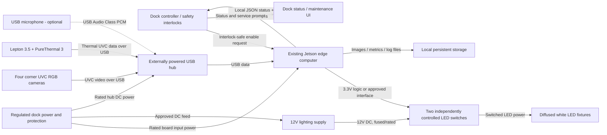
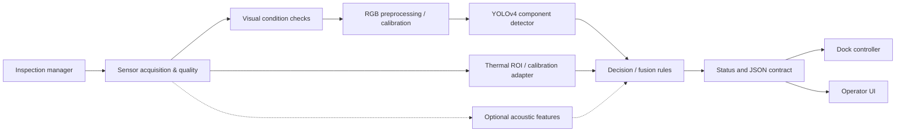
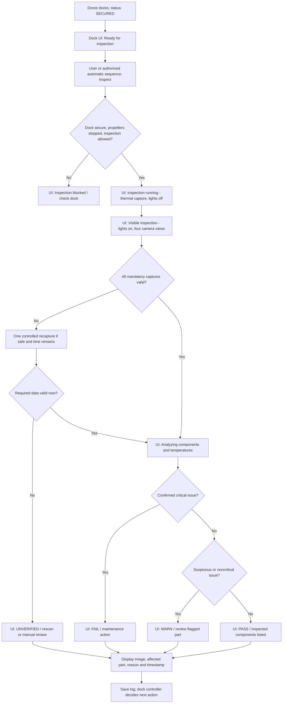
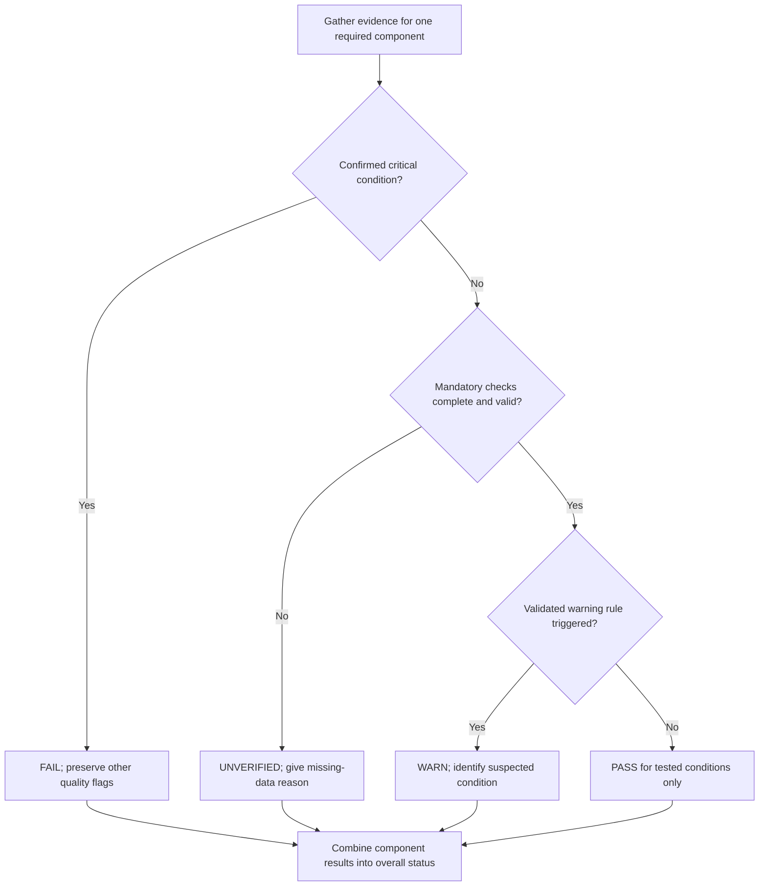

# Conceptual Design — Integrated In-Dock Drone Inspection System

**Valinor Dispatch: Multisensor, AI/ML-Assisted Drone Inspection**

**Team 06 | Consolidated conceptual design working draft | October 23, 2026**

**Document status:** Proposed engineering design for team and client review. Unless a requirement is identified as a supplied physical constraint or published device specification, numerical targets and design choices are preliminary and have **not** been verified by testing or approved by Valinor. This document combines the team's RGB camera, controlled lighting, thermal, acoustic, and ML research in the formatting style of the original ML conceptual design. [T1]–[T6]

## 1. Introduction and fully formulated problem

Valinor's Dispatch dock houses a drone between flights. A drone may return with a missing or damaged propeller, surface damage, loose or missing hardware, or an unusually warm component. A conventional camera cannot directly measure surface temperature, and a thermal camera cannot resolve all of the small visible features. The proposed project adds a coordinated inspection system inside the dock to gather visible and thermal measurements, evaluate the components that can actually be observed, and provide a documented maintenance-oriented result. An acoustic measurement path will be explored separately if a safe diagnostic procedure can be approved. [T1]–[T6]

The selected concept uses four corner-mounted USB Video Class (UVC) cameras, controllable white LED lighting, one FLIR Lepton 3.5 with a PureThermal 3 interface, and an existing NVIDIA Jetson computing platform, with a USB microphone as a conditional extension. The primary processing order is dock safety check → quality checks → component detection and measurements → thermal capture → controlled-light RGB capture → decision-level fusion → report and log. The dock controller, rather than the AI model, remains responsible for flight permission, charging controls, and safety interlocks. [T1]–[T6]

This is an inspection aid, not an aircraft airworthiness certification device. A component outside the cameras' field of view, an untested defect type, or unreliable sensor data must be reported as an inspection limitation; a model's confidence score does not prove that a drone is safe to fly. [T1][1]

### 1.1 Fully formulated problem and proposed system requirements

**Problem statement:** The team shall design, prototype, and evaluate an integrated dock inspection system that gathers repeatable sensor measurements while the drone is safely stationary, identifies selected visible components and possible abnormalities, and provides understandable, traceable results to the existing dock software without compromising normal dock operations.

| ID | System-level **shall** statement | Origin and status |
|---|---|---|
| <span style="white-space: nowrap;">SYS-01</span> | The system **shall** begin an inspection only after the dock controller confirms a secured, non-operating drone and an inspection-permitted state. | Safety/operational constraint; proposed, client confirmation needed [T1][T3] |
| SYS-02 | The system **shall** obtain RGB views of every designated inspectable exterior component using the installed camera arrangement and shall identify any required component that cannot be observed. | Camera and ML team concept; final coverage list TBD [T1][T5] |
| SYS-03 | The system **shall** acquire usable thermal measurements from designated visible surface regions before reporting their thermal status. | Thermal team concept; applicable regions depend on validated geometry [T3] |
| SYS-04 | The system **shall** coordinate lighting and capture so accepted RGB images are taken under a known lighting mode with stable exposure. | Lighting/camera repeatability [T2][T5] |
| SYS-05 | The system **shall** run the primary inspection without requiring continuous internet access. | Edge-processing design objective [T1][T6] |
| SYS-06 | The system **shall** provide per-component and overall `PASS`, `WARN`, `FAIL`, or `UNVERIFIED` results with machine-readable reason codes. | Proposed maintenance reporting convention [T1] |
| SYS-07 | The system **shall not** issue an overall `PASS` if any mandatory check is invalid, missing, or unverified. | Public safety and uncertainty handling [1][T1] |
| SYS-08 | The system **shall** return a timestamp, unique inspection identifier, component identifiers, data-quality flags, and software/configuration versions through a documented local interface. | Dock integration and traceability [T1][T6] |
| SYS-09 | The system **shall** preserve diagnostic evidence within an agreed retention and storage limit and shall handle storage or communication failures without silently reporting `PASS`. | Engineering accountability and system reliability [1][T1] |
| SYS-10 | The system **shall** keep model inference isolated from flight-control and safety-interlock authority. | Operational safety and secure-system design [T1][2] |
| SYS-11 | The prototype **shall** target a complete inspection result within 5 minutes of an accepted request; actual cycle time shall be measured with all chosen cameras and lighting phases. | Preliminary AI draft target, not proven feasible for full multi-camera cycle [T1] |
| SYS-12 | The detector **shall** target at least 90% recall for required visible component classes on held-out dock sessions, with class-specific results reported. | Preliminary ML design target, not achieved at time of writing [T1][T6] |
| SYS-13 | The software **shall** be able to complete a 60-minute continuous-operation test without an application crash or interference with dock control; sensor and storage faults shall be injected during testing. | Preliminary reliability target [T1] |
| SYS-14 | The camera/lighting design **shall** evaluate visibility of a 3-6 pixels/mm representative feature at critical component locations; the project **shall not** claim reliable 3-6 pixels/mm defect detection without measured results. | Camera and lighting research feasibility goal [T2][T5] |
| SYS-15 | A microphone-based motor diagnostic **shall** remain disabled until the client and team approve a safe test event, a motor/propeller interlock procedure, and repeatable test data. | Acoustic proposal versus dock safety constraint [T4][T1] |
| SYS-16 | The system **shall** maintain a stable reporting interface when sensors or compatible ML models are changed. | Modularity goal [T1][T6] |
| SYS-17 | The assembly **shall** fit within verified enclosure and drone clearances, avoid obstructing landing, doors, cooling, charging, and service access, and use correctly protected power rails. | Packaging/electrical safety constraints [T2]–[T5] |
| SYS-18 | The team **shall** document applicable component, firmware, library, dataset, and pretrained-weight licenses before transferring the prototype to the sponsor. | Professional and intellectual-property constraint [T1][T5][3] |

The requirements above define a proposed acceptance baseline. The client must still identify the exact airframe, mandatory component list, acceptable failure response, meaningful defect sizes, flight-authorization boundary, and any stricter cycle-time or accuracy requirements.

### 1.2 Known constraints, measurements, and unresolved source differences

| Subject | Team-provided information | Design interpretation and next action |
|---|---|---|
| Dock enclosure | Approx. **30in W × 40in L × 12-16in H** [T3][T4][T5] | The horizontal footprint is a working basis, not a measured installation drawing; usable internal height, doors, fixtures, and interference envelope must be measured. |
| Drone footprint | Approx. **20in × 20in**; height given as 6-8 inches in acoustic/camera draft [T4][T5] | Centered horizontal clearances would be 5 in across width and 10 inhes along length before fixtures; the camera draft reverses these labels in one equation, so a measured CAD layout must resolve the geometry. |
| Edge computer | ML material describes an original Jetson Nano 4 GB [T1][T6] | The physical board, carrier, installed JetPack, CUDA/TensorRT, power budget and free RAM must be identified before selecting a DeepStream version. |
| Camera candidate | Four UVC cameras, approx. 12.3 MP and a target of 6 pixels/mm at selected feature locations [T5] | The camera module, output interface, lens, pixel density and cost are **not yet selected/verified**. Sony IMX500 is a MIPI-output sensor but has USB UVC variants [4]. |
| Thermal candidate | One radiometric Lepton 3.5, 160 × 120 array, approx. 57° horizontal field; PureThermal 3 USB board [T3][5][6] | Temperature mode, raw-unit conversion, reference calibration and region coverage require bench verification. |
| Lighting | Two opposed **1m / 12V / 10W per m** strips, nominal 20W lighting load, independent switched channels [T2][7] | A proposed 12V, 3A regulated lighting supply provides 36W nameplate capacity; verify actual current and temperatures. |
| Acoustic | One central USB microphone; proposed 2–3s buffers and low-RPM spin test [T4] | Microphone can be prototyped with recorded/bench sounds; no autonomous in-dock motor spin is authorized by this document. |

**Computer compatibility decision gate:** NVIDIA documents the original Jetson Nano with DeepStream 6.0.1 / JetPack 4.6.1, while Jetson Orin Nano appears in later DeepStream/JetPack combinations, including DeepStream 7.1 / JetPack 6.1. These are platform-specific compatibility references, not interchangeable installation instructions. The team will pin a supported stack to the verified board and preserve dock functionality during any upgrade. [8][9][10]

## 2. Comparative analysis of possible solutions

Each comparison weighs inspection coverage, ease of integration, risk, development time, repeatability, and the team's limited semester resources. A selected concept is a starting point for testing, not proof that the performance requirement is met.

### 2.1 Visible-camera position and interface

| Option | Benefits | Limitations | Selection |
|---|---|---|---|
| **Four caddy-corner UVC cameras** | Multiple perspectives; shorter occluded regions; standard Linux V4L2/USB handling | Four mounts/cables, shared USB loading, cost, focus and overlap validation | **Selected prototype layout** [T5] |
| Two opposite wall cameras | Fewer sensors and simpler cabling | Greater hidden areas; short working distance can require wide-angle optics | Not selected for initial full component survey |
| One overhead camera | Minimal interface complexity | Propeller undersides, sidewalls, motor housings may be blocked | Not sufficient alone |
| CSI/MIPI camera set | Dedicated camera interface can reduce USB dependence | Connector/driver integration and wiring constraints | Retained as fallback if UVC testing fails |

The source camera layout uses an approximately 25 in corner-to-center distance and an estimated 59° field-of-view concept [T5]. Real usable field of view depends on tilt, lens distortion, focus, camera elevation, and the height of the propellers; it shall be checked with the real drone instead of accepted as a final optical calculation.

To evaluate the 0.5 mm feature goal, the camera team will measure pixel scale at several positions, not only at image center. The working calculation is:

\[
\text{required sampling} = \frac{3\ \text{pixels}}{0.5\ \text{mm}} = 6\ \text{pixels/mm}
\]

Three pixels across a feature is a sampling hypothesis, not sufficient evidence that an ML model can distinguish a crack from a scratch. Lens focus, motion, noise, lighting, defect contrast, and image downsampling must also be tested. A detector may locate a propeller from a resized frame while a separate full-resolution crop is needed to study tiny damage. [T2][T5][11]

**Camera selection note:** The Sony IMX500 is a research example of a 12.3 MP sensor, but its published output is MIPI D-PHY/SPI [4]; the team will obtain a specific vendor-certified UVC camera SKU, compatible lens and verified full-resolution still-image format before purchasing. An IMX500 camera shall not be budgeted as a plug-and-play USB module without a suitable USB interface.

### 2.2 Lighting configuration

| Option | Strength | Weakness | Selection |
|---|---|---|---|
| **Opposed diffused white LED strips** | Low cost, repositionable, reduces hard shadows in many orientations | Diffuser/strip width may leave glare or dark regions | **Baseline inspection mode** [T2] |
| Shallow-angle directional lighting | Can improve contrast around edges/chips/scratches | Additional switching and extra capture time; reflective surfaces behave differently | **Experimental second mode** |
| Ring/dome illumination | Potentially more even field | Additional space and hardware cost | Fallback if strips cannot meet uniformity requirements |
| Uncontrolled ambient illumination | No additional hardware | Exposure and defect contrast change with environment | Rejected |

The selected lighting is controlled through rated switching hardware. A Jetson logic output does not supply LED load current. The initial two-strip estimate is \(P = 2(10\,\mathrm{W}) = 20\,\mathrm{W}\) and \(I \approx 20/12 = 1.67\,\mathrm{A}\) total. With one independently switched 1 m strip per Adafruit 5648 driver, the estimated 0.83A/channel is below the board's 1.5 A continuous published rating; switching hardware still needs a thermal and connector-rating check. [T2][7][12]

### 2.3 Thermal sensing

| Option | Benefit | Drawback | Selection |
|---|---|---|---|
| **Lepton 3.5 + PureThermal 3 (USB)** | Radiometric-capable core; convenient USB integration; separate thermal pipeline | 160 × 120 pixels may not resolve small parts; surface readings need calibration | **Selected candidate** [T3][5][6] |
| Lepton + low-level breakout/SPI | Fewer interface components | Increased firmware and capture-integration work | Not selected for first prototype |
| Several thermal cameras | Better coverage of multiple components | Significantly higher cost and calibration burden | Consider only after single-camera coverage mapping |
| RGB-only temperature inference | Lower cost | RGB intensities do not provide actual component temperature | Rejected |

The Lepton's approximate view at a 12 in stand-off is only part of the drone, so only mapped, visible thermal regions may receive a thermal assessment. The initial target regions are motor housings, the external battery casing area, and exposed charging connections, if visible. Battery-case surface temperature is not equivalent to internal cell temperature. Reflections, emissivity, time since flight, and charging state constrain comparisons. [T3][5][13]

### 2.4 Acoustic measurement and safe actuation

| Option | Benefit | Drawback | Selection |
|---|---|---|---|
| **USB Audio Class microphone via ALSA** | Linux-native device endpoint and simple removable hardware | Acoustic signal can be weak or confounded in a dock | **Selected research interface**, conditional operation [T4] |
| I2S MEMS microphone | Avoids the USB hub | Device-tree/pinmux and physical wiring complexity | Not selected |
| No audio subsystem | No motor-actuation risk or added cost | May miss a fault detectable only during motion | **Safe baseline inspection** until testing is authorized |

The acoustic research proposes short, approximately 2–3s recordings during controlled low-RPM motor tests and feature extraction with Librosa/SciPy followed by a lightweight classifier [T4]. This differs from the ML draft's explicit decision to **exclude automatic motor spin** [T1]. The consolidated plan therefore treats audio as Phase B, not a normal inspection prerequisite. A separate, sponsor-approved safe procedure is required before any motor-related test; recorded or laboratory-generated clips can be used for initial software validation.

### 2.5 AI processing, component analysis, and sensor fusion

| Design choice | Advantages | Challenges | Decision |
|---|---|---|---|
| **DeepStream/GStreamer + YOLOv4 (Darknet) + TensorRT** | GPU inference, camera metadata, established model family; aligned to earlier ML decision | Need correct DeepStream/JetPack combination and tested YOLO parser | **Primary deployment candidate**, subject to board identification [T1][T6] |
| OpenCV-only pipeline | Quick camera and preprocessing prototype | More custom integration for multi-stage optimized inference | Development/testing support |
| YOLOv4-tiny | Lower compute and memory pressure | Potential loss of small-object recall | Fallback if full YOLOv4 misses timing/resource limits |
| Anomalib (PatchCore/PaDiM) on RGB crops | Can explore subtle deviation from healthy appearances | Dataset, deployment, and false alarm work; different runtime path | Stretch goal only [T5] |
| **Late (decision-level) RGB/thermal fusion** | No requirement for pixel-identical RGB and thermal tensors; testable reason codes | Requires calibrated region mapping and decision rules | **Selected** [T1][T6] |
| Early/feature-level RGB–thermal fusion | Potential richer learned correlations | Strict alignment/training demands and greater integration risk | Not selected initially |

YOLOv4 is first used to locate components and generate named regions of interest. Detecting a component is not equivalent to validating that it has no defect. Surface damage classification will be attempted only for defect categories supported by labeled test examples and measured performance. A rules-based decision layer combines visible and thermal observations without claiming that a detection confidence is a probability of safe flight. [T1][T6][3]

## 3. High-level solution

The inspection manager receives a request from the dock controller, verifies a safe state, and assigns a unique run ID. The thermal camera captures a frame before visible lighting is energized. The controller then enables the general LED mode and the system records one camera at a time, with the capture mode, stable-light confirmation, and timestamps attached to accepted frames. An optional directional-light pass adds frames only if trials show a measurable benefit. Quality checks reject blurred, clipped, stale, obstructed, or incorrectly exposed images. [T1]–[T5]

Next, the software undistorts and maps the valid RGB images, runs the component detector, and checks whether mandatory parts are actually observable. The thermal adapter returns valid surface measurements and region identifiers without requiring a full pixel-to-pixel overlay. A decision manager combines component evidence with configuration-controlled severity rules. The result and supporting evidence are saved locally, transmitted to the dock, and displayed using the dock's existing maintenance/status interface. A failure to observe a required area is `UNVERIFIED`, not a successful inspection. [T1][T3][T6]

### 3.1 Hardware block diagram

Each physical block below is a distinct hardware or dock subsystem. Solid arrows show required signals/power; the dashed microphone path is conditional.



**Block boundaries and wiring constraints:** The dock's existing controller has final authority over operational safety. The Jetson controls the lighting only through an approved driver and a controller-authorized inspection state; a safe de-energized state is required on crash, timeout, or aborted inspection. The hub's upstream connection, number of true root-bus controllers, and available bandwidth shall be measured; sequential acquisition reduces simultaneous traffic but does not guarantee zero USB contention. The thermal core/USB board may require an independent stabilized power path through the hub. Lighting power and Jetson GPIO shall never be directly tied at incompatible voltage levels. [T2][T4][T5][12]

### 3.2 Processing decomposition and subsystem data flow



An internal data record includes `inspection_id`, `capture_time_utc`, `sensor_id`, `lighting_mode`, image shape/units, `calibration_version`, `quality_state`, and the final component mapping. The thermal and visible pipelines may have different resolutions and capture times; their association is by **component ID and capture metadata**, not an assumed matching pixel grid.

### 3.3 Operational flowchart from the user's perspective



**User interface states:** `READY`, `BLOCKED`, `CAPTURING_THERMAL`, `CAPTURING_RGB`, `ANALYZING`, `PASS`, `WARN`, `FAIL`, and `UNVERIFIED`. The AI supplies a data contract; the team is not assuming that a separate touchscreen is purchased. The UI should identify which component was examined, which data were missing, and why review is requested.

### 3.4 External signal and protocol interface register

| Link (direction) | Physical / protocol type | Data sent and received | Design constraints / owner |
|---|---|---|---|
| Dock controller → Jetson | Existing dock-local IPC, exact transport **TBD** (Unix domain socket or authenticated localhost API proposed) | Request: `drone_id`, safe-docked flag/state, desired check set, request timestamp; response acknowledgment | Integration owner confirms existing controller, authorization, timeout and retry behavior. |
| Jetson → dock controller | Bidirectional local IPC response | `inspection_id`, overall and per-part status, `reason_codes`, quality flags, durations, evidence handles | One schema version, validation, idempotent request IDs; no autonomous flight clearance. |
| Four cameras → hub/Jetson | USB UVC, V4L2 `/dev/video*`; compressed MJPEG or uncompressed YUYV as module supports | RGB frames, device ID, dimensions, capture timestamp | Candidate actual SKU/lens and native still resolution **TBD**; sequential poll and verify stale buffers. [T5] |
| Thermal module → hub/Jetson | PureThermal 3 USB UVC; raw radiometric format after verification | Original 16-bit thermal samples if exposed, timestamp, format/scale, sensor state | Must confirm raw units, shutter/FFC effects and calibrated conversion before temperature thresholds. [T3][6] |
| Optional microphone → hub/Jetson | USB Audio Class, ALSA `/dev/snd/*` | PCM audio, sample rate, channels, event ID, timestamp | Default disabled for flight-ready in-dock operation; rate 16/44.1/48 kHz subject to device support. [T4] |
| Jetson → LED switches | Logic-level GPIO to electrically compatible driver, ideally gated by dock interlock | Channel enable/state; optional brightness duty cycle after compatibility tests | LEDs powered by separate 12V rail; independent fail-safe off; no direct load through GPIO. [T2][12] |
| Regulated supplies → peripherals | Protected DC power | Voltage/current at selected board, hub, switches and fixtures | Fuse, cable gauge, grounds, connectors and heat checked in final electrical design. |
| Jetson → storage | Filesystem + structured JSON/SQLite | Images/crops, summaries, configuration and model checksums, failures, timestamps | Permissions, remaining space, retention duration and write-error behavior **TBD**. |

### 3.5 Provisional result message

The following message shows the expected shape only. Values and results are fictitious and are **not measurements or established safety thresholds**.

```json
{
  "schema_version": "0.2-draft",
  "inspection_id": "inspection-00042",
  "drone_id": "aircraft-01",
  "timestamp_utc": "2026-10-23T20:00:00Z",
  "overall_status": "WARN",
  "components": [
    {
      "component_id": "front_left_propeller",
      "status": "PASS",
      "modalities_checked": ["rgb"],
      "reasons": [],
      "rgb_detection_confidence": 0.94
    },
    {
      "component_id": "rear_right_motor",
      "status": "WARN",
      "modalities_checked": ["rgb", "thermal"],
      "reasons": ["THERMAL_PEER_DIFFERENCE"],
      "thermal_peer_delta_c": 9.2
    }
  ],
  "quality": {"rgb": "VALID", "thermal": "VALID", "audio": "NOT_REQUIRED"},
  "performance": {"total_inspection_ms": 7800},
  "versions": {"detector": "yolov4-test", "calibration": "cal-01", "rules": "rules-01"},
  "evidence": ["inspection-00042/front_left_rgb.jpg"]
}
```

**Decision precedence:** A confirmed critical condition returns overall `FAIL` even if some other data are missing; the missing-data problem must remain visible in the report. Otherwise, a mandatory unverified check yields `UNVERIFIED`; validated suspicious conditions yield `WARN`; only fully completed required checks without flags yield `PASS`. `WARN` and `UNVERIFIED` **shall not** be interpreted as automatic clearance. Final severity mapping and any actual flight-block behavior require client sign-off.

## 4. Atomic subsystem specifications

This section decomposes the concept into implementable subsystems. Each subsection includes function, input/output boundaries, a proposed contract, shall statements, and a practical verification method. Values designated **TBD** must be fixed before detailed design is approved.

### 4.1 Dock safety, power and mechanical integration

**Function:** Safely host the inspection cycle inside the dock, provide the approved power/interface boundaries, and preserve normal docking and aircraft operations.

| Inputs | Outputs | Interfaces / protocols | Proposed checks |
|---|---|---|---|
| Dock-safe state, installed-board identity, power sources, enclosure dimensions, mounted sensor dimensions | Inspection enable, regulated and protected DC rails, sensor/lighting mounting positions, controller status | Dock IPC; DC power; mechanical brackets; approved logic-level interlock | Confirm 30 × 40 in planning footprint against physical dock; measure vertical clearance; inspect cable routing, fuse sizing, temperature and load behavior |

- **INT-01:** The integration subsystem **shall** expose a positive `safe_to_inspect` condition indicating the drone is secured and propellers are stopped before enabling capture.
- **INT-02:** The integration subsystem **shall** prevent active illumination and conditional test hardware from obstructing landing, door travel, ventilation, charging contacts, or service access.
- **INT-03:** The power design **shall** provide separately rated Jetson, hub, and 12V lighting supplies or suitably sized converters without applying 12V to 3.3V GPIO.
- **INT-04:** All switched LED outputs **shall** default to off if the inspection process crashes, stops receiving authorized commands, or loses the dock enable state.
- **INT-05:** The team **shall** record the installed Jetson board/carrier model and software image before selecting or modifying the inference runtime.
- **INT-06:** The team **shall** evaluate sensor power, hub power, cable routing, and processor temperatures with all baseline components installed.

**Verification:** Dimensioned photographs/CAD clearance review, power-on measurements, disconnect/fault tests, dock abort test, and unchanged baseline docking function.

### 4.2 RGB camera hardware and acquisition

**Function:** Provide four component views using fixed corner camera mounts and repeatable high-resolution still capture. [T5]

| Inputs | Outputs | Interfaces / protocols | Design values |
|---|---|---|---|
| Camera IDs, mode requests, LED-stable event, calibration configuration, USB power | Native RGB still frames, camera ID, original pixel dimensions, timestamps, quality metadata | UVC/V4L2 through powered USB hub to Jetson; RGB buffers to preprocessing | **Four** planned UVC cameras; approx. **12.3 MP** desired research class; 6 px/mm at critical ROIs is a study target, not certified performance |

- **RGB-01:** The system **shall** capture one camera at a time for the initial multi-camera pass and record the camera and lighting mode for each accepted image.
- **RGB-02:** The camera mounts **shall** provide unobstructed views of a client-approved component coverage map; invisible components **shall** be marked `NOT_VISIBLE` rather than inferred present.
- **RGB-03:** The acquisition software **shall** query and save the verified device resolution, pixel format and stable device identifier; it shall not assume `/dev/video0` always means the same camera.
- **RGB-04:** The acquisition software **shall** reject stale buffered frames after mode or exposure changes and shall mark unplugged cameras and incomplete transfers invalid.
- **RGB-05:** The camera hardware **shall** maintain repeatable focus and stable mounting during repeated simulated docking cycles.
- **RGB-06:** Each chosen camera/lens **shall** undergo field-of-view, geometric calibration and known-feature image tests at representative center, corner, and edge locations.
- **RGB-07:** The team **shall** measure any effect of USB hub sharing and sequential capture on total cycle time and report the observed maximum, rather than assume bandwidth is never limiting.

**Functional sequence:** `Select stable device → set mode/exposure → request frame → flush stale buffer → capture → timestamp and label → quality gate → release endpoint → next camera.`

**Verification:** Annotated coverage map, image-quality target captures under each light mode, cable-removal test, repeated mounting measurements, end-to-end capture timing and a full-resolution pixel-density study.

### 4.3 Controlled illumination

**Function:** Supply repeatable visible illumination without powering LEDs through the Jetson's GPIO. Diffused white light is the baseline; a shallow-angle mode is retained only after evidence shows better defect contrast. [T2]

| Inputs | Outputs | Interfaces / protocols | Preliminary electrical specification |
|---|---|---|---|
| Authorized capture phase, GPIO-compatible switch commands, 12V supply | Light mode `OFF`, `GENERAL`, optionally `DIRECTIONAL`; ready/stabilized indication | 3.3V control signal through compatible MOSFET drivers; separate switched 12V load | Two 1m cool-white strips, 10W each; 20W total, 1.67A total; 12V 3A proposed supply [7][12] |

- **LGT-01:** The illumination subsystem **shall** maintain lights off during baseline thermal-first capture and between inspections.
- **LGT-02:** Each 1 m strip **shall** use a switching channel whose continuous current rating exceeds the measured channel load under operating temperature.
- **LGT-03:** The lights **shall** enter the specified capture mode and stabilize before a frame is accepted; frames from prior modes **shall** be rejected.
- **LGT-04:** The mounts **shall** allow diffusion/angle adjustments without covering cameras, charging hardware, or the drone's motion envelope.
- **LGT-05:** The team **shall** measure coverage, reference-area brightness variability, glare, surface contrast, flicker/banding, current and fixture heating across repeated cycles.
- **LGT-06:** Directional lighting **shall** only be added to normal inspection if testing shows a measurable benefit that justifies its time and thermal effects.
- **LGT-07:** The control circuit **shall** turn off the lighting when power, software, or dock inspection authorization fails.

**Functional sequence:** `Read permitted inspection state → select thermal OFF mode → request GENERAL → wait for stable capture condition → acquire RGB frames → optionally set DIRECTIONAL and repeat selected views → switch OFF.`

**Verification:** Lux/relative-intensity map or fixed-exposure reference images, known-defect contrast experiment, camera banding check, supply-current and driver-temperature measurements, lights-fail-off test.

### 4.4 Thermal imaging and surface-temperature adapter

**Function:** Produce time-stamped thermal measurements from visible and calibrated target regions such as motor housings, exposed battery casing and charging hardware. [T3]

| Inputs | Outputs | Interfaces / protocols | Working parameters |
|---|---|---|---|
| Lepton 3.5 radiometric stream, calibration data, component ROI map, capture command, flight/charge state if available | Temperature summary per mapped component, capture time, validity/reason codes, optional review colormap | Lepton core → PureThermal 3 → USB UVC → Jetson/OpenCV/NumPy; numeric data to fusion | **160 × 120**, approx. **57°** horizontal FOV, approx. **8.6 Hz** nominal [T3][5][6] |

- **THM-01:** The adapter **shall** preserve raw thermal measurement units and metadata separately from any false-color visualization.
- **THM-02:** The adapter **shall not** report physical temperatures until the USB stream encoding, radiometric mode, scale and offset have been established and checked against a reference.
- **THM-03:** The thermal mount **shall** provide a documented component coverage map and identify excluded regions where a surface is hidden or insufficiently resolved.
- **THM-04:** Each result **shall** include ROI ID, sample count, capture timestamp and a validity flag; disconnected, stale, saturated, or uncalibrated data **shall** be `UNVERIFIED` for required checks.
- **THM-05:** Temperature comparisons **shall** distinguish post-flight, charging and ambient reference conditions; thresholds **shall** be derived from measured healthy ranges and controlled targets, not invented from example values.
- **THM-06:** The team **shall** test reflected heat and residual light-fixture heating; the lights-off-first sequence **shall** be revised if those tests indicate interference.
- **THM-07:** The adapter **shall** provide per-ROI median/maximum temperature or peer-difference measurements only when sampling and calibration quality permit meaningful values.

**Functional sequence:** `Verify USB device and temperature mode → confirm lights OFF → capture thermal frame → detect invalid/stale data → apply unit conversion and calibration → map named ROIs → return measurements/quality to decision layer.`

**Verification:** Controlled known-temperature target, repeated readings, blocked-lens test, unplugged camera test, ROI footprint demonstration and matched light-on/off trials. Surface temperature must not be described as a direct internal cell or bearing temperature.

### 4.5 Acoustic capture and research classifier (conditional)

**Function:** Capture an identified sound event for possible later mechanical-condition analysis. This subsystem is **not a required pass criterion** for the baseline dock inspection. [T4][T1]

| Inputs | Outputs | Interfaces / protocols | Working parameters |
|---|---|---|---|
| Approved test-event ID, USB microphone input, timestamp, reference audio | PCM buffer, MFCC/Mel-spectrogram features, optional experimental anomaly score, quality state | USB Audio Class → ALSA → Python audio capture → Librosa/SciPy → optional small classifier | One central microphone proposed; approx. 2–3 s clip and device-supported 16/44.1/48 kHz sampling to be tested |

- **AUD-01:** The baseline system **shall** function and complete required checks with the acoustic stage disabled.
- **AUD-02:** The microphone interface **shall** enumerate through ALSA and shall log its physical device identity, format, buffer length and sample rate.
- **AUD-03:** The subsystem **shall** reject clipped, missing, or event-unmatched recordings as invalid rather than claim a diagnostic condition.
- **AUD-04:** The software **shall not** energize or command the drone motors. Any low-RPM diagnostic needs a separate approved controller procedure and safety analysis before it can become a production step.
- **AUD-05:** Experimental features/classifications **shall** be developed first using controlled recorded/bench events and separately held-out test sessions.
- **AUD-06:** Any eventual acoustic warning **shall** include the test event and its limitations and **shall not** override confirmed RGB/thermal failure evidence.

**Verification:** USB microphone capture demonstration, noise/clipping assessment, controlled audio dataset and format test; optional motor-excitation phase awaits sponsor safety approval.

### 4.6 RGB calibration, component detection and condition checks

**Function:** Convert acquired camera views to consistent coordinates; detect known drone components; distinguish missing/occluded parts from visually abnormal parts. [T1][T5][T6]

| Inputs | Outputs | Interfaces / protocols | Proposed implementation |
|---|---|---|---|
| Valid RGB frames, intrinsic/extrinsic calibration, lighting metadata, YOLO weights, component list | Corrected images, mapped bounding boxes, class/confidence, part ID, `visible` flag, visual rule flags | OpenCV transforms and image-quality tests; YOLOv4/Darknet deployed via compatible DeepStream/TensorRT; ROI data to fusion | Classes proposed: propeller, motor, arm, body, battery area, landing gear; fasteners conditional on visibility |

- **VIS-01:** The preprocessing module **shall** apply documented calibration and quality gates consistently during training evaluation and deployment.
- **VIS-02:** Bounding boxes **shall** map back to original-frame pixels and retain camera ID and calibration version.
- **VIS-03:** YOLOv4 **shall** be the baseline component locator, with YOLOv4-tiny considered only after a recorded benchmark motivates the change.
- **VIS-04:** Component names such as `front_left_propeller` **shall** be defined separately from general class names such as `propeller` so identical parts can be evaluated individually.
- **VIS-05:** A component that was not observed due to occlusion/blur/out-of-frame geometry **shall** be reported `NOT_INSPECTED`; a visible expected location with no detected component may be flagged `MISSING_SUSPECTED` only under validated rules.
- **VIS-06:** The visual checker **shall not** declare crack, chipped blade, delamination or loose-fastener detection until appropriate examples, labeling criteria and held-out results demonstrate the capability.
- **VIS-07:** The validation report **shall** include precision, recall, mAP, false negatives by component, defect false-PASS cases and runtime under actual dock capture conditions.

**Functional sequence:** `Verify frame → check exposure/blur → undistort → select ROI → run detector → map coordinates → compare required component locations → optional supported defect analysis → per-part evidence and quality.`

**Verification:** Calibrated target, labeled ground-truth dock sessions, intentionally missing mock components where safe, known harmless defect samples, and repeatable inference benchmarking.

### 4.7 Multimodal fusion and diagnostic decision manager

**Function:** Map RGB and thermal information to the same named component and combine validated findings into a conservative, explainable inspection result.

| Inputs | Outputs | Interfaces / protocols | Main rule hierarchy |
|---|---|---|---|
| Visual component statuses, thermal ROI values/quality, optional approved audio flags, mandatory-check list, thresholds/config versions | Per-component and overall status, reasons, sensor coverage, supporting evidence references | Typed internal records → JSON report builder | Critical confirmed `FAIL` → `FAIL`; otherwise missing mandatory → `UNVERIFIED`; otherwise suspicious → `WARN`; else `PASS` |

- **FUS-01:** The fusion layer **shall** associate sensor results using a named component ID and documented geometric mapping; it shall not assume RGB and thermal pixels correspond one-to-one.
- **FUS-02:** Each mandatory component **shall** have a documented applicable-modality checklist; an inapplicable modality must not be treated as missing mandatory evidence.
- **FUS-03:** An unavailable required modality **shall** prevent a PASS for the affected component even when another modality reports normal data.
- **FUS-04:** A confirmed critical defect **shall** retain its FAIL status even if another sensor reports normal readings or becomes unavailable.
- **FUS-05:** Thermal alert limits, ML score cutoffs, and critical-component definitions **shall** be versioned and based on approved test evidence before operational use.
- **FUS-06:** Every non-PASS state **shall** include a reason, affected component, sensor quality and an action label suitable for maintenance review.

**Decision flowchart:**



**Verification:** Synthetic test matrices covering all PASS/WARN/FAIL/UNVERIFIED combinations, sensor faults, missing parts, contradictory signals and configuration-version changes.

### 4.8 Data records, model management, and dock interface

**Function:** Make the inspection result traceable, reviewable and compatible with current dock software. [T1][T6]

| Inputs | Outputs | Interfaces / protocols | Storage / UI behavior |
|---|---|---|---|
| Per-component findings, selected images, calibration and model versions, timestamps, performance measurements | JSON result, dock UI status and review prompts, local evidence and run log | Versioned local JSON over agreed dock IPC; local filesystem with SQLite/JSONL manifest | Retention/space budget and exact IPC method **TBD**; only necessary images are retained |

- **DAT-01:** The report **shall** include `schema_version`, `inspection_id`, `drone_id`, overall/per-component status, reasons, quality summary, and run timestamp.
- **DAT-02:** The report **shall** include detector and calibration versions and a way to identify the associated rules/threshold configuration.
- **DAT-03:** The dock interface **shall** validate malformed requests and support bounded timeout/error responses.
- **DAT-04:** The storage module **shall** record failed inspections and representative evidence while applying a documented capacity limit and deletion/retention procedure.
- **DAT-05:** The system **shall** mark failed storage writes and lost dock acknowledgments explicitly; it shall not treat a successful model inference as a successfully communicated inspection.
- **DAT-06:** Model replacement and calibration updates **shall** preserve the external message schema unless a versioned change is reviewed by integration owners.
- **DAT-07:** The user-visible status **shall** show a component name, inspection time, issue reason and an appropriate rescan/maintenance-review prompt for non-PASS outcomes.

**Verification:** Schema test against representative messages, malformed/duplicate-request tests, full-disk test, report review with dock stakeholder and model-version rollback demonstration.

### 4.9 Dataset, calibration, and verification infrastructure

**Function:** Provide controlled evidence that the chosen design works on the team's actual dock and drone rather than relying on benchmark claims from unrelated data.

| Inputs | Outputs | Interfaces / protocols | Proposed tools |
|---|---|---|---|
| Real dock images, safe simulated defects, calibration targets, measured temperature references, software builds | Annotated session dataset, calibration maps, test metrics, regression cases, release manifest | CVAT bounding-box export, OpenCV calibration, local training/deployment machine, test scripts | YOLO-compatible labels; held-out **capture sessions**, not near-duplicate video frames |

- **TST-01:** Training, validation and final test data **shall** be split by recording session or other meaningful condition so nearly identical adjacent frames do not leak into separate sets.
- **TST-02:** Each labeled required component **shall** have an unambiguous class, named position and annotation policy.
- **TST-03:** The tests **shall** include normal samples and safe, non-destructive simulated defects under varied camera angles, lighting, landing offsets and environmental conditions.
- **TST-04:** The test report **shall** separately report detection recall, visual-defect capability, thermal measurement repeatability, overall inspection time and the false-PASS rate on deliberately seeded faults.
- **TST-05:** Calibration and preprocessing parameters **shall** be versioned and retained with the associated evaluation result.
- **TST-06:** External datasets such as MVTec AD/LOCO AD **shall** be used only after checking their allowed use; they **shall not** replace dock-specific performance evaluation. [T1][T6]

**Verification:** Review dataset manifests, re-run the same evaluation on a held-out capture day, and reproduce the software/image-calibration environment from saved versions.


## 5. Ethical, professional, and standards considerations

### 5.1 Public safety, false negatives, and accountability

The inspection system may influence a maintenance decision, so the most serious project-specific risk is a false `PASS` on a damaged drone. The system therefore distinguishes *healthy according to tested checks* from *not inspected*, keeps missing inputs visible, rejects unsafe start conditions, and avoids direct authority over launch decisions. The team shall log reproducible evidence and report false-negative cases rather than stating that the model detects all cracks or damage. The NIST AI Risk Management Framework and IEEE 7000-2021 provide processes for considering safety, uncertainty and ethical risks while developing AI-assisted systems. [1][14]

### 5.2 Electrical, thermal, and physical safety

A metal enclosure containing USB-powered devices and 12V / 20W nominal lighting requires cable restraint, appropriate fusing, supply sizing, safe separation of loads from logic GPIO, ventilation and temperature checks. The lighting and optional audio equipment must remain outside the drone's landing envelope. Any motor-powered acoustic test raises an additional propeller-strike risk; this design disables it until a separate approved procedure exists. IEC 62368-1 is consulted as an electrical/equipment safety reference, not presented as a verified compliance claim. [T2][T4][T5][15]

### 5.3 Measurement quality and misleading results

For RGB inspection, ISO 12233:2024 informs camera resolution/spatial-frequency testing, while ISO 15739:2023 helps the team frame camera noise/dynamic-range evaluation. For thermal inspection, ISO 18434-1/-2 and ASTM E1933/E1934 inform thermal condition-monitoring practice, interpretation and surface-emissivity considerations. These references shape the requirement to calibrate, document test conditions, and retain uncertainty, rather than authorize a universal temperature alarm. [T3][T5][11][16][17]

### 5.4 Cybersecurity, privacy, licensing, and responsible development

The dock interface shall validate locally received messages, restrict unnecessary network exposure and handle stale or repeated requests. IEC 62443-4-1:2018 supplies useful secure-development concepts. Stored images might include surroundings beyond the aircraft; the capture framing and retention policy shall minimize unnecessary collection, and access shall be limited to the development and maintenance purpose. ISO/IEC/IEEE 29148:2018 and IEEE 1012-2024 are relevant guides for testable requirements and verification planning. [2][18][19]

The AlexeyAB/Darknet code license supports the team's interest in modifiable source code, but it does not confer a license over all model weights, external datasets, other libraries or redistribution terms. A dependency and dataset license register will be created before client handoff. [T1][T6][3]

### 5.5 Effects on the client, environment and cost

A modular, locally processed design avoids requiring continual cloud connectivity and can reduce routine manual screening time, but it adds electronics, energy demand, replaceable camera hardware and maintenance work. Reusing the dock's actual Jetson prevents an unnecessary second compute purchase, provided performance measurements confirm capacity. False alarms could increase maintenance effort, while false negatives could create much more severe safety implications; evaluation must report both. The lighting is on only during image acquisition to reduce wasted energy and unwanted heat. [T1]–[T6]

## 6. Resources

### 6.1 Budget proposal and subsystem justification

The budget below combines the team's **published quoted prices** for the thermal core, USB board and LED components with **clearly marked planning allowances** for items that were not quoted in the uploaded research. All values are in **USD**, before tax/shipping. Existing dock equipment is treated as sunk cost, not a new purchase. Camera part numbers, microphone selection and stock must be finalized before ordering. [T2][T3][T5][5]–[7][12]

| Subsystem / item | Qty | Unit cost or allowance | Proposed total | Basis and purpose |
|---|---:|---:|---:|---|
| RGB: high-resolution UVC cameras, exact SKU TBD | 4 | $165 | **$660** | Planning allowance, not a vendor quote; four exterior views |
| RGB: camera brackets/adjustable mounts | 4 sets | $10–$20 | **$40–$80** | Allowance for corner alignment and retention |
| Thermal: FLIR Lepton 3.5 | 1 | $164 | **$164** | GroupGets/FLIR listed candidate price [5] |
| Thermal: PureThermal 3 board | 1 | $119.99 ≈ $120 | **$120** | GroupGets listed candidate [6] |
| Lighting: Adafruit 4612 white strip, 1 m | 2 | $11.95 | **$23.90** | Two opposed diffused sources [7] |
| Lighting: Adafruit 5648 switch board | 2 | $3.95 | **$7.90** | Independent LED switching [12] |
| Lighting: regulated 12V / 3A supply | 1 | $25–$45 | **$25–$45** | protects required 20 W load |
| Lighting: diffusers and optical hardware | 1 set | $25–$50 | **$25–$50** | Allowance for glare/contrast trials |
| Integration: externally powered USB hub | 1 | $50–$80 | **$50–$80** | shared with RGB, thermal and audio |
| Integration: USB leads, wiring and protection | 1 lot | $30–$60 | **$30–$60** | power and data connections |
| Lighting: adjustable fixture brackets | 1 lot | $30–$60 | **$30–$60** | opposed positions/angles |
| Jetson and dock controller | 1 | $175-$250 incremental | **$175-$250** | Confirm installed board and resource availability |
| **Mandatory prototype subtotal** | | | **$1,350.80–$1,600.80** | Excludes optional modules and existing hardware |
| Optional acoustic: USB microphone | 1 | $20–$70 | **+$20–$70** | sponsor approval for active diagnostic TBD |
| Optional evidence storage / backup | 1 | $25–$60 | **+$25–$60** | only if existing storage is insufficient |
| **Subtotal including both optional allowances** | | | **$$1,395.80–$1,730.80** | No double count of the common USB hub |
| OpenCV, GStreamer, compatible DeepStream, Darknet, CVAT, Python tooling | — | $0 planned software purchase | **$0** | Validate download, dependency and usage licenses |

**Planning reserve:** A 15% allowance on the mandatory subtotal is*$119.37–$193.62, giving a mandatory planning request of about $915–$1,485 excluding shipping and tax. With *both* optional items included before the same 15% reserve, the total becomes approximately $967–$1,634. These are range estimates, not committed purchasing totals.

**Cost reduction order:** Use existing development computers, borrow test targets/calibration gear, prototype lighting fixtures before buying additional sources, and retain a single thermal camera unless actual coverage tests justify another. A second lighting mode, a second thermal view, or replacement edge compute are **not in the mandatory budget**.

### 6.2 Division of labor and skills-to-subsystem allocation

The supplied research demonstrates that the team has developed work in RGB/optics and UVC, lighting/electrical design, thermal measurement, acoustic/USB audio, and ML/Jetson deployment. These documents demonstrate research ownership but do not establish that each proposed owner has already completed hardware, calibration or software integration skills tests. Responsibility assignments below are proposed roles, pending confirmation of team membership and the sponsor's expectations. Only the name in the original ML draft is preserved; names of other researchers have not been invented. [T1]–[T6]

| Subsystem or deliverable | Proposed lead / assignment | Skills needed and early gap check | Main responsibility |
|---|---|---|---|
| ML component detector, datasets, runtime, fusion | ML draft contributor; confirm final team assignment - **Lucas Taylor**| Python/C++, OpenCV, DeepStream/TensorRT, metrics; verify actual board stack | Deploy/benchmark detector, define JSON interface and evaluation plan |
| Four-camera optics, mounts and USB acquisition | RGB camera research contributor — **Aaron Thongmanivong** | Lens/FOV math, UVC/V4L2, calibration, mechanical mounting | Select verified UVC SKU; coverage and spatial-resolution test |
| LED layout and supply/switching | Controlled lighting research contributor — **Samuel Oke** | 12V sizing, MOSFET drivers, optical test rig, safe wiring | Build repeatable light fixture, current and contrast trials |
| Lepton/PureThermal calibration and ROIs | Thermal research contributor — **Michael Lamberth** | Radiometry, USB imaging, emissivity/temperature validation | Thermal capture, reference verification, component mapping |
| Acoustic proof of concept | Acoustic research contributor — **Aaron Thongmanivong** | ALSA, DSP, recording, safe test planning | Microphone capture and dataset; do not request in-dock motor actuation |
| Dock electrical/mechanical integration | Dock integration coordinator **Benjamin Heimermann** | Jetson board inventory, hub power, CAD, interlocks | Check enclosure and supplies, coordinate cables and dock status interface |
| System verification, Gantt and report review | **Whole team** | Test matrices, traceability, budgeting, Git collaboration | Collect evidence, verify cross-subsystem acceptance and own review signoffs |

**Team allocation rule:** Each subsystem lead is responsible for its own detailed-design schematic/code, interfaces, test evidence and section in the final report. System-level testing and integration are shared; the test coordinator checks completeness but does not certify another member's individual contribution. 

### 6.3 Timeline and revised Gantt chart

The schedule below is a proposed Fall 2026 detailed-design work plan beginning after this October 23 draft. It does not assert a client-approved milestone date. The highest-risk unknowns—the actual Jetson board/software, four-camera view geometry, Lepton radiometric mode, and safe docking interface—are tested first because they constrain all dependent work. Prototype parts may be assessed on a bench before mounting them into the dock.

<p align="center">
  
</p>


<p align="center">
  <em>Project development timeline and Gantt chart.</em>
</p>


### 6.4 Risk register and remaining client decisions

| Risk / unanswered question | Impact | Early mitigation / decision owner |
|---|---|---|
| Unknown existing board: Original Nano vs Orin Nano Super | Wrong software stack or inaccurate compute budget | Photograph/inventory actual board and OS in first week; integration + ML owners |
| Actual camera SKU and 0.5 mm detectability unknown | Missing required defect visibility | Mount/test one candidate at proposed positions with physical targets; RGB owner |
| Single thermal camera sees only selected areas | Incomplete heat inspection | Annotate real visible ROIs, quantify coverage, revise mandatory thermal list; thermal/client |
| Thermal raw units/emissivity/charging condition unknown | False alarms or incorrect interpretation | Reference test and condition-specific baseline; thermal owner |
| USB hub bus/power limitations | Dropouts or false missing-frame results | Test powered hub and bus topology under realistic loads; RGB/integration |
| Motor-based acoustic test not authorized | Safety and schedule risk | Default audio disabled; develop off-dock recorded/bench proof; acoustic/client |
| Component list and flight consequences undefined | Cannot finalize required checks/status severity | Client confirms mandatory parts, manual-review rule and dock response; whole team |
| Image data and pretrained weight licenses | Handoff/use restrictions | Maintain dependency/data register and review licenses; ML/integration |

## 7. Open Questions for Valinor

The following questions will be discussed with Valinor to clarify the existing docking system, identify integration constraints, and establish requirements for the AI/ML inspection subsystem.

1. What specific NVIDIA Jetson board is currently integrated into the dock, where is it located, and what functions does it perform?
2. Would Valinor be willing to provide access to the existing docking software, source code, and information about the board's current resource utilization?
3. Does Valinor have design files, schematics, CAD models, or other documentation for the docking system?
4. What restrictions or constraints exist regarding modifications to the dock's hardware, software, and internal components?
5. Would the team be able to inspect the physical dock soon to better understand its layout, components, and available connections?
6. How are the dock and Jetson powered, what are the available power limits, and how can additional sensors and devices be powered?
7. What privacy, confidentiality, and licensing requirements apply to Valinor's source code, project data, and the use of open-source software in a commercial product?
8. Does Valinor have existing drone images, thermal measurements, or datasets containing examples of PASS, WARN, and FAIL conditions for training and testing?
9. What are Valinor's expectations for inspection accuracy, inspection duration, and the specific drone components or defects that should be prioritized?
10. What are the expected project deadlines, prototyping milestones, and available budget for additional hardware and development?

## 8. References

### 8.1 Team-provided design sources

- **[T1]** *Conceptual Design — AI/ML Pipeline and Dock Integration*, original `ML_Conceptual_Design.md`, working draft dated October 17, 2026 (supplied project baseline).
- **[T2]** *Controlled Lighting Integration*, `Controlled_Lighting_Integration.md`, supplied team research, October 2026.
- **[T3]** *Thermal Subsystem Condensed Research*, `Thermal_Condensed_Research.md`, dated October 22, 2026.
- **[T4]** *USB Audio Subsystem Protocol & Architecture*, `Concise_Acoustic_Research.md`, supplied team research, 2026.
- **[T5]** *UVC Camera Integration*, `Concise_Camera_Research.md`, supplied team research, 2026.
- **[T6]** *Valinor Dispatch — Condensed Research and Priority Design Choices*, `ML_Condensed_Research.md`, dated October 17, 2026.

### 8.2 External technical references and standards

[1] NIST, [*AI Risk Management Framework Playbook*](https://www.nist.gov/itl/ai-risk-management-framework/nist-ai-rmf-playbook).

[2] IEC, [*IEC 62443-4-1:2018, Secure Product Development Lifecycle Requirements*](https://webstore.iec.ch/en/publication/33615).

[3] A. Bochkovskiy, C.-Y. Wang, and H.-Y. M. Liao, [*YOLOv4: Optimal Speed and Accuracy of Object Detection*](https://arxiv.org/abs/2004.10934), 2020; AlexeyAB, [Darknet source/license](https://github.com/AlexeyAB/darknet/blob/master/LICENSE).

[4] Sony, [*IMX500/IMX501 Intelligent Vision Sensor specifications*](https://www.sony.com/en/SonyInfo/News/Press/202005/20-037E/), 2020 (lists 12.3 MP output and MIPI D-PHY/SPI interface).

[5] Teledyne FLIR, [*Lepton camera specifications*](https://oem.flir.com/products/lepton/); GroupGets, [*FLIR Lepton 3.5*](https://groupgets.com/products/flir-lepton-3-5) (radiometric 160 × 120, 57°, listed price $164 at time checked).

[6] GroupGets, [*PureThermal 3*](https://groupgets.com/products/purethermal-3) (USB interface board, listed price $119.99 at time checked).

[7] Adafruit, [*Ultra Flexible White LED Strip, product 4612*](https://www.adafruit.com/product/4612), and [linked datasheet](https://cdn-shop.adafruit.com/product-files/4612/C15482-001__6500K_.pdf).

[8] NVIDIA, [*DeepStream legacy Jetson/JetPack compatibility table*](https://docs.nvidia.com/metropolis/deepstream-nvaie31/dev-guide/text/DS_Quickstart.html) (original Nano / DeepStream 6.0.1 / JetPack 4.6.1).

[9] NVIDIA, [*DeepStream platform and operating-system compatibility*](https://docs.nvidia.com/metropolis/deepstream/8.0/text/DS_Installation.html) (Orin Nano support in earlier Orin-oriented releases including DeepStream 7.1 / JetPack 6.1).

[10] NVIDIA, [*Jetson Orin Nano Super Developer Kit specifications*](https://www.nvidia.com/en-us/autonomous-machines/embedded-systems/jetson-orin/nano-super-developer-kit/), and [*JetPack 6.2 SDK*](https://developer.nvidia.com/embedded/jetpack-sdk-62).

[11] ISO, [*ISO 12233:2024, Digital cameras — Resolution and spatial frequency responses*](https://www.iso.org/standard/88626.html); OpenCV, [camera calibration](https://docs.opencv.org/4.x/d9/d0c/group__calib3d.html).

[12] Adafruit, [*MOSFET Driver, product 5648*](https://www.adafruit.com/product/5648) (1.5 A continuous load, $3.95 per board at time checked).

[13] Teledyne FLIR, [*Radiometry with Lepton*](https://oem.flir.com/learn/thermal-integration-made-easy/radiometry-with-lepton/).

[14] IEEE Standards Association, [*IEEE Std 7000-2021, Model Process for Addressing Ethical Concerns during System Design*](https://standards.ieee.org/ieee/IEEE-7000/6781/).

[15] IEC, [*IEC 62368-1, Audio/video, information and communication technology equipment — Safety requirements*](https://webstore.iec.ch/en/search?query=IEC%2062368-1).

[16] ISO, [*ISO 15739:2023*](https://www.iso.org/search.html?q=ISO%2015739%3A2023); [*ISO 18434-1:2008*](https://www.iso.org/standard/41648.html) and [*ISO 18434-2:2019*](https://www.iso.org/standard/67617.html).

[17] ASTM, [*E1933-14(2022)*](https://store.astm.org/e1933-14r22.html) and [*E1934-99a(2024)*](https://store.astm.org/e1934-99ar24.html).

[18] ISO, [*ISO/IEC/IEEE 29148:2018, Requirements engineering*](https://www.iso.org/standard/72089.html); IEEE, [*1012-2024*](https://standards.ieee.org/ieee/1012/7324/).

[19] USB Implementers Forum, [*USB Audio Class 2.0 specification*](https://www.usb.org/document-library/usb-audio-devices-rev-20-and-adopters-agreement); CVAT, [YOLO annotation format](https://docs.cvat.ai/docs/dataset_management/formats/format-yolo/).

**Additional background retained in team sources:** The team research includes the Darknet/DeepStream-Yolo repositories, Librosa, Anomalib/PatchCore/PaDiM, MVTec AD/LOCO AD, electrical reference pages and UVC camera integration materials. Those options were considered for the design but are not claims of tested performance or purchased equipment. [T1]–[T6]

## 9. Statement of contributions

**Submission requirement:** Each student must **personally** write or approve their own contribution statement. The proposed entries below are **not signatures or certification** of work completed. No other student's contribution has been invented or signed on their behalf.

> **Member:** [Taylor, Lucas W.] 
> **Contribution statement** [Researched and developed the AI/ML conceptual design, including YOLOv4 object detection, edge computing on the NVIDIA Jetson Nano, image processing, and sensor fusion. Contributed to the overall system architecture, software integration plan, and conceptual design documentation.]  
> **Date reviewed / signed by member:** [10/23/2026]

> **Member:** [Thongmanivong, Aaron N.]  
> **Contribution statement:** [Researched RGB camera and acoustic sensing options for the drone inspection system. Evaluated hardware capabilities, software compatibility, and potential methods for detecting visible defects and abnormal operating sounds. Contributed findings and recommendations to the conceptual design.]  
> **Date reviewed / signed by member:** [10/23/2026]

> **Member:** [Oke, Samuel I.]  
> **Contribution statement:** [Researched controlled lighting solutions for the drone inspection system, including LED selection, illumination requirements, and integration considerations. Evaluated how lighting conditions could affect image quality and the reliability of visual inspections.]  
> **Date reviewed / signed by member:** [10/23/2026]

> **Member:** [Lamberth, Michael S.]  
> **Contribution statement:** [Researched thermal imaging solutions for identifying abnormal temperatures in drone components. Evaluated thermal camera specifications, hardware integration requirements, and methods for incorporating temperature measurements into the inspection process.]  
> **Date reviewed / signed by member:** [10/23/2026]

> **Member:** [Heimermann, Benjamin C.]  
> **Contribution statement:** [Researched the existing drone docking system, including its hardware configuration and integration constraints. Investigated applicable IEEE and IEC standards related to electrical safety, system reliability, and hardware integration to help ensure the proposed system follows relevant engineering practices.]  
> **Date reviewed / signed by member:** [10/23/2026]
