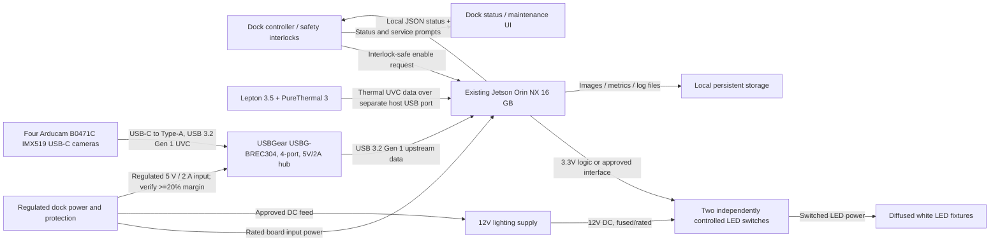
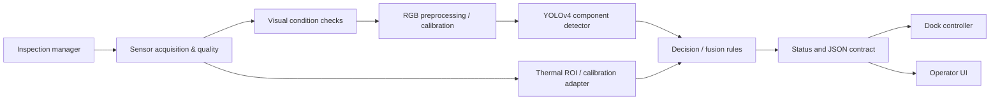
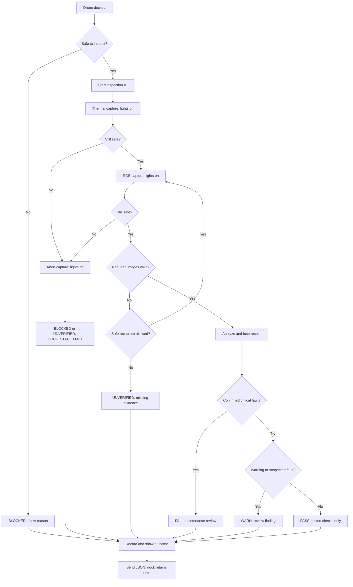
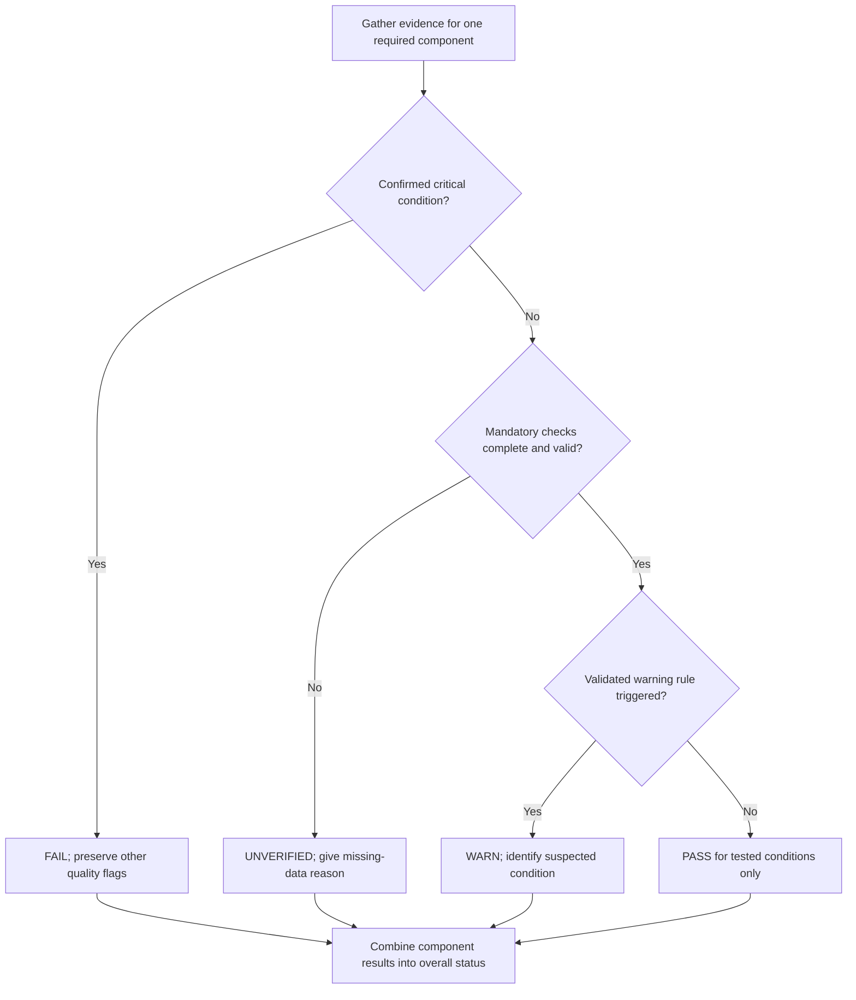

# F26_Team-6_Project_D.R.A.G.O.N.N.

## Introduction
As autonomous drones are deployed worldwide for logistics, infrastructure inspection, and public safety, keeping airframes reliable without human intervention has become a major challenge. Routine maintenance and early defect detection are essential to prevent crashes in the field. However, most current automated docking and inspection stations are proprietary, expensive, and locked down against third-party hardware or modifications. Existing industrial docks rely on high-cost vision hardware and continuous cloud processing pipelines. This creates a serious barrier for fleet operators and developers who need a flexible, modular system they can tailor to their specific airframes and operating budgets.

To address this challenge, Team 6 is developing Project D.R.A.G.O.N.N. (Drone Repair Analysis by Guided Optics via Neural Networks), an edge-based diagnostic payload built to integrate directly into Valinor Dispatch's autonomous drone docking stations for both stationary and mobile setups. The system uses commercial off-the-shelf (COTS) hardware, including a multi-angle UVC camera array and an independent radiometric thermal imager. Rather than building expensive custom software from scratch, each sensor pipeline is developed on top of proven open-source computer vision frameworks and public datasets. Data capture is run through an event-driven sequential loop, reading one device at a time so the USB bus does not choke and the edge board can dedicate all its processing power to the machine learning models.

The scope of this proposal outlines the operational background of automated UAV maintenance, the trade-offs among device hardware and communication protocols, and a comparative survey of existing commercial solutions. It establishes the theoretical foundation for using edge AI to detect structural and mechanical defects across machine vision, and radiometric thermal thresholding. Furthermore, the proposal details the technical specifications provided by Valinor Dispatch, evaluation criteria for successful field operation, budget allocations, available and required technical expertise, and a milestone timeline. Finally, it addresses the operational impact and broader industry implications of deploying an accessible diagnostic architecture built on open-source frameworks.

## Formulating the Problem

### Background
Autonomous drones are increasingly used in applications where the aircraft may operate repeatedly without a technician standing beside the launch site. Between flights, the drone may return to a fixed or mobile docking station for charging, data transfer, storage, and preparation for its next mission. Without a technician on site, remote operators need to know whether a required part appears to be missing, whether a component is unusually warm, and which areas still need inspection before the next flight. To assess how often a fault could go unnoticed, the team will introduce known faults during controlled testing. The proposed target is an overall PASS in no more than 5% of those inspections.

Preflight inspection is normally used to find visible damage, loose or missing hardware, contamination, abnormal motor condition, and other problems that could affect safe operation. Manufacturer guidance for aircraft such as the Skydio X10 includes examining items such as propellers, motors, airframe, and motor windings for damage or evidence of overheating. A human inspector can use sight, touch, and experience to judge these conditions. An unattended dock cannot reproduce that judgment directly, so the inspection problem must be converted into repeatable measurements that can be collected and evaluated automatically.

Remote cameras provide part of this capability, as commercial docking systems may allow an operator to view the aircraft while it is docked. However, a camera feed alone does not establish an automated health assessment. The usefulness of an image depends on camera placement, focus, lighting, reflections, working distance, and whether the required component is visible. A system that produces inconsistent images may report a difference caused by glare or docking position rather than actual damage. 

Within Valinor's dock, moving a camera farther from the aircraft brings more of the airframe into view, but each component occupies fewer pixels. A second viewing angle can help determine whether a propeller is missing or hidden behind an arm. Each additional view also adds data that the dock computer must receive and process. Capturing the views in sequence reduces peak demand on the shared USB connection, but leaves less time for the remaining checks before the next flight.

Capture order also affects how the team interprets thermal measurements. If thermal capture follows a series of visible images, adding another camera view delays the temperature reading. Motors cool after landing, and charging can change surface temperatures. A healthy motor measured immediately after one flight may therefore appear warmer than the same motor measured several minutes after another. To make those readings comparable, the team must account for elapsed time since landing and the aircraft's charging state when choosing the inspection sequence.

Furthermore, before passing any image to a machine learning model, the edge system must mathematically verify optical clarity to avoid false positives. This is done using an image processing quality gate, specifically calculating the Variance of the Laplacian to measure edge sharpness:

$$\text{Variance} = \frac{1}{N} \sum_{x,y} \left( \nabla^2 I(x,y) - \mu \right)^2$$

If this variance drops below a hardcoded threshold, the image is flagged as blurry, and the inspection is aborted before wasting edge compute resources. Therefore, the project aims to strictly control the image-capture conditions and verify image quality before applying machine-learning or anomaly-detection methods.

The prototype camera baseline is four Arducam B0471C enclosed, motorized-focus USB 3.0 cameras using Sony IMX519 16 MP sensors (`4656 × 3496`, 65° horizontal and 51° vertical field of view) and USB Video Class (UVC). The selected product listing specifies up to 80 fps at 720p; Arducam lists YUY2 capture up to 50 fps at 1080p and 8 fps at full 16 MP resolution. Its focus can be programmed from 10 cm to infinity, although the default range is 3 m to infinity, so close focus and focus control must be verified at the prototype's working distances. Each camera is assigned to an upper drone quadrant with overlap at the centerlines. The selected USBGear USBG-BREC304 four-port USB 3.2 Gen 1 powered hub carries the four RGB cameras; the FLIR PureThermal 3 interface uses a separate available host USB port. The IMX519 is the selected prototype camera, not a fixed long-term platform requirement: each camera shall connect through a replaceable module and documented interface so a newer or better camera can be adopted without redesigning the inspection system, provided it meets the coverage, focus, sampling, bandwidth, power, and host-compatibility requirements and passes recalibration and verification. Camera acquisition, sensor preprocessing, machine-learning inference, decision logic, storage, and dock communication remain modular so future hardware can be evaluated without rewriting the full system. [21][22]

## Preliminary Specifications
The following specifications define the initial problem boundaries. Numerical limits will be finalized after the team receives the drone geometry, dock dimensions, inspection-time requirement, environmental range, and acceptance criteria from the sponsor.

### System Capabilities
-	The system shall begin an inspection only after the dock confirms that the drone is present, correctly positioned, and no conflicting dock motion is active.
-	The system shall collect visible and thermal data using a repeatable inspection sequence.
-	The system shall associate each measurement with an inspection identifier, timestamp, sensor identifier, drone or asset identifier, and component region.
-	The system shall evaluate defined components individually rather than returning only one aircraft-wide result.
-	The system shall return PASS, WARN, FAIL, or INSUFFICIENT DATA for each required component or inspection region.
-	The system shall preserve the image, thermal region, or other evidence associated with a warning or failure.
-	The system shall report sensor, lighting, communication, storage, and processing faults separately from detected drone defects.
-	The system shall run routine inference locally without requiring a continuous internet connection.
### Visible Imaging and Controlled Lighting
-	The visible-camera subsystem shall use USB Video Class or another documented interface supported by the selected host. In this proposal, UVC refers to USB Video Class, not ultraviolet-C imaging [7].
-	The system shall provide repeatable coverage of all required inspection regions using fixed or mechanically repeatable camera mounts.
-	Camera intrinsics and lens distortion shall be calibrated, and calibration information shall be retained with the camera configuration [8].
-	Exposure, gain, focus, white balance, and other image settings shall be fixed after calibration unless the inspection procedure explicitly controls their adjustment.
-	The lighting subsystem shall support independently controlled illumination suitable for both general-condition imaging and defect-enhancement imaging.
-	The system shall verify that required lighting channels operate correctly before accepting an image for analysis.
-	The system shall detect unusable frames caused by blur, obstruction, saturation, insufficient illumination, missing data, or incorrect camera state.
-	Visible captures shall be synchronized with the inspection sequence so that dock motion, lighting transitions, or thermal capture do not corrupt the measurement.
- The camera subsystem shall achieve a target image sampling density of **5 pixels/mm** throughout each designated inspection region.
- The four-camera array shall cover the designated upper inspection regions from upper-corner mounts, with centerline overlap where needed to avoid blind spots; actual visibility and sampling shall be checked on the prototype airframe. [21]
- The camera subsystem shall support sequential capture through the selected four-port USBGear USBG-BREC304 hub. The four downstream USB-A ports are allocated to the RGB cameras; the thermal interface requires a separate available host USB port. Capture duration shall be measured against the overall inspection-cycle target. [22]
### Thermal Imaging
-	The thermal subsystem shall capture data with the visible inspection lights off unless testing demonstrates that the lighting system does not alter the required thermal measurement.
-	Thermal data shall be captured after a defined post-docking interval and shall include the elapsed time since landing or motor shutdown.
-	Each thermal record shall include available ambient temperature, camera status, calibration state, and operating-condition metadata.
-	The selected thermal camera and optical path shall provide sufficient field of view and pixels on each required component for the intended anomaly assessment.
-	If absolute temperature is required, the system shall use a radiometric camera and account for emissivity, reflected background temperature, viewing angle, optical-window transmission, and model-specific calibration requirements [9].
-	If only relative anomaly detection is required, the system shall compare equivalent components and validated healthy baselines under similar operating conditions.
-	The thermal camera shall be isolated from avoidable heat produced by processors, lighting drivers, power converters, chargers, fans, and dock airflow.
-	The system shall not accept a thermal result when the camera is unavailable, calibrating, obstructed, thermally unstable, or outside its approved operating condition.

### Data Processing and Decision Logic
-	Sensor acquisition, quality checks, preprocessing, model inference, result fusion, storage, and dock communication shall be implemented as separate functional stages.
-	The software shall support replacement of a camera, thermal module, inference model, or processing platform through documented interfaces or adapters.
-	The pipeline shall resize, normalize, register, or otherwise transform sensor data only according to the requirements of the selected method.
-	If pixel-level or feature-level visible-thermal fusion is used, the system shall include a validated spatial-registration method.
-	The visible-only inspection path shall remain testable independently of the thermal paths.
-	The system shall record inference time, end-to-end inspection time, dropped or invalid data, model version, configuration version, and processing-resource utilization.
-	A multimodal result shall identify which sensors contributed to the decision and shall not hide the loss or failure of one sensor.
-	Inspection thresholds shall be established from prototype testing with healthy units and representative defects rather than assumed in advance.
-	Trained models shall be versioned separately from the camera acquisition and dock-control software.
### Preliminary AI Pipeline Specifications
-	The following specifications are proposed for the AI subsystem and can be changed depending on the circumstances.
-	The AI pipeline shall accept frames produced by the UVC camera subsystem.
-	The AI pipeline shall accept frames or processed image data produced by the thermal imaging subsystem.
-	The system shall timestamp incoming frames so visible and thermal images can be paired as closely as practical. 
-	The pipeline shall include a method of resizing and normalizing images into the format expected by the selected neural network.
-	If pixel-level or feature-level RGB-T fusion is used, the pipeline shall include a method for spatially registering the thermal and visible images.
-	The AI model shall provide readable outputs such as object class, confidence level, bounding-box coordinates, and other necessary information.
-	The software shall record basic performance information such as inference time, frame rate, and dropped frames.
-	The AI pipeline shall be modular enough to allow different trained models to be tested without redesigning the image-acquisition subsystem.
-	The system should be capable of continuing operation if one imaging modality temporarily becomes unavailable.
-	The final inference system shall run locally on the selected processing hardware without requiring continuous internet access.
-	The AI system may include object tracking to reduce unstable detections between consecutive video frames.
-	The training process may occur on a more powerful desktop computer or cloud GPU. The final trained model will then be exported and deployed onto the embedded computer.

### Electrical Integration and Communications
-	Imaging, lighting, processing, and actuator loads shall use appropriately protected power branches. The selected USBGear USBG-BREC304 hub is supplied from 5 V/2 A (10 W); its four downstream ports support up to 900 mA each. Measure peak hub input power with all four cameras active and maintain at least 20% supply margin (no more than 8 W / 1.6 A at 5 V). Use the supplied adapter only where an approved AC source is available; otherwise use a protected, regulated 12 V-to-5 V converter rated for at least 2 A, with connector and polarity verified. [22]
-	Supply and return conductors shall be routed together to reduce loop area, and sensitive data or camera-power cables shall be separated from motors, solenoids, chargers, and other switching loads.
-	Cable shields and enclosure bonds shall be terminated using short, low-impedance connections consistent with the selected interface and equipment guidance.
-	The system shall use the cable type, maximum length, shielding, termination, and connector requirements specified for each communication interface.
-	Communication loss, dropped frames, device disconnection, undervoltage, and storage failure shall be detected and reported.
### Modularity and Maintainability
-	Cameras, lights, thermal modules, interface adapters, and processing hardware shall be replaceable without redesigning the entire inspection architecture.
-	Product-specific settings shall be stored in configuration files or device-adapter modules rather than distributed throughout the application.
-	The system shall support recalibration after a sensor, lens, mount, light, or drone model is changed.
-	The design shall provide service access for lens cleaning, diffuser cleaning, connector inspection, calibration targets, and replacement of high-wear components.
-	Documentation shall identify interfaces, pinouts, supply requirements, cable requirements, calibration data, software versions, and test procedures for each subsystem.
## Constraints
### Physical and Optical Constraints
-	Camera quantity, field of view, working distance, mounting angle, and lens selection are limited by the internal dock geometry and the dimensional envelope of the supported drones.
-	Required surfaces may be hidden by the landing gear, arms, payload, dock structure, or other components. The system cannot classify damage that is not represented in the captured data.
-	Docking-position variation can change image alignment, focus, reflections and thermal regions. Mechanical repeatability or validated image registration is required.
-	Ordinary visible-light glass or clear plastic may block long-wave infrared energy and cannot be placed in the thermal optical path unless its transmission has been verified.
- Camera hardware, including mounts, shall fit within the docking station's **30 x 40-inch footprint** and specified height envelope.
- Camera fields of view shall be selected to maintain the target sampling density of **5 pixels/mm** while covering their assigned inspection regions.
- Adjacent camera views shall minimize overlap where practical without creating unacceptable blind spots.
- Camera acquisition shall complete within the **10-second inspection-cycle limit**.
- Combined sensor data transfer shall remain within the measured usable USB bandwidth and available memory capacity.
- Camera data acquisition and processing shall not run continuously while the system is idle.
- Incremental idle power attributable to the cameras shall be measured before establishing a maximum allowable limit.
- The system shall not rely on USB suspension or selective-suspend behavior unless support is verified for the selected hardware and software.
### Processing and Interface Constraints
-	The number, resolution, format, and frame rate of connected sensors are limited by the host's communication bandwidth, memory, storage rate, and processing capability.
-	Multiple USB cameras may share a host controller. Simultaneous operation must remain within the measured capacity of the selected controller and hub.
-	Sequential capture can reduce simultaneous bandwidth demand, but the total inspection must still meet the sponsor's allowable turnaround time.
-	MIPI, SPI, I2S, and other board-level interfaces may require short cable lengths, compatible voltage levels, driver support, device-tree configuration, or a carrier board specific to the selected host.
-	A model that runs successfully on a development computer may exceed the memory, latency, power, or thermal limits of the deployed processor.
### Measurement and Dataset Constraints
-	A limited number of damaged drones or failure examples may be available. The project may require healthy-baseline anomaly detection, controlled defect samples, synthetic data, transfer learning, or a combination of these methods.
-	Public visible-thermal datasets may support early development but may not match the team's drone, camera geometry, dock lighting, thermal conditions, or target defect classes.
-	Thermal anomalies may indicate abnormal behavior without identifying the underlying cause. Final fault labels must be limited to what the test evidence supports.
-	False-positive and false-negative rates cannot be assumed from performance on unrelated industrial or public datasets.
-	PASS, WARN, and FAIL thresholds require validation on reserved data that is not used to train or tune the model.
### Environmental and Electrical Constraints
-	Ambient light leakage, dust, moisture, vibration, wind, rain, temperature variation, and contamination can change sensor measurements and must be addressed by the enclosure and inspection procedure.
-	Heat retained after flight or produced during charging may resemble a thermal fault unless capture timing and operating state are controlled.
-	Motors, solenoids, switching regulators, chargers, and lighting drivers may introduce conducted or radiated interference into camera, and processor circuits.
-	The available dock voltage, current capacity, grounding arrangement, connector ratings, and cable routes must be confirmed before final hardware selection.
### Safety and Operational Constraints
-	The inspection system shall not command propeller or motor operation unless the aircraft, enclosure, and dock controls provide an approved safe test condition.
-	A sensor or model failure shall not be interpreted as a healthy result. Missing or unreliable data shall produce an INSUFFICIENT DATA or equivalent fault state.
-	For flights under 14 CFR Part 107, the remote pilot in command must check the aircraft system before each flight to determine whether it is safe to operate [18]. The inspection report shall identify the components checked, flag incomplete checks, and provide supporting evidence for the pilot's assessment. A PASS applies only to the checks performed. The inspection system shall have no authority to release the aircraft for flight.
- Manufacturer-required maintenance procedures remain in effect.
-	Stored images, thermal data, identifiers, and maintenance records shall be protected according to the sponsor's access, retention, and cybersecurity requirements.
### Procurement and Product-Neutrality Constraints
-	Final component selection depends on verified availability, lead time, lifecycle status, environmental rating, exact interface support, documentation, and total integration cost.
-	Any procurement or compliance requirement, including NDAA-related requirements, must be confirmed for the exact camera, lens, interface board, and finished configuration rather than assumed from a product family.
-	The architecture shall not require a Jetson, Raspberry Pi, or any other single processing product unless the sponsor later establishes that product as a project requirement.
-	The first prototype may use convenient development hardware, but acceptance criteria shall describe required performance and interfaces rather than a brand name.

### Standards of Compliance
| Standard or specification | Effect on the proposed design |
| --- | --- |
| ISO 12233:2024 [10] | Use a resolution chart at the installed working distance to determine which features the camera and lens can resolve in each required region. Use those measurements to set the smallest feature the team will evaluate for detection. |
| ISO 15739:2023 [11] | Measure image noise under the proposed dock lighting and use the results to select exposure and gain settings for inspection. |
| USB Video Class 1.5 [7] | For each candidate USB camera, verify that the dock computer can acquire the required image format and resolution through its supported UVC interface. |

## Survey of Existing Solutions
Several existing approaches support equipment inspection through manual checks, remote cameras, visual anomaly detection, and thermal imaging. The proposed system will use USB Video Class (UVC) cameras to observe visible damage and a thermal imaging camera to identify abnormal heat signatures.

### Manual Drone Inspection and Skydio Dock for X10
Manufacturer procedures help identify components that should be examined before flight, such as examining motor windings for discoloration or evidence of heat damage. Skydio also describes embedded cameras in its Dock for X10 as supporting remote preflight vehicle inspection.
*   **Pros**: Dock cameras allow the aircraft to be observed remotely; manufacturer checklists help establish inspection targets; images support assessment without requiring a person beside the drone.
*   **Cons**: Camera inspection depends on unobstructed views; remote viewing does not itself establish automated damage detection; visible images do not quantify surface temperature.
*   **Gaps**: The cited descriptions do not demonstrate an automated inspection system that combines visible images and thermal data.
*   **Takeaways**: Define targets using manufacturer guidance, standardize imaging with consistent lighting and drone positioning, and preserve evidence by displaying the associated image region.

### Industrial Visual Anomaly Detection: PatchCore and Anomalib
PatchCore builds a representative memory bank of features from non-defective images, comparing new image regions with this reference to detect anomalies. Anomalib provides a PatchCore implementation and tools for training, evaluation, and inference, including OpenVINO support.
*   **Pros**: Reduces dependence on a comprehensive set of labeled defect classes; identifies suspicious regions; available software supports implementation.
*   **Cons**: An unusual appearance does not automatically identify a particular failure; industrial benchmark results do not establish accuracy on the selected aircraft; processing time and memory use require measurement.
*   **Gaps**: Representative drone images and independent defect examples are still required; a visible-image model does not establish temperature-based anomaly assessment.
*   **Takeaways**: Evaluate a candidate baseline against simpler image-processing methods, represent normal variation, test known defects using reserved test images, and validate thresholds.

### FLIR Thermal Imaging for Equipment Condition Monitoring
FLIR describes thermal imaging as supporting condition monitoring of motors, batteries, and electrical equipment. This provides a relevant precedent for examining heat patterns that may be difficult to recognize through visible inspection.
*   **Pros**: Surface heating can be examined without attaching sensors to every component; images locate hot regions; thermal measurements provide information beyond visible appearance.
*   **Cons**: Enclosed components may not be directly observable; expected post-flight heating must be distinguished from suspicious patterns; a thermal anomaly alone does not identify the underlying fault.
*   **Gaps**: Normal heat patterns must be established for the selected aircraft; general equipment examples do not supply validated drone temperature limits.
*   **Takeaways**: Control measurement timing, compare similar components, and validate separately before combining with visual results.

Published aircraft inspection studies illustrate two choices for Valinor's dock. Harras et al. reported 85.8% accuracy when classifying propeller damage in their study [19]. To evaluate whether damage is visible from the dock, the team would need labeled examples captured at the installed camera angles and under dock lighting. Rice et al. used hangar-mounted pan-tilt-zoom cameras to inspect selected regions of a parked aircraft [20]. In Valinor's smaller enclosure, fixed cameras must cover the required components from the available mounting positions. The proposed prototype will use those views to check component presence, compare surface temperatures in observable regions, and tell the operator which checks could not be completed.

## Measurements of Success
### Functionality
- The AI software shall reliably receive data from the imaging subsystem.
- The final implementation shall be capable of processing the camera stream continuously for at least one hour without software failure.
- The software shall identify and log dropped or invalid frames rather than silently failing.
- The RGB-only detector shall remain usable independently of the thermal pipeline.
- The camera subsystem shall demonstrate at least **5 pixels/mm** throughout designated inspection regions using a calibrated target.
- The camera subsystem shall complete at least **30 inspection trials** to evaluate acquisition time, failures, and cycle-time consistency.
- Each camera shall pass image-quality checks for sharpness, exposure, and frame completeness using validated acceptance thresholds.
- The acquisition software shall detect disconnected cameras and failed or invalid frames.
### Detection Accuracy
- All candidate models shall be evaluated using the same held-out test images.
- Precision, recall, and mean average precision (mAP) shall be recorded where applicable.
- RGB-only, thermal-only, and RGB-T models shall be evaluated separately so the effect of
fusion can be measured.
- A fusion model should only replace the simpler RGB baseline if it demonstrates a measurable advantage in conditions important to the project.
- Special test sets should include normal lighting as well as poor or unusual lighting conditions.
Processing Performance
- End-to-end AI latency shall be measured from acquisition of the frame through
generation of the final detection output.
- The fused AI pipeline should process at least 90% of the frame rate supplied by the slower imaging subsystem during continuous operation.
- CPU, GPU/NPU, RAM, and temperature utilization shall be recorded during extended
tests.
### Reliability
- Loss of the thermal input shall not require restarting the entire software stack if RGB-
only operation is possible.
- Invalid camera frames shall be ignored without terminating the application.
- The pipeline shall recover from temporary stream interruptions where practical.
### Modularity
- The AI model shall be stored separately from camera-acquisition code.
- A replacement model shall be capable of being installed without redesigning the complete
video pipeline.
- Camera preprocessing and model preprocessing shall be separated so changes in one subsystem do not unnecessarily affect the other.


## Resources
The prototype uses four Arducam B0471C enclosed, motorized-focus 16 MP IMX519 USB 3.0 UVC cameras for visible inspection and one FLIR Lepton 3.5 with a PureThermal 3 interface for thermal measurements. The RGB cameras connect to a USBGear USBG-BREC304 four-port powered hub; the thermal interface connects to a separate host USB port. These selected devices are a project baseline, with working-distance focus, USB bandwidth, and power margin to be verified during integration. [21][22]

The current design baseline reuses the existing NVIDIA Jetson Orin NX 16 GB as the inspection processor, subject to verification of the installed software stack and available resources. The project budget therefore assigns no incremental purchase cost to the compute unit. A separate desktop computer may be used for model development and training. Local storage will hold inspection evidence and logs; open-source machine-learning and image-processing tools will support development, subject to a license review before transfer.

### Budget Document

| Item | Estimated Price ($) |
| :--- | ---: |
| Four Arducam B0471C enclosed, motorized-focus 16 MP Sony IMX519 USB 3.0 UVC cameras ($125.99 each, listing snapshot) [21] | $503.96 |
| FLIR Lepton 3.5 and PureThermal 3 interface | $284.00 |
| Existing NVIDIA Jetson Orin NX 16 GB | $0 incremental |
| USBGear USBG-BREC304 four-port USB 3.2 Gen 1 powered hub [22] | $25.99 |
| LED strips, switching boards, lighting supply, diffusers, and fixture brackets | $111.80–$186.80 |
| Camera brackets, USB-C-to-Type-A data cables, wiring, and protected DC conversion | $70.00–$140.00 |
| **Mandatory prototype subtotal** | **$995.75–$1,140.75** |
| 15% planning reserve | $149.36–$171.11 |
| **Planning budget including reserve** | **$1,145.11–$1,311.86** |

The camera price is the $125.99-per-unit listing shown in the supplied product screenshot and is a price snapshot; confirm the live price and exact enclosed-camera variant at procurement. The hub amount is a planning estimate. Record actual order prices at procurement. The four hub ports serve the RGB cameras, and the PureThermal 3 interface requires a separate host USB port. Measure peak hub input power and retain at least 20% margin on its 5 V/2 A supply. The detailed BOM and assumptions govern the subsystem cost ranges; revise the estimate if supplier pricing or client-furnished equipment changes. [21][22]

## Personnel
Team 6 consist of members whose experience and expertise covers hardware integration, programming, and technical writing. Individual skills as follows:

*   **Ben Heimermann:** C/C++, 3d-modeling, Wiring and schematics
*   **Michael Lamberth:** C/C++, Python, Linux, Embedded Systems
*   **Samuel Oke:** C/C++, Wiring and Schematics, Hardware and Software Integration 
*   **Lucas Taylor:** C/C++, Python, Embedded Systems, Linux, Technical Documentation
*   **Aaron Thongmanivong:** C/C++, Python/MicroPython, Technical Writing, Embedded Systems

These combined qualifications are expected to be sufficient to test, process, and train models as needed. Team 6 aims to work hard to fill any gaps in expertise as needed to provide an optimal prototype.

The team has not assigned a directly chosen supervisor for the project, as the team has directed source of help and instructions from multiple professors for their specific field of study. These professors will be able to help in the development of the AI agent, machine learning pipeline system, and edge AI processing.

The Instructors are Dr. Christopher Johnson and Owen O'Connor, who will function as the quality assurance and control for the duration of the project. Major proposals and designs will be vetted and approved by the instructors.

## Stakeholders

The primary stakeholder for Project D.R.A.G.O.N.N. is Valinor Dispatch, the project sponsor. Valinor needs a way to check returning aircraft for missing components and unusual surface temperatures before the next flight. The system must fit within the existing dock infrastructure and provide results quickly enough to help reduce downtime during drone maintenance and repair.

Remote pilots and dock operators need a clear report identifying which components were inspected and which require further review. Maintenance technicians need the location of each suspected issue and the image or thermal measurement that prompted the warning. Valinor's clients depend on reliable service. An unnecessary warning can delay a scheduled mission, while a missed fault can leave an aircraft in service when it needs maintenance.

People near flight operations have an interest in the early detection of faults that could put them at risk. Limiting camera coverage to the aircraft and dock also helps protect their privacy. The Federal Aviation Administration (FAA) is a regulatory stakeholder because the inspection report supports the remote pilot in command's preflight assessment.

## Timeline
*   **Phase 1: Procurement & Architecture Setup** - Acquire UVC cameras, FLIR Lepton sensor, and edge compute hardware. Establish dock mounting constraints.
*   **Phase 2: Subsystem Orchestration** - Develop the Python-based sequential capture loop to prevent USB bus saturation and integrate the OpenCV Variance of the Laplacian blur check.
*   **Phase 3: Model Training** - Train visual anomaly models on pristine drone datasets (Anomalib) and calibrate thermal ROI thresholds.
*   **Phase 4: Fusion & Integration** - Merge optical and thermal metrics into the Diagnostic Consensus Engine to output structured JSON telemetry (PASS, WARN, FAIL).
*   **Phase 5: Field Testing** - Install the payload into the Valinor Dispatch dock and run full-cycle continuous tests to validate accuracy, latency, and reliability.

## Specific/Broad Implications

### Specific Implications
Affordability is the most impactful specific implication of Project D.R.A.G.O.N.N. Standard industrial vision systems are highly expensive, with basic camera arrays costing between $800 and $1,600. By utilizing widely available, standard USB camera modules, the project reduces this cost to roughly $250. This massive cost reduction frees up the budget for other critical sensors, like the thermal imager, and makes automated drone maintenance affordable for fleets of any size.

Furthermore, this setup is highly adaptable. Because the system relies on universally adopted USB connections rather than proprietary hardware, it completely avoids vendor lock-in. If a camera breaks or needs an upgrade, an operator can simply swap it out. The system automatically recognizes the new device without requiring complex software updates or custom coding, ensuring seamless long-term maintenance.

### Broader Implications, Ethics, and Responsibility as Engineers
As autonomous drones become common in logistics and public safety, mid-air mechanical failures pose a serious risk to people and property. Standard drone flight controllers cannot detect gradual physical wear. By using AI to catch mechanical issues"such as cracked propellers or failing motors"before a drone ever leaves the dock, this system actively prevents catastrophic crashes and improves public safety.

Because this is a safety-critical system, the engineering team has a strict ethical responsibility to ensure the AI never makes a guess based on bad data. To prevent false alarms or missed defects, the software runs automated quality checks before every inspection; for example, if a camera lens is blurry or dirty, the system immediately aborts the process rather than risking a bad assessment. Finally, the system guarantees transparency. It combines the visual and thermal results into a simple "PASS, WARN, or FAIL" report, ensuring that human operators always retain absolute clarity and final authority over the health of their fleet.

## References
[1] Skydio, "Skydio X10 Flight Checklist." [Online]. Available: https://support.skydio.com/hc/en-us/articles/25013300914203-Skydio-X10-Flight-Checklist

[2] Skydio, "The Future Of Scalable, Autonomous Flight And Data Capture Is Here With Dock For X10." [Online]. Available: https://www.skydio.com/blog/dock-for-x10-future-scalable-autonomous-flight-data-capture

[3] K. Roth et al., "Towards Total Recall in Industrial Anomaly Detection," Proceedings of the IEEE/CVF Conference on Computer Vision and Pattern Recognition, pp. 14318-14328, 2022. [Online]. Author manuscript available: https://arxiv.org/abs/2106.08265

[4] Anomalib maintainers, "Anomalib," GitHub repository. [Online]. Available: https://github.com/open-edge-platform/anomalib

[5] Anomalib maintainers, "PatchCore," Anomalib documentation. [Online]. Available: https://anomalib.readthedocs.io/en/latest/markdown/guides/reference/models/image/patchcore.html

[6] Teledyne FLIR, "Thermal Imaging for Data Centers," technical note. [Online]. Available: https://www.flir.com/contentassets/5f4aa9d1ef5a439da25b0c91333e83fe/flir-thermal-imaging-for-datacenters-tech-note.pdf

[7] USB Implementers Forum, "USB Device Class Definition for Video Devices, Version 1.5." [Online]. Available: https://www.usb.org/document-library/video-class-v15-document-set

[8] OpenCV, "Camera Calibration and 3D Reconstruction." [Online]. Available: https://docs.opencv.org/5.0/tutorials/calib3d/camera_calibration/camera_calibration.html

[9] Teledyne FLIR OEM, "Radiometry with Lepton." [Online]. Available: https://oem.flir.com/learn/thermal-integration-made-easy/radiometry-with-lepton/

[10] International Organization for Standardization, "ISO 12233:2024 - Digital Cameras - Resolution and Spatial Frequency Responses." [Online]. Available: https://www.iso.org/standard/88626.html

[11] International Organization for Standardization, "ISO 15739:2023 - Photography - Electronic Still-Picture Imaging - Noise Measurements." [Online]. Available: https://www.iso.org/standard/82233.html

[12] USB Implementers Forum, "USB Video Class v1.5 Specification." [Online]. Available: https://www.usb.org/document-library/video-class-v15-document-set

[15] International Electrotechnical Commission, "IEC 62368-1 - Audio/Video, Information and Communication Technology Equipment - Part 1: Safety Requirements." [Online]. Available: https://webstore.iec.ch/

[16] IEEE, "IEEE 7000-2021 - IEEE Standard Model Process for Addressing Ethical Concerns During System Design." [Online]. Available: https://standards.ieee.org/standard/7000-2021.html

[17] International Electrotechnical Commission, "IEC 62443-4-1:2018 - Security for Industrial Automation and Control Systems - Part 4-1: Secure Product Development Lifecycle Requirements." [Online]. Available: https://webstore.iec.ch/

[18] Electronic Code of Federal Regulations, "14 CFR § 107.15 - Condition for safe operation." [Online]. Available: https://www.ecfr.gov/current/title-14/chapter-I/subchapter-F/part-107/subpart-B/section-107.15

[19] M. S. Harras, S. Saleh, B. Battseren, and W. Hardt, "Vision-based Propeller Damage Inspection Using Machine Learning," Embedded Selforganising Systems, vol. 10, no. 7, 2023. [Online]. Available: https://www.bibliothek.tu-chemnitz.de/ojs/index.php/cs/article/view/604

[20] M. D. Rice et al., "Automated Multi-Camera Inspection System for Aircraft," Proceedings of the AAAI Conference on Artificial Intelligence, vol. 40, no. 48, 2026. [Online]. Available: https://doi.org/10.1609/aaai.v40i48.42378

[21] Arducam, *B0471 16 MP IMX519 USB 3.0 Camera Module Datasheet* and B0471/B0471C product information (motorized focus; B0471C enclosed variant). [Online]. Available: https://www.arducam.com/downloads/datasheet/B0471_16MP_IMX519_USB3.0_Camera_Datasheet.pdf and https://www.arducam.com/blog/product/arducam-16mp-imx519-motorized-focus-usb-3-0-camera-module/.

[22] USBGear, *USBG-BREC304 4-Port USB 3.2 Gen 1 Powered Hub*. [Online]. Available: https://www.usbgear.com/usbg-brec304.html.

Note: References [10] and [11] are official standard listings; full-text access may require purchase or Tennessee Tech library access. USB-IF specifications are available through its document library.

## Statement of Contributors
- Ben Heimermann: Resources 
- Michael Lamberth: Survey of Existing Solutions 
- Samuel Oke: Formulating the Problem, Preliminary Inspections, and Constraints
- Lucas Taylor: Preliminary Inspections and Measurement of Success
- Aaron Thongmanivong: Introduction, Formulating the Problem, Preliminary Specifications, Constraints, Resources, and Specific/Broad Implications

<br>

<br>

# Conceptual Design — Integrated In-Dock Drone Inspection System

**Valinor Dispatch: Multisensor, AI/ML-Assisted Drone Inspection**

**Team 06 | Conceptual design baseline | November 20, 2026**

**Document status:** Adopted team design baseline for detailed design and prototype planning. Known client-provided facts and cited device specifications are distinguished from engineering assumptions. Where the client has not provided a final constraint or interface specification, the team has selected a definite baseline value or behavior throughout this document. These selections are **project assumptions, not statements of Valinor approval, verified measurements, or established flight-safety performance**. They govern the proposed prototype unless the team revises the document after testing or sponsor feedback. This document combines the team's RGB camera, controlled lighting, thermal, and ML research. [3][5][7][9][11][32]

## 1. Introduction and fully formulated problem

Valinor's Dispatch dock houses a drone between flights. A drone may return with a missing or damaged propeller, surface damage, loose or missing hardware, or an unusually warm component. A conventional camera cannot directly measure surface temperature, and a thermal camera cannot resolve all of the small visible features. The proposed project adds a coordinated inspection system inside the dock to gather visible and thermal measurements, evaluate the components that can actually be observed, and provide a documented maintenance-oriented result. [3][5][7][9][11] [41]

The selected concept uses four upper-corner-mounted **Arducam B0471C enclosed 16 MP Sony IMX519 USB 3.2 Gen 1 UVC cameras**—each assigned to inspect one drone quadrant with centerline overlap—controllable white LED lighting, one FLIR Lepton 3.5 with a PureThermal 3 interface, a **USBGear USBG-BREC304 four-port USB 3.2 Gen 1 hub** (Amazon ASIN B012DZ4NJ8), and the existing NVIDIA Jetson Orin NX 16 GB. The four hub ports are allocated to the RGB cameras; connect the PureThermal interface to a separate available Jetson host USB port. If no separate port is available, revise the hub architecture before integration. The primary processing order is dock authorization → thermal capture with visible lights off → controlled-light RGB capture → image-quality checks → component and thermal measurements → decision-level fusion → report and log. The dock controller, rather than the AI model, remains responsible for flight permission, charging controls, and safety interlocks. [3][5][7][9][11][32][47][60]

This is an inspection aid, not an aircraft airworthiness certification device. A component outside the cameras' field of view, an untested defect type, or unreliable sensor data must be reported as an inspection limitation; a model's confidence score does not prove that a drone is safe to fly. [3][9][1]

### 1.1 Fully formulated problem and system requirements

**Problem statement:** The team shall design, prototype, and evaluate an integrated dock inspection system that gathers repeatable RGB and thermal measurements while the drone is safely stationary, identifies designated exterior components, and evaluates observable conditions without compromising normal dock operations. The baseline shall determine whether required components are visible, flag a potentially missing propeller or other required part only when its expected location can be evaluated reliably, and assess unusual relative surface temperatures for mapped thermal regions when calibrated data are available. Chipped propeller edges, cracks, and other fine surface damage are candidate research targets but shall not be claimed as detected until labeled examples and held-out testing support that capability. The system shall provide traceable `PASS`, `WARN`, `FAIL`, or `UNVERIFIED` results to the existing dock software and shall not treat an unobserved or unvalidated condition as evidence of a safe aircraft.

| ID | System-level **shall** statement | Design basis |
|---|---|---|
| <span style="white-space: nowrap;">SYS-01</span> | The system **shall** begin an inspection only after the dock controller confirms a secured, non-operating drone and an inspection-permitted state. | Safety/operational constraint; proposed, client confirmation needed [3][9][5][6][13] |
| SYS-02 | The system **shall** obtain RGB views of every designated inspectable exterior component using the installed four-camera quadrant arrangement and shall identify any required component that cannot be observed. | Camera and ML team concept; final coverage list TBD [3][9][11][28] |
| SYS-03 | The system **shall** acquire usable thermal measurements from designated visible surface regions before reporting their thermal status. | Thermal team concept; applicable regions depend on validated geometry [5][6][13] |
| SYS-04 | The system **shall** record the lighting mode for each accepted RGB image and accept only frames captured after that mode settles. In the repeatability test, each required view **shall** keep the mean brightness of a fixed gray patch within **±5% of that view’s 10-cycle mean** across 10 independent light off/on cycles. | Proposed lighting/camera acceptance limit for Valinor review; test method in §4.3. [7][12][11][28] |
| SYS-05 | The system **shall** run the primary inspection without requiring continuous internet access. | Edge-processing design objective [3][9] |
| SYS-06 | The system **shall** provide per-component and overall `PASS`, `WARN`, `FAIL`, or `UNVERIFIED` results with machine-readable reason codes. | Pilot/operator and maintenance requirement; adopted team reporting contract |
| SYS-07 | The system **shall not** issue an overall `PASS` if any mandatory check is invalid, missing, or unverified. | Safety requirement; adopted conservative status policy |
| SYS-08 | The system **shall** return a timestamp, unique inspection identifier, component identifiers, data-quality flags, and software/configuration versions through a documented local interface. | Integration requirement; loopback HTTP/JSON contract adopted in Section 3.4 |
| SYS-09 | The system **shall** preserve diagnostic evidence under a 30-day retention policy and a 64 GB storage allocation and shall handle storage or communication failures without silently reporting `PASS`. | Engineering accountability and system reliability [1][3][9] |
| SYS-10 | The system **shall** keep model inference isolated from flight-control and safety-interlock authority. | Safety requirement; inspection has no launch-authority privileges |
| SYS-11 | The prototype **shall target** an end-to-end inspection result within **5 minutes** of an accepted request, measured from request acceptance through delivery of a complete result message on the installed dock configuration. | Performance acceptance target adopted for the prototype |
| SYS-12 | The component detector **shall target at least 90% recall** for each required visible component class on held-out dock capture sessions; the test report shall include class counts and false negatives. | Component-detection acceptance target adopted for prototype testing |
| SYS-13 | The software **shall** be able to complete a 60-minute continuous-operation test without an application crash or interference with dock control; sensor and storage faults shall be injected during testing. | Reliability acceptance target [3][9] |
| SYS-14 | The adopted RGB camera arrangement **shall target at least 5 pixels/mm** across each camera's assigned near quadrant (out to a maximum effective working distance of **28.77 in / 730.8 mm**) to resolve a **1.0 mm** target defect feature size across **5 pixels**, with actual sampling measured at representative positions after mounting. The team **shall not** infer reliable defect recognition from pixel sampling alone; any minimum defect size must be demonstrated with the chosen camera, lens, lighting, processing pipeline, and held-out test images. | Adopted optics sampling design target; physical performance requires measurement |
| SYS-16 | The system **shall** maintain a stable reporting interface when sensors or compatible ML models are changed. | Versioned interface baseline and backwards-compatibility requirement |
| SYS-17 | The assembly **shall** fit within verified enclosure and drone clearances, avoid obstructing landing, doors, cooling, charging, and service access, and use correctly protected power rails (including a **≥ 20% power margin** on the USB 3.0 hub supply). | Packaging/electrical safety constraints [7][12][11][28] |
| SYS-18 | The team **shall** document applicable component, firmware, library, dataset, and pretrained-weight licenses before transferring the prototype to the sponsor. | Professional and intellectual-property constraint [3][9][11][28] |
| SYS-19 | The inspection pipeline **shall target a seeded-fault false-`PASS` rate of no more than 5%**, reported with fault counts and a one-sided 95% confidence bound on independent held-out trials. | Adopted seeded-fault acceptance target for prototype evaluation |
| SYS-20 | The evaluation report **shall** separately record component-detection precision, recall, mAP, false negatives by category, inference latency, and total inspection time under documented camera, lighting, dataset, and Jetson operating conditions. | Adopted evaluation requirement |
| SYS-21 | For every claimed visual defect class, the team **shall** document the smallest demonstrated observable feature size, tested view locations, camera settings, image-processing conditions, and held-out detection performance. | Adopted evaluation requirement |

The adopted measurable ML targets distinguish inspection speed, component localization, and actual fault recognition. The five-minute limit covers the full requested inspection cycle, rather than model inference alone. A 90% component recall target does not imply 90% detection of chipped blades or thermal abnormalities. The false-`PASS` objective applies to deliberately seeded conditions within the mandatory-check scope defined below. These are design acceptance targets; actual achievement must be demonstrated with representative dock sessions before performance can be claimed.

**Fixed inspection baseline:** The prototype uses a PX4-compatible four-rotor test aircraft with 7 in propellers and a maximum 20 × 20 in plan-view inspection envelope. The mandatory RGB checklist is the four propellers, four motors, four arms, the upper fuselage, and an exposed upper battery housing (14 named positions). The mandatory thermal check is the visible upper battery-housing region under a calibrated, non-charging post-flight condition; other visible motors and charging interfaces are supplemental observations. A required location that cannot be inspected is `UNVERIFIED`. A reliably established missing propeller, motor, or arm is `FAIL`; a suspected but unconfirmed abnormality is `WARN`. Every non-`PASS` result produces a maintenance-review hold request; none of the outputs independently grants launch permission. The optical target is a 1.0 mm feature sampled across at least five native pixels, **not** a guaranteed 1.0 mm defect detector. The full cycle shall complete within five minutes, with at least 90% required-component recall and the seeded-fault false-`PASS` acceptance criterion from SYS-19. These requirements are the team's standing design values until changed through revision control, not statements of sponsor certification.

**Baseline scope and stretch features:** The required software baseline consists of sensor acquisition and quality checks, RGB component localization, identification of required locations that cannot be evaluated, calibrated thermal-region assessment where coverage permits, conservative decision-level fusion, and a local versioned JSON result. Learned crack/chip classification using Anomalib or another anomaly-detection approach, additional learned fusion, and directional-light defect enhancement are stretch features. These features shall not be prerequisites for demonstrating the core inspection. The team shall make its stretch-feature go/no-go decision on **December 4, 2026**, based on available datasets, prototype timing, and integration tests; no stretch feature is part of the mandatory acceptance scope.

### 1.2 Stakeholders and their needs

The inspection system affects several groups with different operational, safety, and maintenance needs. These needs guide the requirements and the system's choice to report uncertainty explicitly.

| Stakeholder | Relevant needs and concerns | Related system requirements |
|---|---|---|
| Valinor engineering and dock-integration staff | Reliable integration with existing dock hardware and software; maintainable interfaces; no interference with safety-critical dock functions | SYS-05, SYS-08, SYS-10, SYS-13, SYS-16 |
| Remote pilots and dock operators | Timely, interpretable inspection outcomes; visible limitations and reasons for warnings; no false indication that the aircraft has been cleared for flight | SYS-01, SYS-06, SYS-07, SYS-11 |
| Maintenance technicians | Component-specific findings, preserved evidence, relevant reason codes, and a practical way to review possible faults without unnecessary repeated inspections | SYS-06, SYS-08, SYS-09, SYS-12 |
| Valinor's customers | Predictable system availability, traceable inspection records, and responsible handling of maintenance information | SYS-09, SYS-11, SYS-13 |
| People near flight operations | Conservative handling of missed or uncertain defects, and reasonable protection from unnecessary image collection | SYS-07, SYS-10, SYS-19 |
| Federal Aviation Administration (FAA) | An operating workflow that supports the remote pilot's legal inspection responsibilities rather than assigning flight authority to an AI model | SYS-01, SYS-07, SYS-10 |

The dock controller is an interfacing subsystem rather than a person or organization. It must supply an authorized inspection state and receive versioned, machine-readable results, while retaining operational control over dock functions. The prototype applies the adopted reporting and safety requirements without representing them as client-approved flight-authorization rules.

### 1.3 Design constraints and fixed project assumptions

| Subject | Design baseline | Implementation and verification boundary |
|---|---|---|
| Dock enclosure | **30 in W × 40 in L × 14 in H** usable planning envelope, selected from the client's approximate **12–16 in** height range [5][6][13][11][28] | The team shall use the 14 in nominal envelope for fixture design and perform a clearance fit-check before installation; no proprietary dock CAD is required. |
| Prototype airframe | **PX4-compatible quadrotor; 7 in propellers; ≤20 in × 20 in** plan-view inspection envelope; top-accessible battery casing | This single airframe geometry defines the inspection regions and camera coverage. The team assumes a test unit will be sourced with Valinor's assistance and furnished without a charge to the team's equipment budget; this is a purchasing assumption, not a confirmed client commitment. [57] |
| Mandatory RGB regions | **Four propellers, four motor housings, four arms, upper fuselage, upper battery casing — 14 named positions** | The test configuration maps every required position to a camera quadrant; landing gear, individual fasteners, and fine cracks/chips are nonmandatory research observations until separately validated. |
| Mandatory thermal region | **One visible top battery-housing region**, captured with the dock in a non-charging, post-flight inspection state | The single Lepton is not required to image every motor. Additional visible thermal regions may be logged as supplemental, but an invalid mandatory battery ROI prevents `PASS`. |
| Edge computer | Existing **NVIDIA Jetson Orin NX 16 GB**, mounted on the dock backplate; no additional compute purchase | The selected prototype software baseline is **JetPack 6.1 + DeepStream 7.1**, with the CUDA and TensorRT versions supplied through the compatible NVIDIA software stack. The inspection service shall operate separately from proprietary dock-control software. This baseline is a project design assumption, not confirmation of the currently installed software. The team shall verify installed versions, available memory, GPU utilization, and dock-control timing before deployment. [9][21] |
| RGB hardware | Four **Arducam B0471C enclosed 16 MP Sony IMX519 USB 3.2 Gen 1 UVC cameras**, with `4656 × 3496` native resolution and `65°` horizontal / `51°` vertical field of view | The B0471C is the cased variant of Arducam’s B0471. Each camera has a USB-C connector and connects to one of the hub’s USB-A downstream ports through a USB 3 data cable. Arducam lists full-resolution YUY2 capture at 8 fps and up to 1.48 W. Its datasheet lists a 3 m–∞ default focus range; because inspection distances are sub-meter, verify close-focus and UVC/V4L2 focus control at the required working distances before accepting the camera baseline. Verify the cased SKU, enclosure clearance, USB bandwidth, and `5 px/mm` sampling target with installed hardware. [47]
| Thermal hardware | One FLIR Lepton 3.5 (`160 × 120`, ~`57°` HFOV) and PureThermal 3 USB adapter | A top-oriented mount and 12 in nominal stand-off target the designated battery-housing region. Radiometric mode, unit scale, and emissivity require calibration before results are considered valid. [5][6][13] |
| Lighting | Two opposed **1 m, 12 V, 10 W/m** diffused white LED strips with independent switching | The combined nominal lighting load is **20 W**, or approximately **1.67 A at 12 V**. A regulated 12 V/3 A lighting branch supplies both strips through separately rated switching devices. Each strip draws approximately 0.83 A under the nominal design assumption. Actual current, connector ratings, switching behavior, glare, and thermal loading shall be tested. [7][12] |
| Available auxiliary power | One protected **12 V/5 A (60 W)** dock auxiliary feed dedicated to inspection peripherals; the Jetson remains powered by the dock’s existing supply | The selected four-port USBGear hub (USBG-BREC304 / Amazon ASIN B012DZ4NJ8) has a **5 V/2 A (10 W)** supply and four USB-A downstream ports rated up to 900 mA each. All four ports are assigned to the RGB cameras; the PureThermal interface requires a separate host USB port. Four cameras draw up to **5.92 W combined** at the published 1.48 W maximum per camera. To retain 20% supply margin, measure the complete hub input and require no more than **8 W (1.6 A at 5 V)** during peak capture. Power the hub through the included adapter only if an approved AC source is available; otherwise use a protected, regulated 12 V-to-5 V converter rated for at least 2 A and verified connector polarity. [47][60]
| Dock data interface | **Authenticated loopback HTTP/JSON** on `127.0.0.1:8765`, with a sponsor-side caller/authorization adapter | The team develops the inspection service and mock dock adapter without receiving proprietary dock code; the integration boundary requires only an externally implemented request/heartbeat client. |
| Evidence storage | **64 GB available local allocation**, 20 inspections/day, **25 MB retained evidence/inspection**, **30-day retention** | Expected retained evidence is ~15 GB per month; reserve additional space for indexes, logs, software, and fault recovery. Full-storage conditions prevent a false `PASS`. |

**Runtime compatibility baseline:** The NVIDIA Jetson Orin NX 16 GB is the installed processing module, and **JetPack 6.1 with DeepStream 7.1** is the team's selected design environment. The original Jetson Nano's DeepStream 6.0.1 / JetPack 4.6.1 pairing shall not be used. The inspection process runs as a separate service/container so that the sponsor's controller and proprietary code are not modified. Startup checks shall compare installed runtime versions against the documented baseline; an incompatibility blocks inspection rather than modifying dock software automatically. [9][21]

Valinor indicated that the dock has substantial available power capacity and that the team should prioritize effective camera and lighting performance during prototyping. However, the exact available voltages, current limits, connector ratings, and power-distribution connections still require confirmation. The inspection system shall use an approved dock interface and team-collected inspection data. Aircraft-specific information protected by NDA shall not be included in public source code or documentation. [57]

**Power, access, and data policy:** The 12 V/5 A auxiliary rail, 64 GB local storage allocation, and loopback endpoint are adopted integration assumptions. Prototype power may be applied only after verifying the actual dock connection meets those electrical ratings; absent or insufficient supplies shall safely block inspection. The team owns the inspection code and its newly collected datasets. NDA-protected aircraft specifications and proprietary dock code shall not be included in public repositories. These engineering baselines are used consistently throughout the remaining sections; failed verification triggers a controlled design revision rather than a silent change to requirements. [67]

## 2. Comparative analysis of possible solutions

Each comparison weighs inspection coverage, ease of integration, risk, development time, repeatability, and the team's limited semester resources. The adopted concept defines the prototype configuration; performance is established only by its verification results.

### 2.1 Visible-camera position and interface

| Option | Benefits | Limitations | Selection |
|---|---|---|---|
| **Four caddy-corner UVC cameras** | Multiple perspectives; shorter occluded regions; standard Linux V4L2/USB handling | Four mounts/cables, shared USB loading, cost, focus and overlap validation | **Selected prototype layout** [11][28] |
| Two opposite wall cameras | Fewer sensors and simpler cabling | Greater hidden areas; short working distance can require wide-angle optics | Not selected for initial full component survey |
| One overhead camera | Minimal interface complexity | Propeller undersides, sidewalls, motor housings may be blocked | Not sufficient alone |
| CSI/MIPI camera set | Dedicated camera interface can reduce USB dependence | Connector/driver integration and wiring constraints | Retained as fallback if UVC testing fails |

**Single-Quadrant Coverage & Overlap Geometry:** Inside the $30"\text{ W} \times 40"\text{ L}$ enclosure, a centered $20" \times 20"$ drone sits $25.00\text{ in}$ ($635.0\text{ mm}$) diagonally from each corner ($\sqrt{20^2 + 15^2} = 25\text{ in}$), with its nearest motor/propeller corner approximately $11\text{ in}$ away. Each of the four corner cameras is assigned to inspect **one singular quadrant** of the drone—extending from its near corner out to the drone's centerlines—with intentional overlap at the center of the drone so no blind spots occur if the aircraft lands slightly off-center:

* **Minimum Quadrant Angle vs. Overengineered Overlap Lens:** Framing the two nearest quadrant centerlines, `(20 in, 5 in)` and `(10 in, 15 in)` from a box corner, requires a minimum horizontal field of view of `90° − atan(5/20) − atan(10/15) ≈ 42.3°`. The selected **Arducam B0471C enclosed 16 MP IMX519** (`4656 × 3496`, `4.28 mm` EFL, `F1.75`, `65°` HFOV / `51°` VFOV) covers about `819 mm` (`32.26 in`) horizontally at the drone center, providing about `9 in` of centerline overlap. It connects by USB-C to a Type-A hub port. Arducam lists autofocus and a `3 m–∞` default focus range in the B0471 datasheet; because the required distances are below `1 m`, verify close-focus behavior and software focus control on the exact B0471C before relying on the sampling calculation.
* **Elevated Upper-Corner Mounting (`3–4 in` Above Drone):** Mounting the cameras near the top of the enclosure—**3 to 4 in above the drone's upper plane** and pitched downward at **`~14°–18°`** toward each quadrant's center—provides an oblique top-down view of the upper propeller surfaces, motor bells, and top fasteners while adding less than `0.35 in` to the `25.00 in` horizontal distance to the drone center (`25.18 in` slant at `3 in` elevation; **`25.32 in` / `643.1 mm` slant** at `4 in` elevation). Real usable field of view and vertical clearance on the nearest landing gear (`~11.40 in` slant distance) depend on tilt, lens distortion, and exact internal dock height (`12–16 in`), and shall be verified with the physical drone. [11][28][27]

**Spatial Sampling & Maximum `5 pixels/mm` Reach (`1.0 mm` Main Feature Size):** Using the horizontal field-of-view relation $\text{Physical FOV (mm)} = 2 \times \text{WD} \times \tan(\theta_H / 2)$ with `4656` horizontal pixels and $\theta_H = 65^\circ$, the maximum working distance before pixel density drops below **`5 pixels/mm`** is:

$$
\text{Max Width at } 5\text{ pixels/mm} = \frac{4656\text{ pixels}}{5\text{ pixels/mm}} = 931.2\text{ mm}\ (\approx 36.66\text{ in})
$$

$$
\text{WD}_{\max} = \frac{931.2\text{ mm}}{2 \times \tan(32.5^\circ)} \approx 730.8\text{ mm}\ (\mathbf{28.77\text{ in}})
$$

Because **`28.77 in` exceeds the `25.32 in` slant distance to the drone's center**, every point inside each camera's assigned quadrant exceeds the **`5 pixels/mm`** target (`SYS-14`)—delivering **`12.62 pixels/mm`** at the `11.40 in` near corner, **`7.97 pixels/mm`** at the `18.03 in` quadrant midpoint, and **`5.68 pixels/mm`** at the `25.32 in` drone center, plus an extra **`3.45 in` (`~88 mm`)** overlap margin past the centerlines at $\ge 5\text{ pixels/mm}$. For the **`1.0 mm`** main target feature size, `5 pixels/mm` provides **5 pixels** across the feature:

$$
\text{sampled width at } 1.0\text{ mm} = 5\text{ pixels/mm} \times 1.0\text{ mm} = 5\text{ pixels}
$$

$$
\text{minimum sampling requirement for 5 pixels across } 1.0\text{ mm} = \frac{5\text{ pixels}}{1.0\text{ mm}} = 5\text{ pixels/mm}
$$

These are sampling calculations, not proof of crack, chip, or scratch recognition. The effective detail level also depends on lens focus, perspective, glare, noise, output format (uncompressed YUY2 vs. compressed MJPEG), model input resizing, and any high-resolution crop analysis. The RGB team shall measure sampling at near, center, and quadrant-overlap locations using an ISO 12233 slanted-edge test target. The ML team shall determine the smallest defect size that can actually be classified under representative conditions.

**Camera selection note:** The **Arducam B0471C enclosed 16 MP Sony IMX519 USB 3.2 Gen 1 UVC** (`4656 × 3496`, `65°` HFOV × `51°` VFOV, up to `1.48 W` per unit) is the selected four-camera baseline. Its USB-C connector connects to the USBGear hub’s USB-A downstream ports with USB 3 data cables; it supports full-resolution YUY2 capture at `8 fps`. The manufacturer lists autofocus, but the datasheet’s `3 m–∞` default focus range does not demonstrate focus at this design’s sub-meter working distances. The team shall confirm close focus and UVC/V4L2 focus control on the exact cased SKU before acceptance. [4][47]


### 2.2 Lighting configuration

| Option | Strength | Weakness | Selection |
|---|---|---|---|
| **Opposed diffused white LED strips** | Low cost, repositionable, reduces hard shadows in many orientations | Diffuser/strip width may leave glare or dark regions | **Baseline inspection mode** [7][12] |
| Shallow-angle directional lighting | Can improve contrast around edges/chips/scratches | Additional switching and extra capture time; reflective surfaces behave differently | **Experimental second mode** |
| Ring/dome illumination | Potentially more even field | Additional space and hardware cost | Fallback if strips cannot meet uniformity requirements |
| Uncontrolled ambient illumination | No additional hardware | Exposure and defect contrast change with environment | Rejected |

**Client lighting preference and team selection:** Valinor confirmed that the dock has no dedicated inspection lighting and left the choice to the team. The **two opposed, diffused white 1 m LED strips** are therefore the adopted prototype lighting configuration. Other arrangements may be compared in research but are not part of the mandatory hardware baseline without a design revision. [57]

The selected lighting is controlled through rated switching hardware. A Jetson logic output does not supply LED load current. The two-strip estimate is $P = 2(10\,\mathrm{W}) = 20\,\mathrm{W}$ and $I \approx 20/12 = 1.67\,\mathrm{A}$ total. With one independently switched 1 m strip per Adafruit 5648 driver, the estimated 0.83A/channel is below the board's 1.5 A continuous published rating; switching hardware still needs a thermal and connector-rating check. [7][12][36][37]

### 2.3 Thermal sensing

| Option | Benefit | Drawback | Selection |
|---|---|---|---|
| **Lepton 3.5 + PureThermal 3 (USB)** | Radiometric-capable core; convenient USB integration; separate thermal pipeline | 160 × 120 pixels may not resolve small parts; surface readings need calibration | **Selected candidate** [5][6][13] |
| Lepton + low-level breakout/SPI | Fewer interface components | Increased firmware and capture-integration work | Not selected for first prototype |
| Several thermal cameras | Better coverage of multiple components | Significantly higher cost and calibration burden | Consider only after single-camera coverage mapping |
| RGB-only temperature inference | Lower cost | RGB intensities do not provide actual component temperature | Rejected |

The Lepton's approximate view at a 12 in stand-off is only part of the drone, so only mapped, visible thermal regions may receive a thermal assessment. The mandatory region is the exposed upper battery casing on the selected 7 in quadrotor; visible motor housings and charging connections are supplemental regions only. Battery-case surface temperature is not equivalent to internal cell temperature. Reflections, emissivity, time since flight, and charging state constrain comparisons. [5][6][13][54]

### 2.4 AI processing, component analysis, and sensor fusion

| Design choice | Advantages | Challenges | Decision |
|---|---|---|---|
| **GStreamer/DeepStream 7.1 + TensorRT + YOLOv4** | GPU-accelerated video handling, inference and component metadata under the JetPack 6.1 design baseline | Requires parser/export validation and resource testing alongside dock functions | **Selected prototype deployment architecture**; other detectors are comparative research, not prerequisites [3][21][22][23] |
| OpenCV-only pipeline | Quick camera and preprocessing prototype | More custom integration for multi-stage optimized inference | Development/testing support |
| YOLOv4-tiny | Lower compute and memory pressure | Potential loss of small-object recall | Fallback if full YOLOv4 misses timing/resource limits |
| Anomalib (PatchCore/PaDiM) on RGB crops | Can explore subtle deviation from healthy appearances | Dataset, deployment, and false alarm work; different runtime path | Stretch goal only [11][28] |
| **Late (decision-level) RGB/thermal fusion** | No requirement for pixel-identical RGB and thermal tensors; testable reason codes | Requires calibrated region mapping and decision rules | **Selected** [3][9] |
| Early/feature-level RGB–thermal fusion | Potential richer learned correlations | Strict alignment/training demands and greater integration risk | Not selected initially |

YOLOv4 is first used to locate components and generate named regions of interest. Detecting a component is not equivalent to validating that it has no defect. Surface damage classification will be attempted only for defect categories supported by labeled test examples and measured performance. A rules-based decision layer combines visible and thermal observations without claiming that a detection confidence is a probability of safe flight. [3][9]

### 2.5 Weighted hardware, software, and compute trade studies

The AI and sensor architecture must balance detection quality and optical sampling with integration effort, available compute, software licensing, energy use, and the need to protect existing dock functions. The following weighted comparisons are preliminary engineering judgments, not measured test results. The selected hardware and software remain the design baseline; benchmark findings will establish whether requirements are met, and any replacement will require a documented revision.

#### RGB camera module alternatives

| Camera Candidate | Spatial Sampling $\ge 5\text{ px/mm}$ (`SYS-14`, 30%) | USB 3.2 Gen 1 camera / Type-A hub / UVC (`SYS-02`, 25%) | Focus & Optical Control (`SYS-04`, 20%) | Unit Cost & Power Efficiency (`SYS-17`, 15%) | Mechanical / Enclosure Fit (`SYS-17`, 10%) | Weighted score / 5 |
|---|---:|---:|---:|---:|---:|---:|
| **Arducam B0471C enclosed, 16 MP IMX519 USB 3.2 Gen 1 Type-C** (`4656 × 3496`, `65°` HFOV) | 5 (`5.68 px/mm` at center; `5 px` per `1.0 mm` out to `28.77 in`) | 5 (UVC/YUY2 through USB-C-to-Type-A data cable) | 3 (autofocus; verify close focus at required distance) | 4 (`~$145` list-price estimate; `1.48 W` max) | 4 (cased module; clearance to verify) | **4.35** |
| **12.3 MP Sony IMX477 USB 3.0 UVC** (`4056 × 3040`, `59°–65°` HFOV) | 4 (`4.95–5.56 px/mm` at center) | 5 (Native UVC/V4L2) | 3 (Manual ring focus lock required) | 4 (`~$110–$130`) | 4 (Standard 38 mm board) | **4.10** |
| **12.3 MP Sony IMX500 Module** [4] | 4 (`5.56 px/mm` at center) | 2 (Requires USB bridge / MIPI) | 3 (Fixed/manual lens) | 2 (Pays for redundant on-chip AI) | 3 (Interface adapter overhead) | **2.90** |

The **Arducam B0471C enclosed 16 MP IMX519** scores highest (`4.35 / 5.00`) because its `4656`-pixel horizontal resolution clears the `5 pixels/mm` target across the assigned quadrant (`5.68 pixels/mm` at the `25.32 in` drone center, resolving a `1.0 mm` target feature across `5 pixels` out to `28.77 in`). Its USB-C interface connects to the USBGear hub’s Type-A ports with standard USB 3 data cables. The selected hub has exactly four downstream ports, so the four RGB cameras use all of them and the PureThermal interface must use a separate Jetson host port. Close-range focus at the actual `11.40–25.32 in` inspection distances and the cased camera’s mounting clearance remain acceptance checks; the manufacturer’s listed default focus range does not establish performance at those distances. [47][60]

#### Object detector alternatives

The initial concept selected YOLOv4 because the team had already researched the Darknet implementation and its TensorRT/DeepStream integration path. However, selecting YOLOv4 without evaluating newer detectors would not adequately justify the choice. YOLOX-S and Ultralytics YOLOv8 are included as more recent comparison candidates. License compliance must cover code, pretrained weights and dependencies separately; use of an open repository does not automatically permit unrestricted proprietary distribution. [3][22][23]

| Detector | License/IP compatibility (30%) | Current integration readiness (30%) | Potential small-part detection (25%) | Potential Jetson efficiency (15%) | Weighted score / 5 |
|---|---:|---:|---:|---:|---:|
| YOLOv4 / Darknet | 4 | 5 | 3 | 3 | 3.90 |
| YOLOX-S | 5 | 3 | 4 | 4 | 4.00 |
| Ultralytics YOLOv8 | 2 | 4 | 4 | 4 | 3.40 |

Ratings use a preliminary 1–5 scale, where 5 is more favorable. The weighted score is `0.30 × licensing + 0.30 × integration + 0.25 × potential detection + 0.15 × efficiency`. The values above represent planning assumptions and **do not establish that one model is more accurate or faster in the Valinor dock**. YOLOv4 is the selected prototype detector; common training/evaluation data, held-out dock sessions, inference timing, memory usage, export compatibility, small-component recall, and license review determine whether it meets the adopted requirements. A substitution requires a recorded design revision. The Apache-2.0-licensed YOLOX implementation is a candidate for comparison, while Ultralytics software may require AGPL-3.0 obligations or an appropriate commercial license depending on intended use. [22][23]

#### Shared versus dedicated compute

| Decision criterion | Weight | Shared existing Orin NX 16 GB | Separate inspection compute module |
|---|---:|---|---|
| Avoidance of dock-control timing and reliability interference | 35% | Must be proven under simultaneous dock and inspection workloads | Greater isolation, but introduces a new dock connection |
| Incremental hardware, power and maintenance cost | 30% | Lower initial equipment cost if adequate headroom exists | Additional hardware, power and enclosure integration |
| Software and electrical integration effort | 20% | Shares existing OS and resource dependencies | Requires separate supply, data link and maintenance |
| ML throughput and future expansion headroom | 15% | Limited by currently available resources | Can be sized to the inspection workload |

The shared **existing Orin NX 16 GB is the selected compute design**, with an assumed minimum of 4 GB memory available to the inspection service and no missed dock-control deadlines. During concurrent tests, the inspection workload shall produce no more than a 10% increase in the dock controller's measured 95th-percentile response latency. A separate compute board is not purchased under this baseline; a failed resource-isolation test is handled through a design revision. Cost, power consumption and software integration are considered here as design-selection factors, rather than only as later broader-impact concerns.

### 2.6 Existing automated visual inspection approaches

Published inspection work provides examples of how machine vision can identify damage or support maintenance review. However, reported results on other aircraft, cameras, and defect datasets cannot be assumed to apply to the Valinor dock.

| Existing approach | Relevant contribution | Limitation relative to this project |
|---|---|---|
| Harras et al., *Vision-based Propeller Damage Inspection Using Machine Learning* (2023) | Uses visual propeller data and a convolutional neural network to investigate automatic propeller-damage recognition; reports 85.8% accuracy in the paper's study | Does not demonstrate the proposed fixed multi-camera, RGB/thermal, dock-safe reporting system or its performance on the Valinor airframe [24] |
| Rice et al., *Automated Multi-Camera Inspection System for Aircraft* (AAAI 2026) | Demonstrates multi-camera, pan/tilt/zoom visual inspection and AI-assisted identification of aircraft exterior conditions with operator review | Uses a larger-airframe and motorized-camera inspection setting rather than a compact stationary drone dock [25] |
| Ishikawa, Iwata, and Satoh, *Event-Camera-Based Defect Detection of High-Speed Rotating Propellers* (2026) | Studies event-based sensing and classification of defects on rotating propellers | Requires a different sensing and motion scenario; the proposed baseline inspection does not energize propellers [26] |

These approaches support studying automated inspection but do not establish the accuracy, coverage or safety of the baseline device. The planned contribution is a compact, stationary in-dock system that combines mapped RGB component checks, limited validated thermal regions, explicit `UNVERIFIED` handling for incomplete evidence, and a versioned result communicated to the existing dock controller. Its effectiveness will depend on representative in-dock data and testing, not the performance numbers reported by unrelated research. [24][25][26]

## 3. High-level solution

The inspection manager receives a request through the adopted local HTTP/JSON dock interface, verifies the `safe_to_inspect` authorization, and assigns a unique run ID. The thermal camera captures a frame before visible lighting is energized. The controller then enables the general LED mode and the system records one camera at a time—each capturing its assigned drone quadrant with centerline overlap—with the capture mode, stable-light confirmation, and timestamps attached to accepted frames. Directional-light capture is experimental and is not included in the mandatory five-minute baseline. Quality checks reject blurred, clipped, stale, obstructed, or incorrectly exposed images. [3][9][11][28]

Next, the software undistorts and maps the valid RGB images, runs the component detector, and checks whether mandatory parts are actually observable. The thermal adapter returns valid surface measurements and region identifiers without requiring a full pixel-to-pixel overlay. A decision manager combines component evidence with configuration-controlled severity rules. The result and supporting evidence are saved locally, transmitted to the dock, and displayed using the dock's existing maintenance/status interface. A failure to observe a required area is `UNVERIFIED`, not a successful inspection. The required checks are the 14 RGB component positions and the single battery-housing thermal ROI defined in Section 1.3. [3][9][5][6][13]

### 3.1 Hardware block diagram

Each physical block below is a distinct hardware or dock subsystem. Solid arrows show required power and data connections; four RGB cameras connect through the four-port hub, while the thermal interface uses a separate Jetson host USB port.



**Block boundaries and wiring constraints:** The dock’s existing controller has final authority over operational safety. The Jetson controls the lighting only through an approved driver and a controller-authorized inspection state; a safe de-energized state is required on crash, timeout, or aborted inspection. The selected USBGear USBG-BREC304 hub has four USB-A downstream ports, all allocated to the four RGB cameras. Connect the PureThermal 3 interface to a separate Jetson host USB port and verify that the host provides a suitable independent connection. If it does not, revise the hub architecture to provide at least five downstream device connections, then repeat power and bandwidth checks. The hub’s 5 V/2 A supply provides 10 W total; maintain at least 20% headroom by keeping measured hub input at or below 8 W (1.6 A). Measure the upstream link, host controller assignment, bandwidth and device enumeration; sequential acquisition reduces simultaneous traffic but does not guarantee zero USB contention. Lighting power and Jetson GPIO shall never be directly tied at incompatible voltage levels. [7][12][11][28][47][60]

### 3.2 Processing decomposition and subsystem data flow



An internal data record includes `inspection_id`, `capture_time_utc`, `sensor_id`, `lighting_mode`, image shape/units, `calibration_version`, `quality_state`, and the final component mapping. The thermal and visible pipelines may have different resolutions and capture times; their association is by **component ID and capture metadata**, not an assumed matching pixel grid.

### 3.3 Operational flowchart from the user's perspective



**User interface states:** `READY`, `BLOCKED`, `CAPTURING_THERMAL`, `CAPTURING_RGB`, `ANALYZING`, `PASS`, `WARN`, `FAIL`, and `UNVERIFIED`. Status is shown through the dock's existing maintenance/status interface using the JSON contract; **no additional touchscreen is purchased**. The UI shall identify the component, inspection time, missing data, and reason for maintenance review. `WARN`, `FAIL`, and `UNVERIFIED` shall request a maintenance-review hold without granting flight authority to the AI.

**Loss of inspection authorization:** The inspection manager shall verify the dock's authorized state before and during sensor capture. If authorization is withdrawn, the software shall stop additional capture and inference, request the lighting hardware's fail-safe off state, record `DOCK_STATE_LOST`, and suppress a `PASS` for the interrupted inspection. The resulting `BLOCKED` or `UNVERIFIED` outcome shall be sent to the dock if communications remain available. A normally-off hardware enable circuit shall remove lighting power independently of the user-space process if the authorization heartbeat is missing for more than 2 seconds.

### 3.4 External signal and protocol interface register

| Link (direction) | Physical / protocol type | Data sent and received | Design constraints / owner |
|---|---|---|---|
| Dock controller/adapter → Jetson | **Authenticated loopback HTTP/JSON** at `127.0.0.1:8765`; `POST /v1/inspections` | `schema_version`, `request_id`, `drone_id`, `safe_to_inspect`, mandatory check set, request time; immediate acknowledgment | Dock-side client/adapter is an assumed sponsor integration interface; team service is implemented without sponsor source code. |
| Dock controller/adapter → Jetson | `POST /v1/inspection-authorization`, **1 Hz** heartbeat | `request_id`, current `safe_to_inspect`, dock state, monotonic sequence | A lost heartbeat for **2 seconds**, authorization withdrawal, or invalid state aborts the inspection; lighting fails off. |
| Jetson → dock controller/adapter | `GET /v1/inspections/{request_id}`, HTTP/JSON polling; 1 Hz while pending | `inspection_id`, current phase, overall/per-component result, `reason_codes`, quality, duration and evidence handles | **3-second** request acknowledgment limit; completed result by **300 seconds**; duplicate `request_id` returns the same inspection rather than rerunning. |
| Four B0471C cameras → USBGear hub → Jetson | USB 3.2 Gen 1 UVC/V4L2; USB-C camera connections to USB-A hub ports; native YUY2 preferred (`4656 × 3496` target) | RGB frames, stable device IDs, dimensions, timestamps, focus metadata | Four enclosed IMX519 cameras, `65°` HFOV baseline; sequential acquisition; four downstream ports allocated to RGB; verify supported native format and close-focus behavior on the exact SKU. [11][28][47][60] |
| Thermal module → separate Jetson USB host port | PureThermal 3 USB UVC radiometric pipeline | Raw 16-bit samples where supported, timestamps, thermal units/scale, sensor state | One Lepton 3.5, mandatory upper-battery ROI; the selected four-port hub is fully allocated to the cameras, so verify an independent host port before integration; fail closed if calibrated temperatures cannot be produced. [5][6][13][60] |
| Jetson → LED switches | 3.3 V-compatible GPIO via rated normally-off switch and dock authorization gate | `GENERAL` / `OFF` enable, optional experimental mode | Two independently switched 12 V channels; lost authorization or watchdog power makes lights OFF. [7][12] |
| Dock aux rail → peripherals | Protected **12 V/5 A** DC feed, 12 V/3 A lighting branch, regulated **5 V/2 A hub input** | Regulated voltage/current, protected returns, fuse status | Four cameras draw up to 5.92 W combined; hub input must remain at or below 8 W to retain 20% margin; Jetson uses existing protected supply. [47][60] |
| Jetson → storage | Local restricted filesystem + JSON/SQLite manifest | Accepted JPEG evidence, selected crops, thermal record, logs and versions | **64 GB evidence allocation; 30-day rolling retention; 20 runs/day × 25 MB/run planning basis**. |

**Fixed dock communication contract:** Each request includes a unique `request_id`, a `drone_id`, the standard mandatory-check list, timestamp, and current `safe_to_inspect` authorization. The inspection service acknowledges a valid request within 3 seconds and reports completion within 300 seconds. The dock-side adapter posts a 1 Hz authorization heartbeat; the inspection is aborted if the last valid heartbeat becomes older than 2 seconds. One failed frame-quality check may trigger **one** safe recapture of the affected camera; no unbounded retry is permitted. Requests older than **10 seconds** at receipt, malformed/unauthenticated requests, and conflicting duplicate IDs shall be rejected. The response schema is version **`1.0`** and includes `request_id`, `inspection_id`, UTC timestamp, overall/per-component state, reason codes, modality validity, evidence handles, and model/configuration versions. `WARN`, `FAIL`, and `UNVERIFIED` indicate a maintenance-review hold request; dock flight and interlock authority remain separate. These numerical protocol values are adopted project assumptions and must pass simulated and on-dock verification.

### 3.5 Result-message contract example

The schema below is fixed for prototype integration; the shown `drone_id`, measurement values, and statuses are illustrative **example data**, not test measurements or validated safety thresholds.

```json
{
  "schema_version": "1.0",
  "request_id": "request-00042",
  "inspection_id": "inspection-00042",
  "drone_id": "aircraft-01",
  "timestamp_utc": "2026-11-20T20:00:00Z",
  "overall_status": "WARN",
  "components": [
    {
      "component_id": "front_left_propeller",
      "status": "PASS",
      "modalities_checked": [
        "rgb"
      ],
      "reasons": []
    },
    {
      "component_id": "front_right_propeller",
      "status": "PASS",
      "modalities_checked": [
        "rgb"
      ],
      "reasons": []
    },
    {
      "component_id": "rear_left_propeller",
      "status": "PASS",
      "modalities_checked": [
        "rgb"
      ],
      "reasons": []
    },
    {
      "component_id": "rear_right_propeller",
      "status": "PASS",
      "modalities_checked": [
        "rgb"
      ],
      "reasons": []
    },
    {
      "component_id": "front_left_motor",
      "status": "PASS",
      "modalities_checked": [
        "rgb"
      ],
      "reasons": []
    },
    {
      "component_id": "front_right_motor",
      "status": "PASS",
      "modalities_checked": [
        "rgb"
      ],
      "reasons": []
    },
    {
      "component_id": "rear_left_motor",
      "status": "PASS",
      "modalities_checked": [
        "rgb"
      ],
      "reasons": []
    },
    {
      "component_id": "rear_right_motor",
      "status": "PASS",
      "modalities_checked": [
        "rgb"
      ],
      "reasons": []
    },
    {
      "component_id": "front_left_arm",
      "status": "PASS",
      "modalities_checked": [
        "rgb"
      ],
      "reasons": []
    },
    {
      "component_id": "front_right_arm",
      "status": "PASS",
      "modalities_checked": [
        "rgb"
      ],
      "reasons": []
    },
    {
      "component_id": "rear_left_arm",
      "status": "PASS",
      "modalities_checked": [
        "rgb"
      ],
      "reasons": []
    },
    {
      "component_id": "rear_right_arm",
      "status": "PASS",
      "modalities_checked": [
        "rgb"
      ],
      "reasons": []
    },
    {
      "component_id": "upper_fuselage",
      "status": "PASS",
      "modalities_checked": [
        "rgb"
      ],
      "reasons": []
    },
    {
      "component_id": "upper_battery_housing",
      "status": "WARN",
      "modalities_checked": [
        "rgb",
        "thermal"
      ],
      "reasons": [
        "THERMAL_REFERENCE_DELTA"
      ],
      "thermal_reference_delta_c": 9.2
    }
  ],
  "quality": {
    "rgb": "VALID",
    "thermal": "VALID",
    "dock_authorization": "VALID_AT_START_AND_CAPTURE"
  },
  "performance": {
    "total_inspection_ms": 7800
  },
  "versions": {
    "detector": "yolov4-test",
    "calibration": "cal-01",
    "rules": "rules-01"
  },
  "evidence": [
    "inspection-00042/rgb_4_quadrants.zip",
    "inspection-00042/thermal_battery.bin"
  ]
}
```

**Decision precedence:** A confirmed missing required propeller, motor, or arm or another validated critical condition returns overall `FAIL`, even if other inputs are missing; missing-data flags remain visible. Otherwise, any unverified item in the fixed mandatory checklist yields `UNVERIFIED`; a suspicious but unconfirmed finding yields `WARN`; only valid mandatory checks without flags yield `PASS`. `WARN`, `FAIL`, and `UNVERIFIED` each request a maintenance-review hold. No inspection status independently provides flight clearance; the dock retains final operational authority.

## 4. Atomic subsystem specifications

This section decomposes the concept into implementable subsystems. Each subsection includes function, input/output boundaries, an adopted project contract, shall statements, and a practical verification method. All Valinor-dependent inputs without a supplied specification are fixed as team design assumptions in this revision; validation failures are documented as engineering changes rather than left as open requirements.

### 4.1 Dock safety, power and mechanical integration

**Function:** Safely host the inspection cycle inside the dock, provide the approved power/interface boundaries, and preserve normal docking and aircraft operations.

| Inputs | Outputs | Interfaces / protocols | Proposed checks |
|---|---|---|---|
| Dock-safe state, installed-board identity, power sources, enclosure dimensions, mounted sensor dimensions | Inspection enable, regulated and protected DC rails, sensor/lighting mounting positions, controller status | Dock IPC; DC power; mechanical brackets; approved logic-level interlock | Use the 30 × 40 × 14 in baseline clearance model; verify physical fit, cable routing, 12 V/5 A auxiliary rail, fuse sizing, and load temperatures |

- **INT-01:** The integration subsystem **shall** expose a positive `safe_to_inspect` condition indicating the drone is secured and propellers are stopped before enabling capture.
- **INT-02:** The integration subsystem **shall** prevent active illumination and sensor hardware from obstructing landing, door travel, ventilation, charging contacts, or service access.
- **INT-03:** The power design **shall** provide separately rated Jetson, externally powered USB 3.0 hub (`≥ 20%` power margin above sensor load), and 12V lighting supplies or suitably sized converters without applying 12V to 3.3V GPIO.
- **INT-04:** All switched LED outputs **shall** default to off if the inspection process crashes, stops receiving authorized commands, or loses the dock enable state.
- **INT-05:** The inspection software **shall** target the existing Orin NX 16 GB with the adopted **JetPack 6.1 / DeepStream 7.1** runtime, validate the actual installed software before starting, and remain isolated from sponsor docking code.
- **INT-06:** During simultaneous dock and inspection workloads, the system **shall** show no missed dock-control deadlines and no more than a **10% increase in measured dock-controller p95 response latency** against the existing-dock baseline. The test shall also record CPU/GPU use, RAM usage, thermals, sensor power, capture and inference latency.

**Verification:** Dimensioned photographs/CAD clearance review, power-on measurements, disconnect/fault tests, dock abort test, and unchanged baseline docking function.


#### 4.1.1 Detailed design: inspection power budget

This budget estimates simultaneous inspection loads with both LED strips at full brightness. The values are design estimates; startup and peak currents still need to be measured. The team’s [compute research](Research%20of%20Subsystems/ML_Condensed_Research.md) identifies the Jetson Orin NX 16GB. The 10–25 W range assumes selected module power modes and excludes the carrier, fan and peripherals. Confirm the installed mode and revise the budget if a higher mode is enabled ([NVIDIA power-mode table](https://docs.nvidia.com/jetson/archives/r36.4.4/DeveloperGuide/SD/PlatformPowerAndPerformance/JetsonOrinNanoSeriesJetsonOrinNxSeriesAndJetsonAgxOrinSeries.html)).

| Inspection load | Quantity | Low (W total) | High (W total) | Basis |
|---|---:|---:|---:|---|
| Jetson Orin NX 16GB module | 1 | 10 | 25 | Assumed module power modes. |
| RGB cameras on powered USB hub | 4 | 3.08 | 5.92 | Four B0471C units; Arducam lists 0.77 W minimum and 1.48 W maximum per camera. [47] |
| Thermal camera and USB interface | 1 set | 1 | 1 | Provisional allowance for the Lepton and PureThermal board together. |
| 12 V white LED strips | 2 × 1 m | 20 | 20 | Each strip draws 10 W at full brightness [7]. |
| Powered USB hub electronics | 1 | 1 | 2 | Hub overhead only; connected devices are counted separately. |
| Spare USB accessory allowance | 0 | 0 | 0 | No spare downstream hub ports in the selected four-camera configuration; PureThermal uses a separate host port. |
| Jetson carrier, fan and lighting controls | 1 set | 2 | 4 | Provisional allowance; verify on selected hardware. |
| **Total at inspection devices** | | **37.08** | **57.92** | Excludes charging, dock motors and other existing loads. |
| **Estimated draw across both dock supplies** | | **43.6** | **68.1** | Device total divided by 0.85, assuming 85% overall conversion efficiency. |

**USB hub sizing.** The four cameras draw up to **5.92 W** combined at the published maximum; add the existing **2 W** high-case hub-electronics allowance for **7.92 W**. Applying a 20% margin gives **9.50 W (1.90 A at 5 V)**, just within the selected hub’s **5 V/2 A (10 W)** supply. The remaining margin is small, so verify the complete hub input at peak camera capture and require **≤8 W / 1.6 A** to retain 20% headroom. Each camera’s maximum listed draw is below the hub’s stated 900 mA per-port limit. The PureThermal interface is not on this hub.

**Lighting branch.** Each 1 m strip draws about **0.83 A at 12 V**. Together they draw **1.67 A (20 W)**. The dock powers the strips through one driver per strip [7][12]; the Jetson only sends control signals. Request a regulated **12 V, 3 A** branch. Its 36 W rating is available capacity, not an additional load. If the dock provides regulated 12 V with enough spare current, no buck converter is needed for the strips. If the assigned rail is above 12 V, use a buck converter rated to deliver at least 3 A continuously at 12 V under dock operating conditions.

**Dock supply check.** The design assumes the Jetson stays on its existing supply and the peripherals use a protected **12 V, 5 A (60 W)** auxiliary feed. If the USB hub is powered from that DC feed through an 85%-efficient 12 V-to-5 V converter, the high-case hub load of **7.92 W** draws about **9.32 W** from the 12 V rail. With the **20 W** lights, the estimated auxiliary load is **29.32 W (2.44 A at 12 V)**, leaving about **30.68 W** for controls and transient loads. If the included 5 V/2 A AC adapter is used instead, recalculate from the actual source. The `68.1 W` estimate in the table covers both supplies combined.

**Verification before integration.** Confirm the assigned dock connector, voltage range, protection and available continuous and peak current while other dock equipment is operating. Verify the USBGear hub input connector and polarity before using a DC converter. Connect four cameras to the hub and the PureThermal interface to a separate Jetson host port; if no such host port is available, revise the hub architecture. Measure the hub input at startup and during peak capture, record voltage and maximum current, and require `≤1.6 A` to preserve 20% margin on the 2 A supply. Measure each LED branch and overall dock input with all inspection loads active, including thermal calibration. Update the budget if measured peaks exceed these limits.

### 4.2 RGB camera hardware and acquisition
**Function:** Provide four upper-corner component views—each responsible for a singular drone quadrant with centerline overlap (`3–4 in` above the drone's upper plane)—and repeatable high-resolution still capture. [11][28].

| Inputs | Outputs | Interfaces / protocols | Design values |
|---|---|---|---|
| Camera IDs, mode/focus requests, LED-stable event, calibration configuration, USB 3.0 power | Native RGB still frames (`4656 × 3496`), camera ID, original pixel dimensions, timestamps, quality metadata | USB 3.2 Gen 1 UVC/V4L2 through USBGear USBG-BREC304; four B0471C USB-C cameras connect to its four USB-A ports; the PureThermal interface uses a separate Jetson host USB port | Four **Arducam B0471C enclosed 16 MP Sony IMX519** cameras (`65°` HFOV × `51°` VFOV, autofocus; close-range behavior to be verified), mounted **3–4 in above drone plane** (`~14°–18°` pitch); single-quadrant assignment (`11.40 in` near corner to `25.32 in` center) with centerline overlap; **5 px/mm** sampling target (`28.77 in` maximum working distance) for a `1.0 mm` target feature; no claimed minimum defect size before testing [47][60] |

- **RGB-01:** The system **shall** capture one camera at a time for the initial multi-camera pass and record the camera, assigned quadrant, and lighting mode for each accepted image.
- **RGB-02:** The camera mounts **shall** position the four modules in the upper enclosure corners (`3–4 in` above the drone plane) so each camera covers its assigned drone quadrant with centerline overlap against the 14-position mandatory component coverage map in Section 1.3; invisible components **shall** be marked `NOT_VISIBLE` rather than inferred present.
- **RGB-03:** The acquisition software **shall** query and save the verified device resolution, pixel format, UVC focus setting, and stable device identifier; it shall not assume `/dev/video0` always means the same camera.
- **RGB-04:** The acquisition software **shall** reject stale buffered frames after mode or exposure changes and shall mark unplugged cameras and incomplete transfers invalid.
- **RGB-05:** The camera hardware and UVC motorized focus configuration **shall** maintain repeatable focus and stable mounting during repeated simulated docking cycles.
- **RGB-06:** Each chosen camera/lens **shall** undergo field-of-view, geometric calibration, and ISO 12233 slanted-edge test captures at representative near-corner (`~11.40 in`), quadrant-midpoint (`~18.03 in`), drone-center (`25.32 in`), and maximum `5 px/mm` (`28.77 in`) locations.
- **RGB-07:** The team **shall** measure any effect of USB 3.0 hub sharing and sequential capture on total cycle time and report the observed maximum, rather than assume bandwidth is never limiting.
- **RGB-08:** For the selected **Arducam B0471C** camera SKU, document supported native resolutions, frame/still formats (uncompressed YUY2 vs. MJPEG), USB speed and maximum camera draw (`≤1.48 W` each). With four cameras on the USBGear USBG-BREC304, measure the complete hub input and require `≤8 W / 1.6 A` at peak capture to retain 20% margin on its 5 V/2 A supply; test each port and shared-hub traffic. Connect PureThermal to a separate host port. Verify autofocus and focus commands at the installed near, midpoint and far working distances, then test whether MJPEG, sensor downsampling or shared traffic degrades `1.0 mm` target-feature evidence or increases capture time. Record native and model-input resolutions separately. [47][60]

**Functional sequence:** `Select stable device → set mode/exposure/focus → request frame → flush stale buffer → capture → timestamp and label → quality gate → release endpoint → next camera.`

**Verification:** Annotated single-quadrant and centerline-overlap coverage map, ISO 12233 slanted-edge target captures under each light mode, cable-removal test, repeated mounting measurements, end-to-end capture timing, USB hub power measurement, and a full-resolution pixel-density study.

**High-resolution evidence handling:** An object detector may use resized images for component localization, but a small crack or chip can be lost when the original high-resolution view is downsampled. Candidate fine-defect analysis will therefore evaluate cropped native-resolution regions within each camera's assigned quadrant in addition to full-frame detector input. The team will compare native uncompressed YUY2 and compressed image captures for loss of edge detail before making a minimum-defect-size claim.

### 4.3 Controlled illumination

**Function:** Supply repeatable visible illumination without powering LEDs through the Jetson's GPIO. Diffused white light is the baseline; a shallow-angle mode is retained only after evidence shows better defect contrast. [7][12]

| Inputs | Outputs | Interfaces / protocols | Adopted electrical design baseline |
|---|---|---|---|
| Authorized capture phase, GPIO-compatible switch commands, 12V supply | Light mode `OFF`, `GENERAL`, optionally `DIRECTIONAL`; ready/stabilized indication | 3.3V control signal through compatible MOSFET drivers; separate switched 12V load | Two 1m cool-white strips, 10W each; 20W total, 1.67A total; 12V/3A supply from the assumed protected 12V/5A auxiliary feed [7][12] |

- **LGT-01:** The illumination subsystem **shall** maintain lights off during baseline thermal-first capture and between inspections.
- **LGT-02:** Each 1 m strip **shall** use a switching channel whose continuous current rating exceeds the measured channel load under operating temperature.
- **LGT-03:** The lights **shall** enter the specified capture mode and stabilize before a frame is accepted; frames from prior modes **shall** be rejected.
- **LGT-04:** The mounts **shall** allow diffusion/angle adjustments without covering cameras, charging hardware, or the drone's motion envelope.
- **LGT-05:** The team **shall** measure coverage, reference-area brightness variability, glare, surface contrast, flicker/banding, current and fixture heating across repeated cycles.
- **LGT-06:** Directional lighting **shall** only be added to normal inspection if testing shows a measurable benefit that justifies its time and thermal effects.
- **LGT-07:** The control circuit **shall** turn off the lighting when power, software, or dock inspection authorization fails.

**Functional sequence:** `Read permitted inspection state → select thermal OFF mode → request GENERAL → wait for stable capture condition → acquire RGB frames → optionally set DIRECTIONAL and repeat selected views → switch OFF.`

**Verification:** Lux/relative-intensity map or fixed-exposure reference images, known-defect contrast experiment, camera banding check, supply-current and driver-temperature measurements, lights-fail-off test.
**SYS-04 exposure repeatability test (proposed).** Place a matte gray target at a representative component position in each required RGB view. Mark the patch used for measurement; keep ambient light and camera position fixed and lock exposure, gain and white balance. For each lighting mode used to accept images, run 10 independent off/on cycles. After each enable, allow the light to settle, discard buffered frames and save one fresh frame per view. Use the same patch and brightness scale in every frame; a clipped, missing or unreadable patch invalidates the trial.

For each camera and mode separately, calculate the patch’s mean pixel brightness in each frame and average those 10 values. **Pass only if all 10 values fall between 0.95 and 1.05 times that average.** For example, for a 10-cycle mean of 120, every reading must be between 114 and 126. Record camera ID, mode, settings and all 10 readings so the result can be checked. This is a bench acceptance test; the ±5% limit is proposed for Valinor review.

### 4.4 Thermal imaging and surface-temperature adapter

**Function:** Produce timestamped thermal measurements from the required visible upper-battery-housing ROI; any visible motors or charging contacts are supplemental observations. [5][6][13]

| Inputs | Outputs | Interfaces / protocols | Working parameters |
|---|---|---|---|
| Lepton 3.5 radiometric stream, battery ROI map, calibration data, capture command, fixed non-charging post-flight state | Surface temperature and reference-relative delta for the mandatory battery ROI, time, validity/reasons; optional supplemental regions | Lepton core → PureThermal 3 → USB UVC → Jetson/OpenCV/NumPy; numeric data to fusion | **160 × 120**, approx. **57°** horizontal FOV, approx. **8.6 Hz** nominal; 12 in stand-off baseline [5][6][13] |

- **THM-01:** The adapter **shall** preserve raw thermal measurement units and metadata separately from any false-color visualization.
- **THM-02:** The adapter **shall not** report physical temperatures until the USB stream encoding, radiometric mode, scale and offset have been established and checked against a reference.
- **THM-03:** The thermal mount **shall** provide a documented component coverage map and identify excluded regions where a surface is hidden or insufficiently resolved.
- **THM-04:** Each result **shall** include ROI ID, sample count, capture timestamp and a validity flag; disconnected, stale, saturated, or uncalibrated data **shall** be `UNVERIFIED` for required checks.
- **THM-05:** The prototype **shall** compare the mandatory battery-housing ROI to its calibrated healthy post-flight, non-charging reference. The adopted research decision limits are **WARN at +8 °C** and **FAIL at +12 °C on two independent valid readings** relative to the matched reference. These are fixed prototype rule values, **not certified safe-temperature limits**; actual reference temperatures are populated only after controlled measurements.
- **THM-06:** The team **shall** test reflected heat and residual light-fixture heating; the lights-off-first sequence **shall** be revised if those tests indicate interference.
- **THM-07:** The adapter **shall** calculate median, maximum, and reference-relative temperature for a battery ROI containing at least **16 valid thermal samples**; otherwise the mandatory thermal check shall be `UNVERIFIED`.

**Functional sequence:** `Verify USB device and temperature mode → confirm lights OFF → capture thermal frame → detect invalid/stale data → apply unit conversion and calibration → map named ROIs → return measurements/quality to decision layer.`

**Verification:** Controlled known-temperature target, repeated readings, blocked-lens test, unplugged camera test, ROI footprint demonstration and matched light-on/off trials. Surface temperature must not be described as a direct internal cell or bearing temperature.

### 4.5 RGB calibration, component detection and condition checks

**Function:** Convert acquired camera views to consistent coordinates; detect known drone components; distinguish missing/occluded parts from visually abnormal parts. [3][9][11][28]

| Inputs | Outputs | Interfaces / protocols | Adopted prototype implementation |
|---|---|---|---|
| Valid RGB frames, intrinsic/extrinsic calibration, lighting metadata, YOLO weights, component list | Corrected images, mapped bounding boxes, class/confidence, part ID, `visible` flag, visual rule flags | OpenCV transforms and image-quality tests; YOLOv4/Darknet deployed via compatible DeepStream/TensorRT; ROI data to fusion | Classes: propeller, motor, arm, upper body, battery housing; 14 mandatory named positions; landing gear and fasteners are supplemental |

- **VIS-01:** The preprocessing module **shall** apply documented calibration and quality gates consistently during training evaluation and deployment.
- **VIS-02:** Bounding boxes **shall** map back to original-frame pixels and retain camera ID and calibration version.
- **VIS-03:** YOLOv4 **shall** be the baseline component locator, with YOLOv4-tiny considered only after a recorded benchmark motivates the change.
- **VIS-04:** The 14 mandatory positions **shall** be `front_left`, `front_right`, `rear_left`, and `rear_right` for each propeller, motor, and arm, plus `upper_fuselage` and `upper_battery_housing`; class names such as `propeller` remain distinct from named positions.
- **VIS-05:** A component that cannot be observed because of occlusion, blur, or field-of-view limitations **shall** be reported `NOT_INSPECTED`. A missing-part finding **shall** only be produced when the expected component location is adequately visible and a validated positional/absence rule supports the result.
- **VIS-06:** Blade chips, cracks, scratches, delamination, and loose fasteners **shall** remain candidate defect classes until the team has documented labeling criteria, representative training examples, held-out evaluations, and an observable feature-size limit for each claimed class. Component localization alone **shall not** be represented as proof of defect detection.
- **VIS-07:** The validation report **shall** include class-specific precision, recall and mAP for component localization; measured false negatives; available defect-class results; false-`PASS` outcomes from seeded-fault inspections; original-frame feature sampling; and inference and full-cycle timing from the actual Jetson Orin NX 16 GB configuration. Model confidence thresholds **shall** be versioned and selected using held-out validation data rather than treated as a probability of aircraft safety.

**Functional sequence:** `Verify frame → check exposure/blur → undistort → select ROI → run detector → map coordinates → compare required component locations → optional supported defect analysis → per-part evidence and quality.`

**Verification:** Calibrated target, labeled ground-truth dock sessions, intentionally missing mock components where safe, known harmless defect samples, and repeatable inference benchmarking.

### 4.6 Multimodal fusion and diagnostic decision manager

**Function:** Map RGB and thermal information to the same named component and combine validated findings into a conservative, explainable inspection result.

| Inputs | Outputs | Interfaces / protocols | Main rule hierarchy |
|---|---|---|---|
| Visual component statuses, thermal ROI values/quality, mandatory-check list, thresholds/config versions | Per-component and overall status, reasons, sensor coverage, supporting evidence references | Typed internal records → JSON report builder | Critical confirmed `FAIL` → `FAIL`; otherwise missing mandatory → `UNVERIFIED`; otherwise suspicious → `WARN`; else `PASS` |

- **FUS-01:** The fusion layer **shall** associate sensor results using a named component ID and documented geometric mapping; it shall not assume RGB and thermal pixels correspond one-to-one.
- **FUS-02:** Each mandatory component **shall** have a documented applicable-modality checklist; an inapplicable modality must not be treated as missing mandatory evidence.
- **FUS-03:** An unavailable required modality **shall** prevent a PASS for the affected component even when another modality reports normal data.
- **FUS-04:** A confirmed critical defect **shall** retain its FAIL status even if another sensor reports normal readings or becomes unavailable.
- **FUS-05:** The prototype rules **shall** version the **+8 °C WARN / +12 °C confirmed FAIL** relative-temperature limits and require a **0.50 initial YOLOv4 component-confidence cutoff**, subject to held-out validation; the 12 propeller/motor/arm positions are treated as critical. Rule values are team design assumptions and may not be represented as established airworthiness thresholds.
- **FUS-06:** Every non-PASS state **shall** include a reason, affected component, sensor quality and an action label suitable for maintenance review.

**Decision flowchart:**



**Verification:** Synthetic test matrices covering all PASS/WARN/FAIL/UNVERIFIED combinations, sensor faults, missing parts, contradictory signals and configuration-version changes.

### 4.7 Data records, model management, and dock interface

**Function:** Make the inspection result traceable, reviewable and compatible with current dock software. [3][9]

| Inputs | Outputs | Interfaces / protocols | Storage / UI behavior |
|---|---|---|---|
| Per-component findings, accepted RGB evidence, one thermal record, timestamps, versions | JSON 1.0 status, dock UI review prompts, local logs | Authenticated loopback HTTP/JSON at `127.0.0.1:8765`; local JPEG/SQLite manifest | 64 GB evidence allocation, 30-day rolling retention, 20 runs/day and 25 MB/run planning basis |

- **DAT-01:** The report **shall** include `schema_version`, `inspection_id`, `drone_id`, overall/per-component status, reasons, quality summary, and run timestamp.
- **DAT-02:** The report **shall** include detector and calibration versions and a way to identify the associated rules/threshold configuration.
- **DAT-03:** The dock interface **shall** validate malformed requests and support bounded timeout/error responses.
- **DAT-04:** The storage module **shall** record failed inspections and representative evidence while applying a documented capacity limit and deletion/retention procedure.
- **DAT-05:** The system **shall** mark failed storage writes and lost dock acknowledgments explicitly; it shall not treat a successful model inference as a successfully communicated inspection.
- **DAT-06:** Model replacement and calibration updates **shall** preserve the external message schema unless a versioned change is reviewed by integration owners.
- **DAT-07:** The user-visible status **shall** show a component name, inspection time, issue reason and an appropriate rescan/maintenance-review prompt for non-PASS outcomes.
- **DAT-08:** Each request and result **shall** include a stable request identifier and schema version, and the interface **shall** reject malformed, unauthorized, stale, and conflicting duplicate requests without starting a new inspection.
- **DAT-09:** The dock interface **shall** use a **1 Hz** authorization heartbeat, **2-second** heartbeat-loss abort, **3-second** request-acknowledgment limit, **300-second** result deadline, and **10-second** request freshness window; tests shall cover timeouts, lost acknowledgments, and authorization withdrawal.
- **DAT-10:** If safe-state authorization is withdrawn during an inspection, the software **shall** stop acquisition, request lighting shutdown, record `DOCK_STATE_LOST`, preserve the interruption reason, and **shall not** return a completed `PASS` result.
- **DAT-11:** The storage plan **shall** reserve **64 GB** for inspection evidence, retain records for **30 days**, and budget **25 MB per inspection × 20 inspections/day**; the team shall compare these assumptions with actual file sizes and preserve a capacity margin.
- **DAT-12:** If storage is unavailable or full, the pipeline **shall** retain an explicit storage-error state and **shall not** silently claim that a complete traceable inspection was saved or delivered.

**Storage sizing baseline:** `20 inspections/day × 25 MB/inspection × 30 days = 15,000 MB` (about **15 GB** of retained files). The service shall use a **64 GB writable allocation**, save up to four compressed full-resolution RGB images plus selected crops and one thermal record per normal run, maintain an SQLite manifest, purge evidence older than **30 days**, and limit file access to the dedicated inspection service and authorized maintenance users. The remaining allocation supports logs, indexes, variation in image size, and recovery. Actual file sizes and deletion behavior will be verified; reaching a full disk shall generate `STORAGE_UNAVAILABLE` and prevent a traceability claim.

**Verification:** Schema test against representative messages, malformed/duplicate-request tests, full-disk test, report review with dock stakeholder and model-version rollback demonstration.

### 4.8 Dataset, calibration, and verification infrastructure

**Function:** Provide controlled evidence that the chosen design works on the team's actual dock and drone rather than relying on benchmark claims from unrelated data.

| Inputs | Outputs | Interfaces / protocols | Proposed tools |
|---|---|---|---|
| Real dock images, safe simulated defects, calibration targets, measured temperature references, software builds | Annotated session dataset, calibration maps, test metrics, regression cases, release manifest | CVAT bounding-box export, OpenCV calibration, local training/deployment machine, test scripts | YOLO-compatible labels; held-out **capture sessions**, not near-duplicate video frames |

- **TST-01:** Training, validation and final test data **shall** be split by recording session or other meaningful condition so nearly identical adjacent frames do not leak into separate sets.
- **TST-02:** Each labeled required component **shall** have an unambiguous class, named position and annotation policy.
- **TST-03:** The tests **shall** include normal samples and safe, non-destructive simulated defects under varied camera angles, lighting, landing offsets and environmental conditions.
- **TST-04:** The test report **shall** separately report detection recall, visual-defect capability, thermal measurement repeatability, overall inspection time and the false-PASS rate on deliberately seeded faults.
- **TST-05:** Calibration and preprocessing parameters **shall** be versioned and retained with the associated evaluation result.
- **TST-06:** External datasets such as MVTec AD/LOCO AD **shall** be used only after checking their allowed use; they **shall not** replace dock-specific performance evaluation. [3][9]
- **TST-07:** The team **shall** perform at least **59 independent held-out seeded-fault trials** and report false-`PASS` counts, the one-sided 95% binomial confidence bound, and results by fault category; the aggregate criterion passes only if there are zero false `PASS` results in 59 trials.
- **TST-08:** The team **shall** collect at least **139 independent held-out positive instances for each required component class**, record session IDs and sample counts, and separate training, validation and final testing by capture session or comparable independent conditions, not adjacent images of the same event.

**Adopted evaluation sample sizes:** The acceptance test shall use **at least 59 independent held-out seeded-fault inspections**, with **zero false `PASS` outcomes** required for an exact one-sided 95% binomial upper bound below 5% (`1 - 0.05^(1/59) ≈ 4.95%`). The component recall evaluation shall use **at least 139 independent held-out positive instances per required class**, based on the simple 90% recall/±5 percentage-point normal approximation (`1.96² × 0.90 × 0.10 / 0.05² ≈ 138.3`). These sample counts are minimum research plans, not collected results; additional independent sessions shall be used if correlation or sparse fault classes make the estimates inadequate. The 59-trial aggregate cannot establish that every individual fault category has a false-`PASS` rate below 5%.

**Verification:** Review dataset manifests, re-run the same evaluation on a held-out capture day, and reproduce the software/image-calibration environment from saved versions.


## 5. Ethical, professional, and standards considerations

### 5.1 Public safety, false negatives, and accountability

The inspection system may influence a maintenance decision, so the most serious project-specific risk is a false `PASS` on a damaged drone. The system therefore distinguishes *healthy according to tested checks* from *not inspected*, keeps missing inputs visible, rejects unsafe start conditions, and avoids direct authority over launch decisions. The team shall log reproducible evidence and report false-negative cases rather than stating that the model detects all cracks or damage. The NIST AI Risk Management Framework and IEEE 7000-2021 provide processes for considering safety, uncertainty and ethical risks while developing AI-assisted systems. [1][14]

Under **14 CFR § 107.15**, the remote pilot in command is responsible for checking the small unmanned aircraft system before each flight to determine whether it is in a condition for safe operation. The proposed in-dock inspection is intended to support that responsibility by identifying selected observable components, documenting possible abnormalities, and reporting incomplete checks. It does not certify the aircraft as airworthy, replace a required preflight assessment, or independently authorize launch. A `PASS` means only that the implemented and validated mandatory checks were completed without a flagged issue; `WARN`, `FAIL`, and `UNVERIFIED` remain visible to authorized operators and the dock controller. [20]

The ML verification plan will treat a false `PASS` on a seeded fault as a primary safety metric and will report both the observed rate and uncertainty due to sample size. Component recall, defect recall, invalid-image frequency, thermal-data limitations and incomplete inspections will be reported separately. An overall accuracy value will not be used to hide poor performance on a critical component or rare fault category. The preliminary 5% false-`PASS` objective is a proposed test target requiring sponsor review, not evidence that the completed system is safe for autonomous flight decisions.

### 5.2 Electrical, thermal, and physical safety

A metal enclosure containing USB-powered devices (`~6.9 W` for four cameras at their published maximum plus the provisional `1 W` PureThermal interface allowance, before USB hub overhead) and 12 V / 20 W nominal lighting requires cable restraint, appropriate fusing, supply sizing (`≥20%` power margin on the selected 5 V/2 A hub supply), safe separation of loads from logic GPIO, ventilation and temperature checks. The four-port hub is fully allocated to the RGB cameras; connect PureThermal through a separate Jetson host port. All camera brackets, hub mounts, and lighting fixtures must remain outside the drone landing envelope and be mechanically retained against vibration. IEC 62368-1 is consulted as an electrical/equipment safety reference, not presented as a verified compliance claim. [7][12][11][28][15][47][60]

### 5.3 Measurement quality and misleading results

For RGB inspection, ISO 12233:2024 informs camera resolution/spatial-frequency testing (`5 pixels/mm` target out to `28.77 in` for a `1.0 mm` target feature size), while ISO 15739:2023 helps the team frame camera noise/dynamic-range evaluation. For thermal inspection, ISO 18434-1/-2 and ASTM E1933/E1934 inform thermal condition-monitoring practice, interpretation and surface-emissivity considerations. These references shape the requirement to calibrate, document test conditions, and retain uncertainty, rather than authorize a universal temperature alarm. [5][6][13][11][28][16][17]

### 5.4 Cybersecurity, privacy, licensing, and responsible development

The dock interface shall validate locally received messages, restrict unnecessary network exposure and handle stale or repeated requests. IEC 62443-4-1:2018 supplies useful secure-development concepts. Stored images might include surroundings beyond the aircraft; the capture framing and retention policy shall minimize unnecessary collection, and access shall be limited to the development and maintenance purpose. ISO/IEC/IEEE 29148:2018 and IEEE 1012-2024 are relevant guides for testable requirements and verification planning. [2][18][19]

The AlexeyAB/Darknet code license supports the team's interest in modifiable source code, but it does not confer a license over all model weights, external datasets, other libraries or redistribution terms. A dependency and dataset license register will be created before client handoff. [3][9]

#### Applicable subsystem standards and planned verification

| Standard | Influence on the proposed subsystem | Planned evidence or test |
|---|---|---|
| **ISO 12233:2024**, digital cameras — resolution and spatial frequency responses | Established the `5 pixels/mm` (`1.0 mm` target feature size at `5 pixels` across; `28.77 in` max distance) sampling requirement and guided selection of the `16 MP` IMX519 sensor with locked/motorized focus | Measure spatial frequency response (MTF) at near (`~11.40 in`), center (`25.32 in`), and `28.77 in` positions using a slanted-edge resolution test chart [11] |
| **ISO 15739:2023**, electronic still-picture imaging — noise measurements | Guided camera exposure-stabilization rules (`SYS-04`), ring-buffer frame flushing, and evaluation of noise/dynamic range under LED illumination | Measure temporal noise, clipping, and brightness repeatability across fixed-exposure reference targets under `GENERAL` LED mode [16] |
| **IEC 62443-4-1:2018**, secure product development lifecycle requirements | Guides secure development of the dock-facing inspection software, including request checking, fault handling, change tracking and vulnerability remediation | Test malformed, stale, unauthorized and duplicate messages; record expected responses and software revisions; review versioned issue/remediation records [2] |

**Engineering process references:** NIST's AI Risk Management Framework and IEEE 7000-2021 inform risk and ethical review for false-`PASS` results, operator overreliance and uncertainty. ISO/IEC/IEEE 29148:2018 informs clear, traceable, verifiable requirements; IEEE 1012-2024 informs software verification and validation planning. These are treated as design/development process references, not counted as distinct physical-subsystem standards or as evidence of compliance certification. [1][14][18]

The thermal owner will separately map its relevant measurement standards to design choices and practical tests (for example, thermal reference-target checks). The project does not claim third-party standards certification.

### 5.5 Effects on the client, environment and cost

A modular, locally processed design avoids requiring continual cloud connectivity and can reduce routine manual screening time, but it adds electronics, energy demand, replaceable camera hardware and maintenance work. Reusing the dock's actual Jetson prevents an unnecessary second compute purchase, provided performance measurements confirm capacity. False alarms could increase maintenance effort, while false negatives could create much more severe safety implications; evaluation must report both. The lighting is on only during image acquisition to reduce wasted energy and unwanted heat. [3][5][7][9][11][28]

To reduce unnecessary maintenance work, a flagged component will be accompanied by its location, modality, reason code, image or thermal evidence when available, and an explicit `WARN`, `FAIL`, or `UNVERIFIED` explanation. A bounded recapture may resolve a quality failure without creating repeated unexplained alarms; genuine suspected faults will remain available for human review. To reduce privacy impact on people near the dock, cameras should be aimed primarily at the aircraft and interior inspection area, external scene regions should be cropped or masked when practical, and only necessary diagnostic evidence should be retained with role-restricted access. The retained evidence shall follow the adopted 30-day rolling retention policy with restricted service/maintenance access and the 64 GB local storage allocation. These mitigations make maintainability, privacy and operational cost active design criteria alongside detector accuracy and hardware performance.

## 6. Resources

### 6.1 Budget proposal and subsystem justification

The budget adopts **four Arducam B0471C enclosed IMX519 UVC cameras, one USBGear USBG-BREC304 four-port powered hub, one Lepton 3.5/PureThermal 3, two LED strips and the existing Jetson Orin NX 16 GB**. The four hub ports are allocated to RGB; the thermal interface needs a separate host USB port. The Orin NX and dock controller are **existing, sponsor-provided assets with $0 incremental purchase cost** in this budget.

| Subsystem / item | Qty | Unit cost or allowance | Proposed total | Basis and purpose |
|---|---:|---:|---:|---|
| RGB: Arducam B0471C enclosed 16 MP Sony IMX519 USB 3.2 Gen 1 UVC cameras | 4 | $144.99 | $579.96 | Rounded manufacturer list-price estimate for the cased SKU; replace with the order price at purchase. [47] |
| RGB: upper-corner camera brackets/adjustable mounts | 4 sets | $10–$20 | $40–$80 | 3.5 in nominal elevated corner fixtures |
| Thermal: FLIR Lepton 3.5 | 1 | $164 | $164 | Quoted candidate price [5] |
| Thermal: PureThermal 3 board | 1 | $120 | $120 | Rounded listed $119.99 [6] |
| Lighting: Adafruit 4612 white strip, 1 m | 2 | $11.95 | $23.90 | Two opposed diffused sources [7] |
| Lighting: Adafruit 5648 switching board | 2 | $3.95 | $7.90 | Independent LED switching [12] |
| Lighting: regulated 12 V/3 A supply/converter | 1 | $25–$45 | $25–$45 | Supports nominal 20 W LED load |
| Lighting: diffusers and optical hardware | 1 set | $25–$50 | $25–$50 | Glare and contrast management |
| Integration: USBGear USBG-BREC304 four-port USB 3.2 Gen 1 powered hub | 1 | $25.99 | $25.99 | Four Type-A downstream ports; supplied 5 V/2 A adapter; 900 mA per port; 5 Gbps; Amazon ASIN B012DZ4NJ8. [60] |
| Integration: USB-C-to-Type-A data cables, wiring and protected DC conversion | 1 lot | $30–$60 | $30–$60 | Four camera data cables and, if required by the dock power source, a regulated 12 V-to-5 V converter rated for at least 2 A; verify hub connector/polarity. |
| Lighting: adjustable fixture brackets | 1 lot | $30–$60 | $30–$60 | Adjustable opposed lighting mounting |
| Existing Jetson Orin NX 16 GB / dock controller | 1 existing | $0 incremental | $0 | Shared installed computing platform |
| PX4-compatible 7 in quadrotor prototype | 1 assumed client-furnished | $0 to team | $0 | Acquired through client support under budget assumption [57] |
| **Mandatory prototype subtotal** | | | **$1,071.75–$1,216.75** | Updated using the B0471C and USBGear list-price estimates. |
| Optional storage expansion / backup | 1 | $25–$60 | $25–$60 | Only if the planned local 64 GB allocation cannot be provided |
| **Subtotal with optional storage** | | | **$1,096.75–$1,276.75** | No duplicate Jetson, drone, or hub purchase. |
| OpenCV, GStreamer, DeepStream 7.1, Darknet, CVAT, Python tools | — | $0 new software purchase | $0 | License/dependency audit required for transfer |

**Planning reserve:** The adopted **15% contingency** on the mandatory hardware subtotal is **$160.76–$182.52**, producing a **mandatory purchase budget of $1,232.51–$1,399.26**. Including optional storage first produces **$1,261.26–$1,468.26** after the same reserve. Camera and hub prices are planning estimates based on currently listed manufacturer prices; use the actual seller prices on the purchase record. [47][60]

**Equipment acquisition and power baseline:** The team shall procure the four cameras, thermal hardware, lighting, powered hub and mounting/electrical materials within the above cost bands. The existing Orin NX/dock controller will be reused without purchasing another compute board. The prototype design uses the assumed protected **12 V/5 A auxiliary feed**; the team shall electrically verify the actual dock feed before connection. The prototype airframe is the PX4-compatible 7 in quadrotor assumed to be furnished without a charge to the team's budget. If the supplier quotation or client-furnished equipment differs, the project budget will be formally revised instead of leaving the procurement scope undefined. [57]

**Excluded from the mandatory baseline:** A second thermal camera, additional lighting modes, another compute board, and a separate touchscreen. Existing team development computers and available calibration targets are reused wherever practical.

### 6.2 Division of labor and skills-to-subsystem allocation

The supplied research demonstrates that the team has developed work in RGB/optics and UVC, lighting/electrical design, thermal measurement, and ML/Jetson deployment. These documents demonstrate research ownership but do not establish that each proposed owner has already completed hardware, calibration or software integration skills tests. The team adopts the role assignments below for this design revision; task ownership is independent of Valinor's proprietary software access. [3][5][7][9][11][28]

| Subsystem or deliverable | Assigned lead / responsibility | Skills needed | Main responsibility |
|---|---|---|---|
| ML component detector, datasets, runtime, fusion and reporting schema | **Lucas Taylor** | Python/C++, OpenCV, DeepStream/TensorRT, evaluation metrics and JSON contracts; implement the documented loopback HTTP/JSON endpoint with the integration group | Benchmark component detector and model resource use; define fusion/reporting behavior and ML evaluation plan |
| Four-camera optics, mounts and USB 3.2 Gen 1 acquisition | **Aaron Thongmanivong** | Lens/FOV math, UVC/V4L2, calibration, mechanical corner mounting | Implement the B0471C USB-C cameras on the USBGear Type-A hub; verify close focus, cased-module clearance, single-quadrant coverage (`5 px/mm` out to `28.77 in` for `1.0 mm` target features), ISO 12233 and sequential capture tests |
| LED layout and supply/switching | Controlled lighting research contributor — **Samuel Oke** | 12V sizing, MOSFET drivers, optical test rig, safe wiring | Build repeatable light fixture, current and contrast trials |
| Lepton/PureThermal calibration and ROIs | Thermal research contributor — **Michael Lamberth** | Radiometry, USB imaging, emissivity/temperature validation | Thermal capture, reference verification, component mapping |
| Dock electrical/mechanical integration | **Whole Team** | Jetson software inventory, USB 3.0 hub power (`≥ 20%` margin), team-created CAD/clearance plans, interlocks and dock IPC; coordinate with Valinor | Check enclosure, supplies, cable routing and existing dock status interface |
| System verification, Gantt and report review | **Whole team** | Test matrices, traceability, budgeting, Git collaboration | Collect evidence, verify cross-subsystem acceptance and own review signoffs |

**Team allocation rule:** **Aaron Thongmanivong** is the point of contact and coordinates integration decisions for the remaining four-person team; implementation, electrical verification, and mock-dock testing are shared as shown above. Benjamin's departure does not erase his historical October contribution statement. Each subsystem lead owns detailed schematics/code, interfaces, test evidence, and the final-report section for that subsystem. System-level verification and integration are shared responsibilities. 

### 6.3 Timeline and revised Gantt chart

The team adopts **November 20–December 4, 2026** for closing detailed-design assumptions and the **December 4, 2026** stretch-feature go/no-go review. Bench verification and mock-controller interface tests precede installation in the dock. The existing figure remains the project-wide Gantt reference; the baseline sequencing is Jetson/runtime verification → camera FOV and power bench tests → thermal calibration → mock HTTP/JSON dock integration → full inspection and fault-injection tests. Physical performance, not a further client questionnaire, determines whether the selected prototype passes its requirements.

<p align="center">
  
</p>


<p align="center">
  <em>Proposed dated project milestones through Capstone II. </em>
</p>


### 6.4 Risk register and design verification gates

The team has resolved open sponsor-dependent design questions into definite requirements and working assumptions. The remaining items below are **tests or change-control triggers**, not unanswered design specifications.

| Baseline choice / verification risk | Consequence if assumption is incorrect | Verification and response owner |
|---|---|---|
| Jetson Orin NX 16 GB running the selected JetPack 6.1 / DeepStream 7.1 inspection stack with 4 GB service memory headroom | Runtime mismatch, contention, or missed dock deadlines | Inspect installed software and profile shared workloads; require zero missed control deadlines and ≤10% p95 controller-latency increase — Lucas / integration team |
| Four B0471C enclosed cameras at 3.5 in above the drone plane, 65°/51° FOV, ≥5 px/mm across each assigned quadrant | Camera clipping or inability to inspect one of 14 required positions; close focus may fail at sub-meter working distances | Verify the cased SKU, USB format, autofocus/focus commands, and ISO 12233 targets at near, midpoint and far positions; measure actual working distance — Aaron |
| A single 12 in stand-off Lepton images the upper battery casing with ≥16 valid thermal samples | Required thermal ROI is occluded or too small; outcome becomes `UNVERIFIED` | Image the selected test quadrotor, map ROI samples, and calibrate to a temperature reference — Michael |
| +8 °C thermal WARN / +12 °C confirmed FAIL relative to matched healthy reference | Prototype false alerts or missed seeded temperature anomalies | Capture healthy non-charging reference states and safe controlled temperature-target trials; revise decision rules if bench data invalidate limits — Michael / Lucas |
| Four camera connections use all four USBGear hub ports; PureThermal requires a separate host port | Thermal acquisition cannot connect or may contend with RGB if no host port is available | Verify the Jetson carrier’s available USB host ports and enumerate all five endpoints during sequential capture; revise hub architecture if a separate port is unavailable — integration team |
| Protected 12 V/5 A auxiliary feed, 12 V/3 A LED branch and USBGear 5 V/2 A hub supply | Hub peak draw may exceed the limit for 20% headroom, or the actual dock connector may be unsuitable | Verify power source, hub input connector/polarity, fuse and dock rail; measure peak hub draw and require ≤8 W / 1.6 A — Samuel / integration team |
| Sponsor-side authenticated loopback caller with 1 Hz authorization heartbeat | No live inspection permission or result integration without a client-side adapter | Test full protocol against team-owned mock caller first; verify actual dock adapter before acceptance; never require proprietary dock code transfer — Aaron / Lucas |
| Sponsor-assisted 7 in quadrotor with 20 × 20 in maximum footprint and top-exposed battery casing, at $0 to team | Fixture geometry, checklist visibility, and equipment budget change if an alternate airframe arrives | Validate the delivered airframe against the design envelope; formally revise airframe and procurement assumptions if needed — Aaron / whole team |
| 64 GB writable storage, 20 inspections/day, 25 MB/run, 30-day retention | Space exhaustion or missing traceability | Measure saved evidence sizes, simulate full disk, verify rolling deletion and restricted access — Lucas |
| YOLOv4 license, model weights, data rights, third-party dependencies | Handoff or redistribution restrictions | Maintain an audit of code/data/weight licenses before transfer — Lucas / whole team |

**Acceptance boundary:** Passing tests demonstrates only the implemented inspection checks on the representative prototype. The system does not certify the aircraft or replace remote-pilot responsibility. A failed verification gate requires an engineering-change record and, if needed, a new revision of this baseline.

## 7. References

### 7.1 Consolidated external technical references from the team research

References are numbered consecutively. Repeated entries for the same source have been consolidated; distinct sources on similar topics are retained. Historical Jetson Nano, alternate camera, and alternate software references are included for design comparisons and do not describe the selected installed hardware. Manufacturer documents and project assumptions remain distinct from experimentally verified results.

[1] NIST, [*AI Risk Management Framework Playbook*](https://www.nist.gov/itl/ai-risk-management-framework/nist-ai-rmf-playbook).

[2] IEC, [*IEC 62443-4-1:2018, Secure Product Development Lifecycle Requirements*](https://webstore.iec.ch/en/publication/33615).

[3] A. Bochkovskiy, C.-Y. Wang, and H.-Y. M. Liao, [*YOLOv4: Optimal Speed and Accuracy of Object Detection*](https://arxiv.org/abs/2004.10934), 2020; AlexeyAB, [Darknet source/license](https://github.com/AlexeyAB/darknet/blob/master/LICENSE).

[4] Sony, [*IMX500/IMX501 Intelligent Vision Sensor specifications*](https://www.sony.com/en/SonyInfo/News/Press/202005/20-037E/), 2020 (lists 12.3 MP output and MIPI D-PHY/SPI interface). Historical alternative only; superseded by the proposed 16 MP IMX519 USB 3.0 Type-A UVC camera.

[5] Teledyne FLIR, [*Lepton camera specifications*](https://oem.flir.com/products/lepton/); GroupGets, [*FLIR Lepton 3.5*](https://groupgets.com/products/flir-lepton-3-5) (radiometric 160 × 120, 57°, listed price $164 at time checked).

[6] GroupGets, [*PureThermal 3*](https://groupgets.com/products/purethermal-3) (USB interface board, listed price $119.99 at time checked).

[7] Adafruit, [*Ultra Flexible White LED Strip, product 4612*](https://www.adafruit.com/product/4612), and [linked datasheet](https://cdn-shop.adafruit.com/product-files/4612/C15482-001__6500K_.pdf).

[8] NVIDIA, [*DeepStream legacy Jetson/JetPack compatibility table*](https://docs.nvidia.com/metropolis/deepstream-nvaie31/dev-guide/text/DS_Quickstart.html) (original Nano / DeepStream 6.0.1 / JetPack 4.6.1).

[9] NVIDIA, [*DeepStream SDK 7.1 Installation Guide*](https://docs.nvidia.com/metropolis/deepstream/7.1/text/DS_Installation.html). Official installation requirements and supported NVIDIA Jetson platforms, including Jetson Orin NX. Used to establish the selected DeepStream 7.1 deployment baseline.

[10] NVIDIA, [*Jetson Orin Nano Super Developer Kit specifications*](https://www.nvidia.com/en-us/autonomous-machines/embedded-systems/jetson-orin/nano-super-developer-kit/), and [*JetPack 6.2 SDK*](https://developer.nvidia.com/embedded/jetpack-sdk-62).

[11] ISO, [*ISO 12233:2024, Digital cameras — Resolution and spatial frequency responses*](https://www.iso.org/standard/88626.html); OpenCV, [camera calibration](https://docs.opencv.org/4.x/d9/d0c/group__calib3d.html).

[12] Adafruit, [*MOSFET Driver, product 5648*](https://www.adafruit.com/product/5648) (1.5 A continuous load, $3.95 per board at time checked).

[13] Teledyne FLIR, [*Radiometry with Lepton*](https://oem.flir.com/learn/thermal-integration-made-easy/radiometry-with-lepton/).

[14] IEEE Standards Association, [*IEEE Std 7000-2021, Model Process for Addressing Ethical Concerns during System Design*](https://standards.ieee.org/ieee/IEEE-7000/6781/).

[15] IEC, [*IEC 62368-1, Audio/video, information and communication technology equipment — Safety requirements*](https://webstore.iec.ch/en/search?query=IEC%2062368-1).

[16] ISO, [*ISO 15739:2023*](https://www.iso.org/search.html?q=ISO%2015739%3A2023); [*ISO 18434-1:2008*](https://www.iso.org/standard/41648.html) and [*ISO 18434-2:2019*](https://www.iso.org/standard/67617.html).

[17] ASTM, [*E1933-14(2022)*](https://store.astm.org/e1933-14r22.html) and [*E1934-99a(2024)*](https://store.astm.org/e1934-99ar24.html).

[18] ISO, [*ISO/IEC/IEEE 29148:2018, Requirements engineering*](https://www.iso.org/standard/72089.html); IEEE, [*1012-2024*](https://standards.ieee.org/ieee/1012/7324/).

[19] CVAT, [YOLO annotation format](https://docs.cvat.ai/docs/dataset_management/formats/format-yolo/).

[20] Electronic Code of Federal Regulations, [*14 CFR § 107.15 — Condition for safe operation*](https://www.ecfr.gov/current/title-14/chapter-I/subchapter-F/part-107/subpart-B/section-107.15), accessed November 2026.

[21] NVIDIA, [*JetPack SDK 6.1*](https://developer.nvidia.com/embedded/jetpack-sdk-61); NVIDIA, [*JetPack 6.1 Release Notes*](https://docs.nvidia.com/jetson/archives/jetpack-archived/jetpack-61/release-notes/index.html).

[22] Megvii-BaseDetection, [*YOLOX implementation and Apache-2.0 license*](https://github.com/Megvii-BaseDetection/YOLOX); Ultralytics, [*Licensing*](https://www.ultralytics.com/license), accessed November 2026.

[23] Ultralytics, [*Ultralytics YOLO implementation*](https://github.com/ultralytics/ultralytics), accessed November 2026. For Darknet implementation and license see [3].

[24] M. S. Harras, S. Saleh, B. Battseren, and W. Hardt, [*Vision-based Propeller Damage Inspection Using Machine Learning*](https://www.bibliothek.tu-chemnitz.de/ojs/index.php/cs/article/view/604), *Embedded Selforganising Systems*, vol. 10, no. 7, 2023, doi:10.14464/ess.v10i7.604.

[25] M. D. Rice et al., [*Automated Multi-Camera Inspection System for Aircraft*](https://ojs.aaai.org/index.php/AAAI/article/download/42378/46339), *Proceedings of the AAAI Conference on Artificial Intelligence*, 2026, doi:10.1609/aaai.v40i48.42378.

[26] Y. Ishikawa, K. Iwata, and Y. Satoh, [*Event-Camera-Based Defect Detection of High-Speed Rotating Propellers*](https://www.mdpi.com/1424-8220/26/15/4721), *Sensors*, vol. 26, no. 15, article 4721, 2026, doi:10.3390/s26154721.

[27] Edge AI and Vision Alliance, "Unlock Edge AI Potential: Why USB Cameras Are the Future of Vision Solutions," Edge AI and Vision Alliance, Nov. 2023. [Original source](https://www.edge-ai-vision.com/2023/11/unlock-edge-ai-potential-why-usb-cameras-are-the-future-of-vision-solutions/). (From RGB condensed research.)

[28] Edge AI and Vision Alliance, "What is a UVC Camera, and What are the Different Types of UVC Cameras?," Edge AI and Vision Alliance, Jan. 2024.   Accessed: Sep. 28, 2026. [Original source](https://www.edge-ai-vision.com/2024/01/what-is-a-uvc-camera-and-what-are-the-different-types-of-uvc-cameras/). (From RGB condensed research.)

[29] Edge AI and Vision Alliance, "Choosing Best USB Camera for Edge AI Retail Systems," Edge AI and Vision Alliance, Dec. 2023.   Accessed: Sep. 28, 2026. [Original source](https://www.edge-ai-vision.com/2023/12/choosing-best-usb-camera-for-edge-ai-retail-systems/). (From RGB condensed research.)

[30] e-con Systems, "USB 3.0 vs. MIPI CSI-2: Choosing the Right Interface for High-Resolution Embedded Vision Systems," 2023. [Original source](https://www.e-consystems.com/blog/camera/technology-explained/usb-3-0-vs-mipi-csi-2-choosing-the-right-interface-for-high-resolution-embedded-vision-systems/). Accessed September 28, 2026.

[31] OpenCV, "Camera Calibration and 3D Reconstruction (calib3d)," OpenCV Documentation. [Original source](https://docs.opencv.org/5.0/tutorials/calib3d/camera_calibration/camera_calibration.html). Accessed September 28, 2026.

[32] Intel, "Optimize Inference — OpenVINO Documentation," 2024. [Original source](https://docs.openvino.ai/2026/openvino-workflow/running-inference/optimize-inference.html). Accessed September 28, 2026.

[33] Intel, "Anomalib: An Anomaly Detection Library for Deep Learning," GitHub repository, 2024. [Original source](https://github.com/openvinotoolkit/anomalib). Accessed September 28, 2026.

[34] biscolab, "drone-defect-detector: Automated Defect Detection Pipeline Using YOLOv8," GitHub repository, 2024. [Original source](https://github.com/biscolab/drone-defect-detector). Accessed September 28, 2026.

[35] H. Ramezani, "drone-defect-detection: Structural Surface Defect Classification with Synthetic Data," GitHub repository, 2024. [Original source](https://github.com/HoomanRamezani/drone-defect-detection). Accessed September 28, 2026.

[36] Edmund Optics, "Common Illumination Types / Choose the Correct Illumination." [Original source](https://www.edmundoptics.com/knowledge-center/application-notes/illumination/choose-the-correct-illumination/). (From lighting condensed research.)

[37] Adafruit, "Ultra Flexible Warm White LED Strip, product 4613." [Original source](https://www.adafruit.com/product/4613). (Alternative lighting source from lighting condensed research.)

[38] NVIDIA, *Jetson Nano Developer Kit User Guide*, December 2019. [Original source](https://developer.download.nvidia.com/embedded/L4T/r32-3-1_Release_v1.0/Jetson_Nano_Developer_Kit_User_Guide.pdf). Historical hardware reference.

[39] Basler, "Electronic Shutter Types." [Original source](https://docs.baslerweb.com/electronic-shutter-types). (From lighting condensed research.)

[40] Teledyne FLIR, "How Does Emissivity Affect Thermal Imaging?" [Original source](https://www.flir.com/en-asia/discover/professional-tools/how-does-emissivity-affect-thermal-imaging/). (From lighting condensed research.)

[41] NVIDIA, "Jetson Orin Module Specifications and Jetson Orin NX 16 GB Overview." [Original source](https://www.nvidia.com/en-us/autonomous-machines/embedded-systems/). (From ML condensed research.)

[42] NVIDIA, "Boost Edge AI Performance with the NVIDIA Jetson Orin NX 16 GB." [Original source](https://developer.nvidia.com/blog/boost-edge-ai-performance-with-the-new-nvidia-jetson-orin-nx-16gb/). (From ML condensed research.)

[43] NVIDIA, "DeepStream Installation and Platform/OS Compatibility Matrix." [Original source](https://docs.nvidia.com/deepstream/text/DS_Installation). (From ML condensed research.)

[44] C.-Y. Wang et al., "Scaled-YOLOv4," 2020. [Original source](https://arxiv.org/abs/2011.08036). (From ML condensed research.)

[45] NVIDIA, "JetPack SDK 6.2.3." [Original source](https://developer.nvidia.com/embedded/jetpack-sdk-623). (From ML condensed research.)

[46] NVIDIA, "DeepStream SDK Collection." [Original source](https://catalog.ngc.nvidia.com/orgs/nvidia/-/collections/deepstream_sdk). (From ML condensed research.)

[47] Arducam, [*B0471 16 MP IMX519 USB 3.0 Camera Module Datasheet*](https://www.arducam.com/downloads/datasheet/B0471_16MP_IMX519_USB3.0_Camera_Datasheet.pdf), and [*B0471/B0471C product information*](https://www.arducam.com/blog/product/arducam-16mp-imx519-motorized-focus-usb-3-0-camera-module/) (identifies B0471C as the cased variant); Amazon, [B0471C listing, ASIN B0CXTBXS1L](https://www.amazon.com/dp/B0CXTBXS1L).

[48] GroupGets, "FLIR Lepton 3.5 Listing / Thermal Imaging Collection." [Original source](https://groupgets.com/collections/thermal-imaging). (From ML condensed research.)

[49] GroupGets, "PureThermal 2 Shielded." [Original source](https://groupgets.com/products/purethermal-2-shielded). Historical alternative, distinct from PureThermal 3. (From ML condensed research.)

[50] MVTec, "MVTec AD Dataset." [Original source](https://www.mvtec.com/research-teaching/datasets/mvtec-ad). (From ML condensed research.)

[51] MVTec, "MVTec LOCO AD Dataset." [Original source](https://www.mvtec.com/research-teaching/datasets/mvtec-loco-ad). (From ML condensed research.)

[52] M. Batzner et al., "EfficientAD: Accurate Visual Anomaly Detection at Millisecond-Level Latencies," *WACV*, 2024. [Original source](https://openaccess.thecvf.com/content/WACV2024/html/Batzner_EfficientAD_Accurate_Visual_Anomaly_Detection_at_Millisecond-Level_Latencies_WACV_2024_paper.html). (From ML condensed research.)

[53] marcoslucianops, "DeepStream-Yolo Compatibility and Configuration Examples," GitHub repository. [Original source](https://github.com/marcoslucianops/DeepStream-Yolo). Third-party code; pin and test a revision compatible with the project software stack. (From ML condensed research.)

[54] Valinor, "Dispatch Specifications." [Original source](https://www.valinor.co/products/dispatch). (From thermal condensed research.)

[55] GroupGets, "PureThermal UVC Capture and Radiometry Examples," GitHub repository. [Original source](https://github.com/groupgets/purethermal1-uvc-capture). For FLIR radiometry principles, see [13]. (From thermal condensed research.)

[56] GroupGets, "PureThermal Breakout Board." [Original source](https://groupgets.com/products/purethermal-breakout-board). Historical alternative to selected PureThermal 3. (From thermal condensed research.)

[57] Valinor Dispatch, "Follow-up on power availability, dock dimensions, prototype drone acquisition, lighting, and MAVLink motor control," client email correspondence, 2026. Internal project communication.

### 7.2 AI-assistance attribution

[58] Google Gemini, AI-assisted technical editing and formatting, 2026 (disclosed by the camera research contributor; not a technical validation source).

[59] OpenAI, *ChatGPT (GPT-6)*, assisted in organizing the 2026 conceptual-design revisions, combining research citations, drafting proposed requirement/rebuttal wording, and document editing, November 18, 2026. Not an independent engineering validation source.

[60] USBGear, [*4-Port USB 3.2 Gen 1 Mountable Charging and Data Hub, USBG-BREC304*](https://www.usbgear.com/usbg-brec304.html) (four USB-A downstream ports, 5 Gbps, 5 V/2 A adapter, up to 900 mA per port; listed price $25.99 at time checked); Amazon, [ASIN B012DZ4NJ8](https://www.amazon.com/dp/B012DZ4NJ8).

The team is responsible for confirming the correctness of all specifications, source links, and proposed decisions. Neither AI assistance nor the cited research papers establish tested performance on Valinor’s drone or dock.

## 8. Statement of contributions

> **Member:** [Taylor, Lucas W.] 
> **Contribution statement:** Researched the AI/ML inspection architecture, including YOLOv4 component detection, NVIDIA Jetson Orin NX 16 GB deployment considerations, camera preprocessing, sensor fusion, JSON reporting, and preliminary model evaluation planning. Contributed to software integration and revision of the conceptual design.  
> **Date reviewed / signed by member:** [10/23/2026]

> **Member:** [Thongmanivong, Aaron N.]  
> **Contribution statement:** [Researched the RGB camera subsystem for the drone inspection system, including the 16 MP Sony IMX519 USB 3.0 Type-A UVC camera selection, upper-corner single-quadrant mounting geometry (`5 pixels/mm` sampling target out to `28.77 in` max working distance for `1.0 mm` target feature size with centerline overlap), V4L2 sequential capture, and ISO 12233/15739 verification planning. Contributed findings and revisions to the conceptual design.]  
> **Date reviewed / signed by member:** [11/19/2026]

> **Member:** [Oke, Samuel I.]  
> **Contribution statement:** [Researched controlled lighting solutions for the drone inspection system, including LED selection, illumination requirements, and integration considerations. Evaluated how lighting conditions could affect image quality and the reliability of visual inspections.]  
> **Date reviewed / signed by member:** [10/23/2026]

> **Member:** [Lamberth, Michael S.]  
> **Contribution statement:** [Researched thermal imaging solutions for identifying abnormal temperatures in drone components. Evaluated thermal camera specifications, hardware integration requirements, and methods for incorporating temperature measurements into the inspection process.]  
> **Date reviewed / signed by member:** [10/23/2026]

> **Member:** [Heimermann, Benjamin C.]  
> **Contribution statement:** [Researched the existing drone docking system, including its hardware configuration and integration constraints. Investigated applicable IEEE and IEC standards related to electrical safety, system reliability, and hardware integration to help ensure the proposed system follows relevant engineering practices.]  
> **Date reviewed / signed by member:** [10/23/2026]
