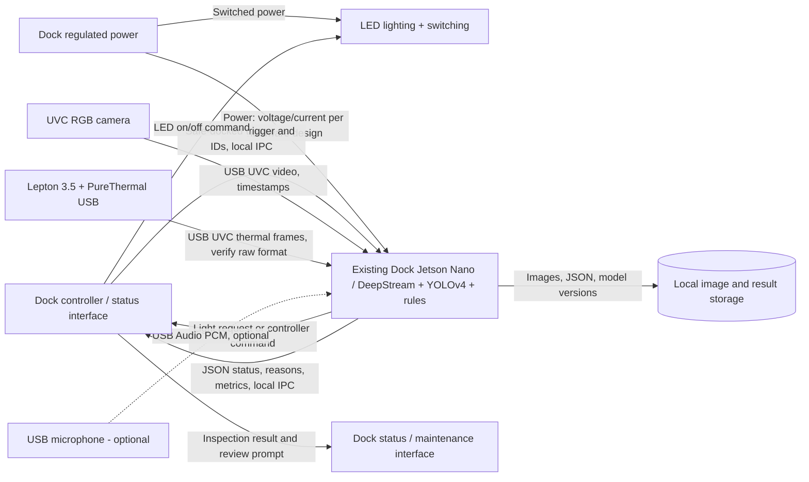
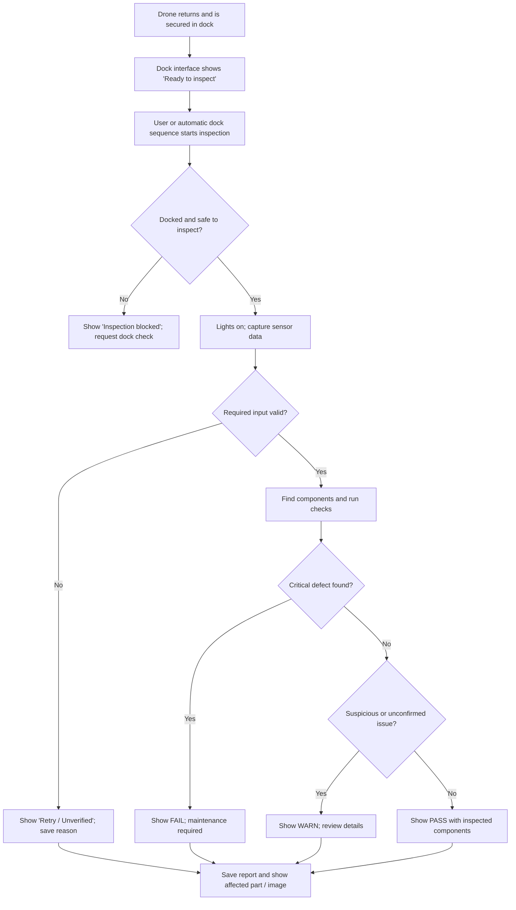

# Conceptual Design — AI/ML Pipeline and Dock Integration

**Valinor Dispatch: AI/ML-Assisted In-Dock Drone Inspection**

**Working draft — AI/ML subsystem contribution | October 17, 2026**

## 1. Introduction and fully formulated problem

The project needs a way to check the condition of a small unmanned aircraft while it is parked inside its dock. The inspection should help identify visible damage, missing components, and unusual thermal conditions between flights. The AI/ML subsystem will take information from the dock's sensors, analyze it locally, and return a result that the dock software can understand. The software is intended to support maintenance decisions, not certify the aircraft as airworthy or replace a human preflight inspection.

The team's current research proposes the following sequence: **camera inputs → frame capture → synchronization → preprocessing → AI model/fusion → postprocessing → output/logging**. It also emphasizes modular software, on-device inference, and separately measured accuracy and performance. Those concepts are kept in this design. [T1]

### 1.1 Proposed project-level requirements for the ML subsystem

These are draft shall statements for the team's consolidated project specification. They should be compared with the approved client requirements before submission.

| ID | Proposed requirement | Origin / reason |
|---|---|---|
| <span style="white-space: nowrap;">SYS-AI-01</span> | The system shall inspect a docked drone using available RGB and thermal data before producing an inspection result. | Client/project scope as described in team research [T1] |
| SYS-AI-02 | The AI subsystem shall operate on the dock's existing Jetson Nano without requiring a continuous internet connection. | Existing dock hardware and local-inference goal [T1][1] |
| SYS-AI-03 | The system shall report the status of each supported component as **PASS**, **WARN**, **FAIL**, or **UNVERIFIED** and provide an overall status. | Proposed safety/maintenance interpretation of project goal |
| SYS-AI-04 | The system shall not return PASS for an inspection that lacks enough valid sensor data to evaluate the required checks. | Public-safety / ethical constraint [12] |
| SYS-AI-05 | The system shall give the dock software the inspection result, timestamp, component identifiers, and reason codes through a documented local interface. | Integration need expressed in team research [T1] |
| SYS-AI-06 | The AI subsystem shall save enough information to review failures and measure performance while following project data-retention rules. | Debugging, accountability, and responsible AI design [12] |
| SYS-AI-07 | The subsystem shall be designed so a trained model can be replaced without redesigning camera acquisition or result reporting. | Modularity goal from team research [T1] |
| SYS-AI-08 | The AI software shall be tested alongside existing dock functions and shall not interfere with dock safety controls. | Shared computing hardware and safe dock operation; proposed design constraint |
| SYS-AI-09 | The AI subsystem shall operate within the installed Jetson Nano's available RAM, with memory consumption recorded during performance testing. | The standard Jetson Nano module has 4 GB of LPDDR4 memory shared by the operating system and applications [1]. |
| SYS-AI-10 | The AI subsystem shall target a total inspection processing time of 10 seconds or less, measured from the accepted inspection request to the completed status report. | Proposed preliminary design target to minimize inspection delays; subject to client approval and hardware testing. |
| SYS-AI-11 | The subsystem shall achieve at least 90% recall for required component detection on the team's held-out validation dataset. | Proposed initial performance target to reduce missed components; not a demonstrated accuracy result. |
| SYS-AI-12 | The subsystem shall complete a minimum 60-minute continuous-operation test without software crashes or unintended interference with dock controls. | Reliability target based on existing team research [T1]. |

**Constraints and origins:** The Jetson Nano already installed in the dock and DeepStream are fixed team choices. YOLOv4 is the chosen object detector; the AlexeyAB/Darknet implementation was selected because its code license allows the team's intended closed-source use, subject to checking all other dependencies and model assets. [3][4] The existing Jetson Nano has limited memory and also supports dock operations, so inference speed, model size, shared CPU/GPU/memory usage, and temperatures are practical design limits. [1] Incorrectly calling a damaged component PASS could create a safety risk; this is the reason for explicit UNVERIFIED/RETRY handling, logging, and human review. [12]

## 2. Comparative analysis of possible solutions

### 2.1 Pipeline and inference

| Option | Advantage | Drawback | Decision |
|---|---|---|---|
| **DeepStream + GStreamer** | GPU-accelerated pipeline and detection metadata on NVIDIA hardware | Version setup and custom YOLO parser take work | **Selected** |
| OpenCV scripts only | Fast to prototype and easy to debug | More work to manage streaming and optimized inference | Supporting tool, not the full runtime |
| GStreamer alone | Flexible low-level camera streaming | The application must assemble more inference logic | Used underneath/alongside DeepStream |

The original Jetson Nano appears in NVIDIA's DeepStream 6.0.1 / JetPack 4.6.1 compatibility list. Later DeepStream documentation and samples may target newer Jetsons. For this reason, the software environment shall be checked before installation and a YOLOv4 integration path compatible with the installed version must be demonstrated. [2][5][6]

**Jetson Nano Hardware Limitations:** The NVIDIA Jetson Nano 4 GB module includes a quad-core ARM Cortex-A57 CPU, a 128-core NVIDIA Maxwell GPU, and 4 GB of 64-bit LPDDR4 memory with a maximum memory bandwidth of 25.6 GB/s. The module supports 5 W and 10 W power modes, depending on configuration [1].

These specifications are important because the AI pipeline must share the available processing resources with the operating system and existing dock software. The team will monitor RAM usage, CPU/GPU utilization, power mode, and temperature while running YOLOv4 inference.

Since the full YOLOv4 model may be too computationally demanding for the Jetson Nano, YOLOv4-tiny will remain a fallback option if testing shows unacceptable processing times or memory consumption.

| Hardware specification | Jetson Nano 4 GB module |
|---|---|
| CPU | Quad-core ARM Cortex-A57 |
| GPU | 128-core NVIDIA Maxwell |
| System memory | 4 GB LPDDR4 |
| Memory bandwidth | 25.6 GB/s |
| Power modes | 5 W / 10 W |
| GPU compute capability | 5.3 |

### 2.2 Detection model

| Option | Advantage | Drawback | Decision |
|---|---|---|---|
| **YOLOv4 (Darknet)** | Meets team's detector and license choice; outputs boxes/classes | Full model may be demanding on Nano | **Selected baseline** |
| YOLOv4-tiny | Reduced compute and memory requirements | May miss smaller details | **Fallback option** |
| MobileNet-SSD | Lightweight embedded alternative | Would replace team's selected detector | Not selected |
| Faster R-CNN | Useful offline comparison | Higher processing cost | Not selected |

YOLOv4 is used to locate components, not to guarantee that every crack or loose fastener can be identified. Smaller visual defects need additional image checks or a later anomaly-detection model. YOLOv4 confidence also describes a model detection, not an aircraft safety probability. [3][7]

### 2.3 Combining RGB, thermal, and audio

| Method | Tradeoff | Decision |
|---|---|---|
| Early RGB–thermal fusion | Requires carefully aligned data and a specially trained multi-channel model | Not used in first prototype |
| Middle/feature-level fusion | Can learn richer combinations, but adds training and memory demands | Stretch goal only |
| **Late/decision-level fusion** | Simple modules are easier to test, and data may have different resolutions | **Selected** |

The initial design uses YOLOv4 on the RGB camera, separate thermal measurements over mapped component regions, and simple decision rules. Audio is a research interface only until the team decides what event can be measured safely and repeatably. No automatic motor-spin test is part of this draft.

## 3. High-level solution

The dock controller starts an inspection only after it confirms that the aircraft is in a safe docked state. The AI process requests frames, checks image quality, identifies the required components, runs visual and thermal checks, and combines the results. It then sends a status message back to the dock and records the inspection for later review. If a sensor is unavailable or a required area cannot be inspected, the result is UNVERIFIED rather than PASS.

### 3.1 Hardware and interface block diagram



**Block boundaries:** Camera optics, Lepton wiring, microphone placement, LEDs, supplies, brackets, and cables belong to the corresponding hardware subsystem owners. The AI/ML owner specifies the data that must cross each boundary. The dock controller retains responsibility for lighting actuation, operational interlocks, and any decision to permit another flight.

### 3.2 End-user operational flowchart



The final dock user interface will be designed by the team. The AI subsystem returns the information needed for this workflow and does not require a separate touchscreen or desktop GUI.

## 4. Atomic subsystem specifications

The table below defines proposed modules and their boundaries. Exact device paths and software interfaces are set during detailed design; the listed types and fields form the intended contract.

| Atomic module | Main function | Inputs | Outputs and interface | Core specification / verification |
|---|---|---|---|---|
| **1. Inspection manager** | Start, coordinate, and time out one inspection | Local dock event `inspection_request`, `drone_id`, dock-safe status, optional time since landing | Internal capture request; final response over agreed local IPC (Unix socket, HTTP localhost, or MQTT on local network) | AI-1a: shall reject an unsafe/invalid start state. AI-1b: shall assign unique inspection_id. AI-1c: shall issue a timeout rather than wait forever. |
| **2. Camera acquisition and quality** | Obtain images and check whether they can be used | RGB USB UVC / V4L2 frames (e.g., MJPEG or YUYV) and timestamp; thermal USB interface data | Timestamped decoded images, quality flags such as `BLUR`, `LOW_LIGHT`, `MISSING_FRAME`; internal software interface | AI-2a: shall verify frame dimensions and timestamp. AI-2b: shall record dropped/invalid data. AI-2c: shall not silently replace a missing required frame with a PASS. |
| **3. Calibration and preprocessing** | Convert data into stable model input | Valid RGB image; saved camera calibration; region definition | Corrected/resized image, scale/ROI metadata, component mapping | AI-3a: shall apply the same saved preprocessing during testing and deployment. AI-3b: shall preserve coordinates linking a detection to the original image. AI-3c: shall store calibration version. |
| **4. YOLOv4 component detector** | Find visible drone parts | Preprocessed RGB frame, model weights, labels | Detected `class_id`, bounding box in original-image pixels, confidence, inference time; DeepStream metadata/custom parser | AI-4a: shall use YOLOv4 as baseline. AI-4b: shall report class labels and confidence. AI-4c: shall benchmark TensorRT runtime on the actual Nano. AI-4d: shall compare YOLOv4-tiny only if the baseline misses an agreed performance target. |
| **5. Visual condition checks** | Check whether visible required components appear present/normal | YOLO boxes, component requirements, high-resolution RGB ROIs | Per-component `present`, `visual_flag`, score or rule reason | AI-5a: shall distinguish not visible/not inspected from visibly absent. AI-5b: shall provide a reason for a missing-component or suspected-damage warning. AI-5c: shall not claim crack detection without demonstrated accuracy. |
| **6. Thermal adapter** | Produce thermal condition measurements | Radiometric Lepton frames, frame time, per-component thermal mapping, ambient reference if available | Per-component summary such as median/max temperature and peer difference; internal data structure | AI-6a: shall identify whether raw frames are temperature-capable before thermal thresholds are used. AI-6b: shall flag stale or unavailable thermal frames. AI-6c: shall document limits from image resolution, emissivity, and time since landing. |
| **7. Audio adapter (optional)** | Capture repeatable acoustic measurements if scope approved | USB Audio Class / ALSA PCM, sample rate, test event identifier | Timestamped PCM window and/or extracted spectral features; internal interface | AI-7a: shall not start motors or actuators. AI-7b: shall remain disabled until a safe, repeatable acoustic event and dataset are defined. |
| **8. Decision and report manager** | Combine findings and send understandable results | Visual flags, thermal flags, availability/quality flags, threshold configuration | `PASS`, `WARN`, `FAIL`, `UNVERIFIED` per component, overall result and reason codes; JSON to dock | AI-8a: shall prioritize confirmed critical failures over reassuring readings from other sensors. AI-8b: shall never mark required uninspected components PASS. AI-8c: shall provide a machine-readable reason. |
| **9. Evidence and model management** | Preserve traceable results and software versions | Images, sensor summaries, scores, inspection decisions | Local files/SQLite or JSONL, model/config checksums, metrics | AI-9a: shall log model versions, capture/processing times, invalid-frame counts. AI-9b: shall allow model replacement without changing the dock API. AI-9c: shall apply an agreed storage limit and retention policy. |

### 4.1 Sensor and external interfaces

| Source → receiver | Direction and physical/protocol type | Proposed payload | Constraints and owner |
|---|---|---|---|
| RGB camera → Jetson | **Input**, USB video (UVC/V4L2); GStreamer `v4l2src` or equivalent | Color frames; initial camera candidate supports MJPEG/YUYV and 2592 × 1944 images | Camera team verifies USB bandwidth, lighting, mount, field of view, autofocus stability; AI team checks decode and quality. [8] |
| PureThermal/Lepton → Jetson | **Input**, USB UVC via thermal interface board; underlying Lepton interface handled by board | Timestamped thermal frame. Radiometric/raw encoding must be confirmed before temperature interpretation | Thermal team verifies radiometry, format, calibration, and mounting; AI team consumes the documented values. [9] |
| USB mic → Jetson | **Optional input**, USB Audio Class using Linux ALSA | Signed PCM samples; proposed 16-bit/44.1 or 48 kHz subject to device support | Mic team validates signal/noise and meaningful event; AI does not assume motor sound is available in a powered-down dock. [10] |
| Jetson ↔ dock controller | **Bidirectional**, local software interface; exact method TBD | Request: safe-docked flag, `drone_id`, `inspection_id` if assigned by dock; response: status JSON, reason codes, optional paths to evidence | Dock integration owner specifies transport, authentication if networked, retry behavior, and lighting interlock. |
| Jetson → local storage | **Output**, filesystem/SQLite | `inspection_id`, image paths, scores, sensor state, model and calibration versions | AI owner sets retention, write-error handling, space limits and access control. |
| Dock controller → lights | **Output**, switched power via approved driver | On/off state and timing | Lighting/power owner, not direct uncontrolled GPIO from inference script. |

**Provisional integration format (theoretical example)**

```json
{
  "schema_version": "0.1-draft",
  "inspection_id": "inspection-00042",
  "drone_id": "dock-aircraft-01",
  "timestamp_utc": "2026-10-16T22:00:00Z",
  "overall_status": "WARN",
  "components": [
    {
      "component_id": "front_left_propeller",
      "status": "PASS",
      "reasons": [],
      "rgb_detection_confidence": 0.94
    },
    {
      "component_id": "rear_right_motor",
      "status": "WARN",
      "reasons": ["THERMAL_PEER_DIFFERENCE"],
      "thermal_peer_delta_c": 9.2
    }
  ],
  "quality": {"rgb": "VALID", "thermal": "VALID", "audio": "NOT_USED"},
  "performance": {"total_inspection_ms": 3600},
  "versions": {"model": "yolov4-demo-v1", "calibration": "rgb-cal-01"}
}
```

**All numbers in the example are placeholders to show data shape and are not measured results or safety thresholds.**

### 4.2 Detailed operation and decision rules

1. The inspection manager receives a safe-to-inspect request and an identifier for the drone. It verifies that the required sensor interfaces respond.

2. The dock controller turns on stable inspection lighting. RGB frames and thermal frames are gathered with timestamps. The microphone is used only if an approved acoustic test has been specified.

3. The software checks image quality and whether the expected aircraft is visible. Failed quality checks request recapture; a second failure or timeout produces UNVERIFIED.

4. OpenCV loads calibration data and corrects/prepares the RGB frame. YOLOv4 identifies visible components and maps its detections back to original-frame coordinates.

5. The component checker verifies required part presence and computes any extra RGB measurements supported by the dataset. Thermal readings are associated with the same named components using fixed geometry or calibration.

6. The rule module combines outcomes. A confirmed critical defect results in `FAIL`. A suspicious value or unconfirmed defect results in `WARN`. A required region that was not successfully checked results in UNVERIFIED. Only a fully valid inspection with no flags returns `PASS`.

7. A JSON report, selected evidence images, and execution metrics are saved. The dock UI receives the status and part names for maintenance review.

**Proposed severity rule:** `FAIL` takes priority over `WARN`, which takes priority over `PASS`. UNVERIFIED must not be treated as a pass or an automatic flight clearance; if both a confirmed FAIL and missing data exist, the reported overall result should retain the FAIL and include a separate data-quality problem. All thresholds and critical part definitions must come from client/team review and test results, not arbitrary temperature or confidence numbers.

## 5. Dataset, training, and validation plan

The dataset should be collected mainly with the cameras installed at their final positions. Each session should include normal-looking drone components and, when safe to create, known non-destructive defect samples or approved test props. Images should include the expected lighting and docking-position variation. Separate sessions should be held out for testing rather than splitting nearly identical frames from the same recording across training and test sets.

**Proposed first classes:** `propeller`, `motor`, `arm`, `body`, `battery_area`, and `landing_gear`. Fastener detection should be added only if a camera-angle and pixel-resolution study shows individual fasteners can be seen reliably. The team should also define named locations such as `front_left_propeller` so two detections of the same class can be checked separately.

**Labeling method:** CVAT will be used to draw YOLO-compatible bounding boxes. [11] Transfer learning from suitable YOLOv4 weights will be attempted on a development PC or other stronger computer; the trained model will then be transferred to the Jetson. Public MVTec AD and LOCO AD datasets can teach anomaly-detection techniques but do not replace actual images of the team's drone. Their published datasets are marked for noncommercial use, so external use needs a separate license review. [13][14]

**Checks during testing:**

- **Detection:** precision, recall, mAP, and per-class false negatives on held-out dock sessions.

- **Safety-related decisions:** number and type of deliberately seeded defects incorrectly classified PASS; number of harmless components flagged FAIL or WARN.

- **Runtime:** total inspection latency, RGB model inference latency, FPS where relevant, dropped frames, Jetson memory use and temperature.

- **Reliability:** run the pipeline continuously for at least one hour without crashing; detect an unplugged camera, invalid frames, and insufficient storage without treating the inspection as PASS. This one-hour goal comes from the team's existing pipeline research. [T1]

- **Modularity:** swap between an original YOLOv4 model and a separate test model without rewriting acquisition or JSON output.

- **Thermal:** compare motors/areas under similar conditions only after thermal radiometric capability, ambient conditions, emissivity, and time since shutdown have been studied.

The team research also suggested processing 90% of the slower sensor's incoming frames. For a dock that only needs a brief inspection after landing, this should be treated as a research benchmark, not a final requirement, until the client decides whether continuous video or a small number of snapshots is required. [T1]

### 5.1 Development sequence and unknowns

| Order | Prototype milestone | Main question answered |
|---|---|---|
| 1 | Inventory the current Nano software and verify a DeepStream sample | Can the installed dock software coexist with the compatible AI stack? |
| 2 | Get RGB frame capture and a pretrained YOLOv4 detector working | Is a working detector possible on the available Nano? |
| 3 | Benchmark full YOLOv4; test YOLOv4-tiny only if necessary | Is inference performance acceptable alongside existing dock tasks? |
| 4 | Collect dock images; label named components; fine-tune detector | Does the model recognize this drone in this dock? |
| 5 | Add data-quality checks, thermal adapter, and component rules | Can it return meaningful component-level status? |
| 6 | Connect to dock API; run one-hour, defect, and failure tests | Can the entire workflow be trusted enough for a supervised demonstration? |

### 5.2 Initial Quantitative Performance Targets

The team proposes a maximum total inspection time of 10 seconds, at least 90% component-detection recall on held-out test images, and a continuous operation period of at least 60 minutes without a software crash.

The software will also record peak RAM usage, average inference time in milliseconds, CPU/GPU utilization, and the number of dropped or invalid frames.

These values are preliminary engineering targets rather than results already achieved. Final acceptable limits will be determined after testing YOLOv4 on the Jetson Nano while the existing dock software is running.

| Performance metric | Proposed target | Verification method |
|---|---|---|
| Total inspection time | ≤ 10 seconds | Measure time from inspection request to final status |
| Component detection recall | ≥ 90% | Evaluate on held-out labeled test images |
| Continuous operation | ≥ 60 minutes | Run pipeline without software crashes |
| RAM usage | Within available Jetson memory | Monitor peak memory usage during inference |
| CPU/GPU utilization | Record during testing | Monitor Jetson hardware statistics |
| Invalid or dropped frames | Record all occurrences | Review pipeline logs |

## 6. Resources

### 6.1 Planning for the AI/ML portion

The AI/ML subsystem will run on the NVIDIA Jetson Nano already integrated into the dock. No additional Jetson Nano board is planned. The AI model and supporting software will share the existing board with dock-related processes, so the team must confirm available resources and ensure inspection processing does not interfere with dock control functions.

DeepStream, Darknet YOLOv4, OpenCV, and CVAT will be used for the software portion of the project. These tools do not require an additional software purchase for the planned prototype, but their licensing requirements will still need to be followed.

The team will also use an available development computer for training the AI model before deploying it to the Jetson Nano. Additional storage may be purchased if needed.

| AI-associated resource | Estimated extra cost | Explanation |
|---|---:|---|
| Existing NVIDIA Jetson Nano | $175-$250 additional | Already integrated into the dock; confirm its model, JetPack version, and available processing capacity |
| DeepStream 6.0.1, Darknet YOLOv4, OpenCV, CVAT | $0 | Free software tools; licensing requirements must still be followed |
| Existing development PC / available lab GPU | $0 | Used to train the AI model before deploying it to the Jetson Nano |
| Optional removable storage / backup | $25 | Additional storage for datasets, models, and testing results if needed |
| **Provisional AI-specific additional subtotal** | $200–$275 | No new Jetson board; excludes shared sensors and other hardware |

Any optional storage purchase will be included in the overall team budget and counted only once. The existing Jetson Nano adds no new board cost. Prices are preliminary allowances and must be confirmed before purchasing.

## 7. Ethical, Professional, and Standards Considerations

The AI/ML subsystem is intended to help identify possible damage or abnormal conditions on a drone before its next flight. Because an incorrect inspection result could allow a damaged drone to return to operation, the system must prioritize safety, reliability, and clear reporting of uncertain results. The design will follow relevant IEEE and IEC engineering guidance where applicable.

### 7.1 Ethical Considerations and IEEE 7000-2021

- The chosen design shall report inspection results as PASS, WARN, FAIL, or UNVERIFIED and shall not classify an inspection as PASS when required sensor data is missing or invalid.
  - This requirement is important because AI models can make incorrect predictions, especially when image quality is poor or a defect was not represented in the training dataset. A false PASS could cause an unsafe drone to return to service.
  - IEEE Std 7000-2021, *IEEE Standard Model Process for Addressing Ethical Concerns during System Design*, provides a process for considering ethical values and risks throughout system development [17]. This is relevant to our project because we must consider public safety, accountability, and the possible consequences of incorrect AI decisions.
  - To support this approach, the AI subsystem will record inspection results, model versions, and reason codes so that questionable decisions can be reviewed. The software will support human maintenance decisions rather than independently certifying the drone as safe to fly.

### 7.2 Software Security and IEC 62443-4-1:2018

- The chosen design shall use a documented local communication interface between the Jetson Nano and dock controller, with appropriate handling of invalid messages, communication failures, and unauthorized access.
  - Since the Jetson Nano processes inspection data and sends results to the dock controller, communication failures or software vulnerabilities could affect the reliability of the overall system.
  - IEC 62443-4-1:2018, *Security for Industrial Automation and Control Systems — Part 4-1: Secure Product Development Lifecycle Requirements*, describes secure development practices, including security requirements, secure implementation, verification, and vulnerability management [18].
  - Although this standard is intended for industrial automation and control products, its secure-development principles are useful for our dock software. The team will consider input validation, access restrictions, software updates, and error logging during implementation.

### 7.3 Professional Responsibility

The team is responsible for testing the AI subsystem before using its results to support maintenance decisions. The system's accuracy, processing time, and reliability must be measured on the actual Jetson Nano rather than assumed from published AI model benchmarks.

Any known limitations, including missed defects, thermal measurement uncertainty, and hardware performance restrictions, will be documented.

The team does not currently claim formal compliance or certification under IEEE 7000-2021 or IEC 62443-4-1:2018. These standards are being used as engineering references to guide responsible design and testing.

## 8. Open decisions that require a team or client answer

1. Which exact Jetson Nano variant and JetPack version are installed in the dock, and how much CPU, GPU, and memory capacity can be allocated to AI processing without disrupting existing dock functions?

2. Which drone model and parts are required to be inspected? What is the smallest relevant physical defect?

3. How will the dock tell the AI software that propellers are stopped and the aircraft is safe to inspect?

4. Which thermal sensor and interface are already owned, if any? Can the team access calibrated temperatures?

5. Is acoustic analysis a real requirement, and what safe test produces useful sound?

6. Which output statuses actually block a flight, and which require a human to review?

7. What message transport, storage location, and retention period does the dock software expect?

## 9. References

**Team materials provided for this draft**

- **[T1]** **AI Pipelining Integration Research** (team-uploaded PDF), especially pipeline architecture, options, draft requirements, and measures of success.

**External sources**

[1] NVIDIA, [Jetson Nano specifications](https://developer.nvidia.com/embedded/jetson-nano/).
[2] NVIDIA, [DeepStream 6.0.1 and Jetson/JetPack compatibility](https://docs.nvidia.com/metropolis/deepstream-nvaie31/dev-guide/text/DS_Quickstart.html).
[3] A. Bochkovskiy, C.-Y. Wang, and H.-Y. M. Liao, [YOLOv4: Optimal Speed and Accuracy of Object Detection](https://arxiv.org/abs/2004.10934), 2020.
[4] AlexeyAB, [Darknet YOLOv4 source and license](https://github.com/AlexeyAB/darknet/blob/master/LICENSE).
[5] NVIDIA, [JetPack 4.6.1](https://developer.nvidia.com/embedded/jetpack-sdk-461).
[6] marcoslucianops, [DeepStream-Yolo](https://github.com/marcoslucianops/DeepStream-Yolo), examples of Darknet model integration (third-party; verify an appropriate version for DeepStream 6.0.1).
[7] C.-Y. Wang et al., [Scaled-YOLOv4](https://arxiv.org/abs/2011.08036), 2020 (lightweight YOLOv4-tiny comparison).
[8] Arducam, [B0441 5 MP USB camera specifications](https://www.arducam.com/5mp-autofocus-usb-camera-module-with-single-microphone-for-windows-linux-macos-android.html).
[9] GroupGets, [PureThermal 2 Shielded interface](https://groupgets.com/products/purethermal-2-shielded) and [FLIR Lepton core listing](https://groupgets.com/collections/thermal-imaging).
[10] Samson, [Go Mic specifications](https://www.samsontech.com/products/microphones/usb-microphones/gomic/).
[11] CVAT, [YOLO detection label format](https://docs.cvat.ai/docs/dataset_management/formats/format-yolo/).
[12] NIST, [AI Risk Management Framework Playbook](https://www.nist.gov/itl/ai-risk-management-framework/nist-ai-rmf-playbook).
[13] MVTec, [MVTec AD dataset](https://www.mvtec.com/research-teaching/datasets/mvtec-ad).
[14] MVTec, [MVTec LOCO AD dataset](https://www.mvtec.com/research-teaching/datasets/mvtec-loco-ad).
[15] OpenCV, [Camera calibration documentation](https://docs.opencv.org/4.x/d9/d0c/group__calib3d.html).
[16] Teledyne FLIR, [Lepton LWIR Micro Thermal Camera Module](https://oem.flir.com/products/lepton/), Lepton 3.5 technical specifications.
[17] IEEE Standards Association, [IEEE Std 7000-2021: IEEE Standard Model Process for Addressing Ethical Concerns during System Design](https://standards.ieee.org/ieee/IEEE-7000/6781/), 2021.
[18] International Electrotechnical Commission, [IEC 62443-4-1:2018: Security for Industrial Automation and Control Systems — Part 4-1: Secure Product Development Lifecycle Requirements](https://webstore.iec.ch/en/publication/33615), 2018.
[19] OpenAI, *ChatGPT (GPT-6)*, AI-assisted research and writing support for the conceptual design document, October 21, 2026. https://chatgpt.com/.

## 10. Statement of contributions

This draft does **not** certify an individual's work or claim that testing has been completed.

> **Member:** [Lucas Taylor]

> **Date reviewed:** [10/18/2026]
